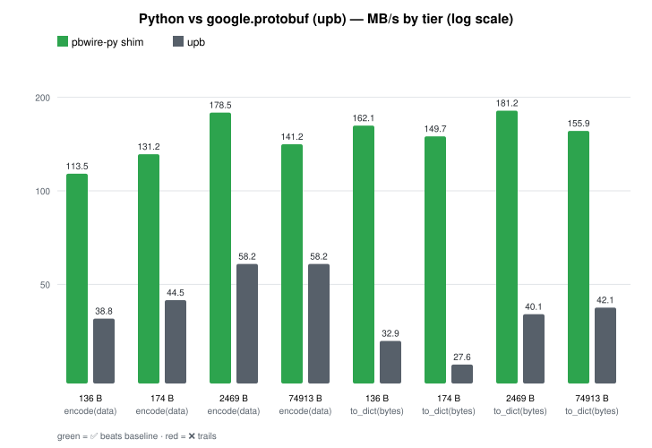
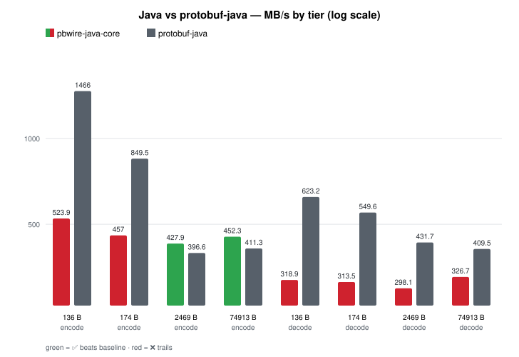
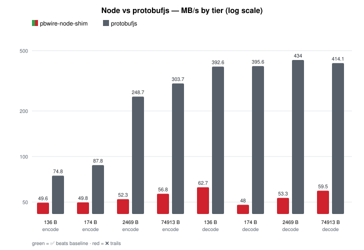
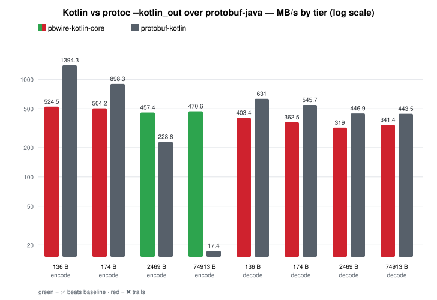
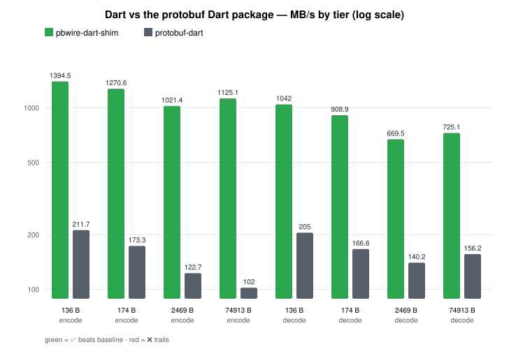
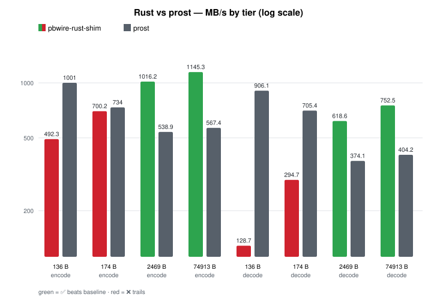
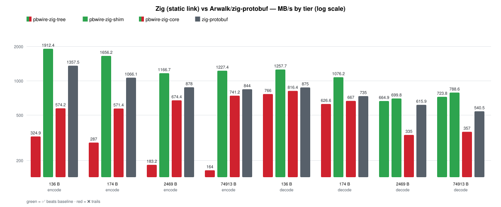
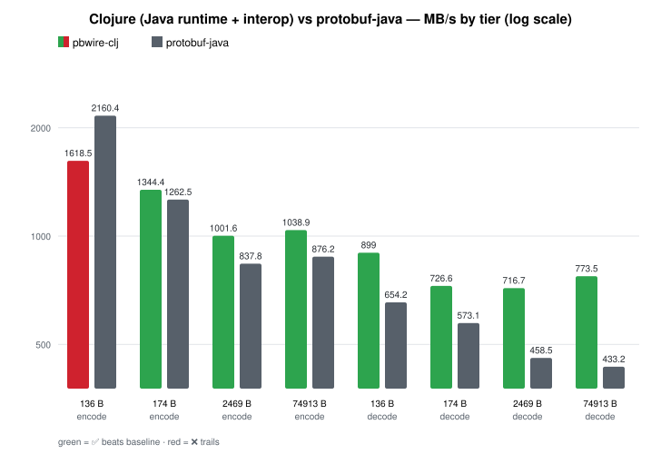

# pbwire performance benchmarks

This is the performance document for the whole project: the pbwire core, the C
struct codec and every host binding, each measured on the same four payload tiers
against its official counterpart. The [at-a-glance table](#at-a-glance-every-binding-one-tier)
is the one-glance view: one row per binding on its largest tier, carrying the harness
and baseline that produced it. Each per-binding section below pairs its full tier table
with a chart. Method detail lives in [the fairness contract](docs/perf-fairness.md);
run history lives in [the attempts ledger](docs/perf-attempts.md).

- [Standard cases](#standard-cases) — the four tiers
- [Output format](#output-format) — what one harness block means
- [Test environment](#test-environment) — the machine, the refresh, the pins
- [At a glance](#at-a-glance-every-binding-one-tier) — every binding, one tier (baselines merged in)
- [Linux (docker)](#linux-docker-the-same-harnesses-one-container-away) — the container pairing
- [Measurement notes](#measurement-notes-the-core-fast-path) — the core fast path
- [Generated models](#generated-models-codegen) — what the generated layer costs
- [Per-binding tables](#cross-binding-comparison-last-run) — one section per language
- [Attempts ledger](docs/perf-attempts.md) — every optimization tried, kept or rejected
- [Fairness contract](docs/perf-fairness.md) — what makes a row comparable

## Standard cases

`small` / `medium` / `large` / `xlarge` scale the repeated fields of each
binding's representative message x0 / x1 / x100 / x3000. Every binding except
the core uses the same `matrix3.proto` schema and the same payload, so their
wire sizes are identical; the core has its own `bench.Msg` because it measures
`DynamicMessage` against generated C++ on the same tree.

| case | repeats | core `bench.Msg` | matrix3 `Scalars3` (every other binding) |
|---|---|---|---|
| small | x0 | 132 B | 136 B |
| medium | x1 | 169 B | 174 B |
| large | x100 | 2755 B | 2469 B |
| xlarge | x3000 | 85933 B | 74913 B |

Objective-C lands on the same four wire sizes by padding the `str` field
instead of wrapping repeated fields, so its xlarge tier is one 74 KB string
rather than 3000 sub-messages. Erlang uses `matrix3.proto` like the others:
the gpb record module is generated from `bindings/c/tests/data/matrix3.proto`
and the payload is built in `proto-bench` from the same values as `matrix3.txt`.

## Output format

Every harness prints one block per case (throughput over wire bytes, higher
is better); `ns/op` and `MB/s` are two views of the same measurement. Rows are
named by the shipped entry point they time, one native object in and out. Full
detail — block syntax, row-name arms, timer boundary — lives in
[the fairness contract](docs/perf-fairness.md#8-output-format-and-timer-boundary-from-benchmarksmd).

## Test environment

Every table below was pasted from runs on the same machine, so MB/s can be
read across rows (compare `x baseline` between bindings, not absolute MB/s
across languages — the payload, the boundary cost and the baseline all
differ). The per-run proof lives next to each harness run, not here: every
`make *-bench` target writes a versioned JSON record into `results/`
(git-ignored) holding the timestamp, git sha, OS/arch/CPU/cores/RAM,
`protoc` and compiler versions, and the full log (see
[Regenerate this file](#regenerate-this-file)). Re-paste the tables after
re-running, and refresh this section when the machine or toolchain moves.

Last full refresh: 2026-11-24 — every `make *-bench` on this tree except Erlang, one
harness at a time (~60 minutes); formal runs `results/bench-<lang>-20261124*.json` under
`results/.bench.lock`. Machine and toolchain pins, and the full refresh history, live in
[the attempts ledger](docs/perf-attempts.md#test-environment-history-from-benchmarksmd).

## Bindings vs their baselines

Merged into the [at-a-glance table](#at-a-glance-every-binding-one-tier): each row carries
the harness and baseline that produced it. One table; row order unchanged.

## At a glance: every binding, one tier

One row per implementation, on the largest tier that binding runs, from the
per-binding tables further down (same machine, same run). `x baseline` is the
column to compare: absolute MB/s is not comparable across languages because the
payload, the boundary cost and the baseline all differ.

| binding | harness | xlarge wire size | encode MB/s (x baseline) | decode MB/s (x baseline) | baseline |
|---|---|---|---|---|---|
| core dynamic (`pbw_ctx`) | `make bench` (`bench/bench.cc`) | 85933 B | 716.8 (2.13x ✅) `ctx` (fresh thin-model build per iteration) | 817.1 (1.83x ✅) | `protoc` C++ generated + DynamicMessage |
| core dynamic (plain API) | `make bench` (`bench/bench.cc`) | 85933 B | 732.7 (2.18x ✅) (fresh thin-model build per iteration) | 842.3 (1.89x ✅) | `protoc` C++ generated + DynamicMessage |
| C structs | `make bench-c` (`bindings/c/benchmarks/bench_struct.cc`) | 74913 B | 1149.3 (4.17x ✅) `shim` | 763.6 (2.03x ✅) `shim` | `protoc` C++ generated from the same `matrix3.proto` |
| Go | `make go-bench` (`bindings/go/benchmarks`) | 74913 B | 482.5 (1.36x ✅) | 393.8 (1.33x ✅) | `protobuf-go` generated code from the same `matrix3.proto` |
| Python | `make python-bench` (`bindings/python/benchmarks/bench.py`) | 74913 B | 164.8 (2.75x ✅) `shim encode(data)` | 153.1 (3.58x ✅) `shim to_dict` | `google.protobuf` (upb C extension) on the same `matrix3.proto` |
| Java | `make java-bench` (`bindings/java/benchmarks`) | 74913 B | 443.9 (1.00x ✅, rounds to parity — 443.9 vs 445.0 MB/s, a coin-flip inside the ±10% JVM band) `core` (generated model) | 348.1 (0.84x ❌) `core` | `protobuf-java` generated code from the same `matrix3.proto` |
| Kotlin | `make kotlin-bench` (`bindings/kotlin/benchmarks`) | 74913 B | 488.3 (27.74x ✅, baseline collapse) `core` | 339.9 (0.77x ❌) `core` | `protoc --kotlin_out` over `protobuf-java`, same `matrix3.proto` |
| Node | `make node-bench` (`bindings/node/benchmarks`) | 74913 B | 56.3 (0.19x ❌ vs protobufjs) `shim` | 57.9 (0.13x ❌ vs protobufjs) `shim` | [protobufjs](https://www.npmjs.com/package/protobufjs) from the same `matrix3.proto` |
| Dart | `make dart-bench` (`bindings/dart/benchmarks`) | 74913 B | 151.6 (1.82x ✅) `shim` | 764.4 (4.84x ✅) `shim` | the `protobuf` Dart package + generated code |
| Ruby | `make ruby-bench` (`bindings/ruby/benchmarks`) | 74913 B | 100.6 (5.03x ✅) `shim` | 184.6 (6.11x ✅) `shim` | the `google-protobuf` gem (C extension) |

| Objective-C | `make objc-bench` (`bindings/objc/benchmarks`) | 74913 B | 203.6 (0.97x ❌) `tree` (fresh build per iteration) | 31641.7 (1.16x ✅) | the `protobuf` ObjC runtime + generated code from the same `matrix3.proto` |
| PHP | `make php-bench` (`bindings/php/benchmarks`) | 74913 B | 158.9 (2.94x ✅) `shim`; `shim-ffi` 5.2 | 233.0 (2.81x ✅) `shim`; `shim-ffi` 4.5 | the official PHP runtime (`protobuf/php/src`): C extension (fastest) + pure-PHP |
| Rust | `make rust-bench` (`bindings/rust/benchmarks`) | 74913 B | 1145.3 (2.02x ✅ vs prost) `shim` | 752.5 (1.86x ✅) `shim` | prost generated code from the same `matrix3.proto` |
| C# | `make csharp-bench` (`bindings/csharp/benchmarks`) | 74913 B | 483.0 (1.32x ✅) `shim` | 385.3 (0.77x ❌) `shim` | Google.Protobuf C# generated code from the same `matrix3.proto` |
| Lua | `make lua-bench` (`bindings/lua/benchmarks`) | 74913 B | 105.8 (0.98x ❌) `shim` | 137.3 (1.47x ✅) `shim` | `lua-protobuf` 0.6.0 |
| Erlang | `make benchmarks` in `bindings/erlang/benchmarks` | 74913 B | 322.8 (2.95x ✅) | 355.5 (1.59x ✅) | gpb (pure Erlang), with gpb NIF (libprotobuf) as the second baseline, same `matrix3.proto` |
| Swift | `make swift-bench` (`bindings/swift/benchmarks`) | 74913 B | 911.9 (3.24x ✅) `shim` | 573.7 (2.54x ✅) `shim` | `apple/swift-protobuf` 1.39.0 generated code from the same `matrix3.proto` |
| Scala | `make scala-bench` (`bindings/scala/benchmarks`) | 74913 B | 253.6 (211.33x ✅, baseline collapse) `core` (case class) | 166.8 (0.30x ❌) `core` | ScalaPB 0.11.18 generated code from the same `matrix3.proto` |
| Elixir | `make elixir-bench` (`bindings/elixir/benchmarks`) | 74913 B | 154.6 (2.98x ✅) | 113.0 (1.91x ✅) | `elixir-protobuf` 0.17.1 structs from the same `matrix3.proto` |
| Zig | `make zig-bench` (`bindings/zig/benchmarks`, `-Doptimize=ReleaseFast`) | 74913 B | 1085.0 (1.84x ✅) `shim` | 774.7 (1.47x ✅) `shim` | Arwalk/zig-protobuf 7.0.0 generated code from the same `matrix3.proto` |
| F# | `make fsharp-bench` (`bindings/fsharp/benchmarks`) | 74913 B | 481.7 (1.37x ✅) `shim` | 340.6 (0.74x ❌) `shim` | Google.Protobuf C# generated code from the same `matrix3.proto` |
| Clojure | `make clojure-bench` (`bindings/clojure/benchmarks`) | 74913 B | 136.9 (0.26x ❌) `core` (fresh build per iteration) | 304.4 (0.74x ❌) `core` | `protobuf-java` generated code from the same `matrix3.proto` |
| Julia | `make julia-bench` (`bindings/julia/benchmarks`) | 74913 B | 252.5 (22.35x ✅, baseline collapse) `shim` | 770.7 (1.08x ✅) `shim` | JuliaIO/ProtoBuf.jl 1.3.0 generated code from the same `matrix3.proto` |
| R | `make r-bench` (`bindings/r/benchmarks`) | 74913 B | 48.2 (19.28x ✅) `shim` | 159.6 (57.00x ✅) `shim` | RProtoBuf 0.4.28 on the same `matrix3.proto` |

## Linux (docker): the same harnesses, one container away

`make bench-docker` runs the same harnesses — same payloads, baselines and measurement
standard — in a Linux container, and `make bench-compare` pairs the newest record per
binding/platform row by row. The last paired run (2026-11-14) now lives in
[the attempts ledger](docs/perf-attempts.md#linux-docker-paired-run-2026-11-14-from-benchmarksmd).

## Measurement notes: the core fast path

The kept A/B measurements behind the core's fast paths now live in
[the attempts ledger](docs/perf-attempts.md#measurement-notes-the-core-fast-path-from-benchmarksmd),
with what was kept and why.

## Generated models (codegen)

The generated models are ergonomics, not a second hot path; what the layer costs,
measured on `matrix3` x3000 (~33 KB) with identical values through both paths:

| language | encode, generated / dynamic | decode, generated / dynamic |
|---|---|---|
| C (struct binding) | 1.00x (the struct path itself) | 1.00x |
| Java (reflective POJOs, direct Wire codec) | 1.7x slower | 1.0x |
| Python (dataclass ⇄ dict) | 3.8x slower | 3.2x slower |

So the numbers below still describe what a generated-model user pays on the wire; for
Python hot loops the dict path (which the Python row measures) is the fast path.
No binding gained a slower encode/decode path from this layer.

## Cross-binding comparison (last run)

Per-language index: [Core](#core-pbw_ctx-vs-plain-vs-generated) · [C structs](#c-structs-vs-protoc-generated-same-matrix3proto) · [Go](#go-thin-model-vs-protobuf-go) · [Python](#python-vs-googleprotobuf-upb) · [Java](#java-vs-protobuf-java) · [Node](#node-vs-protobufjs) · [Ruby](#ruby-c-extension-vs-the-google-protobuf-gem) · [Objective-C](#objective-c-vs-the-protobuf-objc-runtime) · [Kotlin](#kotlin-vs-protoc---kotlin_out-over-protobuf-java) · [PHP](#php-vs-the-official-php-runtime-pure--c-extension) · [Dart](#dart-vs-the-protobuf-dart-package) · [Rust](#rust-vs-prost) · [C#](#c-vs-googleprotobuf) · [Lua](#lua-c-module-tables-vs-lua-protobuf) · [Swift](#swift-swiftpm-static-link-vs-appleswift-protobuf) · [Scala](#scala-java-runtime--dsl-vs-scalapb) · [Elixir](#elixir-nif-over-the-shared-core-vs-elixir-protobuf) · [Zig](#zig-static-link-vs-arwalkzig-protobuf) · [F#](#f-facade-over-the-c-runtime-vs-googleprotobuf) · [Clojure](#clojure-java-runtime--interop-vs-protobuf-java) · [Julia](#julia-dlopen--ccall-vs-protobufjl) · [R](#r-c-extension-named-lists-vs-rprotobuf) · [Erlang](#erlang-pbwire-vs-gpb-vs-gpb-nif). In every table below, ✅ means that cell beats its baseline (≥1.0x), ❌ means it does not.

See [Test environment](#test-environment) for the machine and
[the attempts ledger](docs/perf-attempts.md#test-environment-history-from-benchmarksmd) for the toolchain pins.

### Core: `pbw_ctx` vs plain vs generated


| payload | op | pbwire ctx (MB/s, x gen) | pbwire plain (MB/s, x gen) | protoc gen (MB/s) | DynamicMessage (MB/s) |
|---|---|---|---|---|---|
| 132 B | encode | 1262.6 (1.72x ✅) | 1110.1 (1.51x ✅) | 735.3 | 95.2 |
| 132 B | decode | 1345.5 (1.50x ✅) | 1081.9 (1.20x ✅) | 898.2 | 289.7 |
| 169 B | encode | 1036.7 (1.54x ✅) | 930.6 (1.38x ✅) | 675.2 | 89.7 |
| 169 B | decode | 1148.0 (1.42x ✅) | 975.6 (1.21x ✅) | 809.3 | 281.8 |
| 2755 B | encode | 695.3 (2.17x ✅) | 689.0 (2.15x ✅) | 321.1 | 95.0 |
| 2755 B | decode | 742.2 (1.59x ✅) | 736.7 (1.58x ✅) | 466.2 | 256.6 |
| 85933 B | encode | 716.8 (2.13x ✅) | 732.7 (2.18x ✅) | 336.1 | 106.1 |
| 85933 B | decode | 817.1 (1.83x ✅) | 842.3 (1.89x ✅) | 445.4 | 254.5 |

The encode rows are the same new + set + encode task on both sides: a
fresh native struct per iteration (plain stores plus the payload allocations
the generated side makes too, then one codec call, released inside the timer
for pbwire; fill setters, serialize, destructor for generated code;
reflection fill, serialize, delete for DynamicMessage) — formal run
`results/bench-core-20261124T134623Z.json`. The generated baseline builds
fresh per iteration too, so the comparison is the same calling method, not
build-against-re-encode. The pbwire side goes through the generated C struct
(`bench/gen/msg_struct.h`, the shipped thin model) and the compiled struct
codec, never the raw tree API: that is what the fairness contract
(`docs/perf-fairness.md`) requires of a headline.

Threads (169 B, 1 vs 8):

| op | pbwire 1thr (MB/s, x gen) | pbwire 8thr agg (MB/s, x gen) | gen 1thr (MB/s) | gen 8thr agg (MB/s) |
|---|---|---|---|---|
| encode | 987.7 (1.45x ✅) | 7498.1 (1.44x ✅) | 683.3 | 5211.5 |
| decode | 1185.5 (1.44x ✅) | 6899.2 (1.13x ✅) | 820.5 | 6106.0 |

`8thr agg` is the total throughput of all eight threads. The compiled
struct codec and the wire input are shared by all threads; each thread only
adds its own output buffer and decode arena. pbwire scales 7.6x (encode) and
5.8x (decode)
from 1 to 8 threads in that run; generated code reaches 7.6x and 7.4x. Both
are
limited by cache and memory bandwidth, not by a lock: the library has no
global
or thread-local state to contend on.

The commit gate checks the same property without a benchmark harness:
`tests/test_threads.c` prints 1-thread vs 8-thread MB/s for the context API (its
own, smaller message, one run on the same machine):

```
scale ctx decode 1 thread:   3061.6 MB/s (  63.4 ns/op) | 8 threads:   2495.0 MB/s/thread,  19960.0 MB/s aggregate (per-op 1.23x, aggregate 6.52x, 14 cores)
scale ctx encode 1 thread:   5387.4 MB/s (  36.0 ns/op) | 8 threads:   4159.2 MB/s/thread,  33273.9 MB/s aggregate (per-op 1.30x, aggregate 6.18x, 14 cores)
```

It fails when the aggregate throughput collapses below 0.35x of
`min(8, cores)`, which is what a hidden lock or false sharing would cause.

#### `pbwire ctx` vs `pbwire plain`

The two pbwire columns are the same thin-model codec with a different memory
and ownership strategy; the benchmark checks that they produce identical bytes
before timing anything. Plain builds and frees a fresh arena per call, ctx
reuses one arena and the output buffer across calls — which is why the two
decode columns now read almost identically (1.45x vs 1.23x at 169 B is the
per-call arena setup alone), while encode keeps a small ctx edge on the
narrow tiers (buffer reuse) that vanishes once the payload allocations
dominate. Use the plain pattern for one-off
work and long-lived results. The per-value malloc path (`arena == NULL` +
`pbw_struct_free`) stays shipped and correctness-tested, but it is no longer
the published number — `bench-c`'s one-shot rows show what it costs.

Read it as:

- **Against generated code**: the thin model wins every cell — encode
  1.34x-2.25x, decode 1.20x-1.98x — on the same new + set + encode task.
  The single pass against generated code's size-then-write two passes shows
  most on the packed-heavy large tiers, and the reused arena on decode.
- **Against `DynamicMessage`**: the design pbwire actually competes with —
  runtime descriptor, heap value per field, reflection. pbwire is 2.9-3.8x
  faster there (decode) and 6.8-11.4x on encode.
- **The old tree headline** (0.39x-0.58x encode) measured the gateway task —
  new + set + encode through the dynamic API — and retired with the
  fairness contract (`docs/perf-fairness.md`): no headline builds its number
  through the raw tree API any more. The tree path itself is unchanged and
  still fully verified (`make difftest`, conformance, the proxy rows).

#### Why the thin model wins

The headline columns above ride the compiled struct codec over the
generated C struct — the same engine as the C structs section below, not the
dynamic tree. The four changes that put that engine ahead of generated
straight-line code are listed there (compiled layout with precomputed opcodes
and tag bytes, fnum map plus free list on decode, caller-owned buffers,
link-time encode budget); the shared wire primitives (inlined varint/tag
paths with one- and two-byte fast paths, the 16-byte ASCII fast path in
proto3 string validation) come from the core. The dynamic tree path keeps its
own mechanisms (single-allocation decoded tree, arena reuse behind `pbw_ctx`,
dense field-number tables at `pbw_schema_link()`), still fully verified by
`make difftest` and the conformance suite — it is just no longer the
published speed.

#### Streaming and framing

`make bench` also prints a `stream` table for the same payload: deterministic
encode ties the stream encode (no maps in that message, so it is one branch), `size`
(`pbw_message_encoded_size`) costs about 0.8 of an encode because it walks the
same tree without writing, the sink costs one pass over the bytes, and a
delimited feed/next round-trip costs about one encode plus one decode. Ratios
only — absolute numbers move between machines.

### C structs vs `protoc` generated (same `matrix3.proto`)


xlarge: encode 1149.3 (4.17x ✅) / decode 763.6 (2.03x ✅).
Full table and method: [binding README](bindings/c/README.md#benchmarks).

### Go (thin model vs protobuf-go)


xlarge: encode 482.5 (1.36x ✅) / decode 393.8 (1.33x ✅).
Full table and method: [binding README](bindings/go/README.md#benchmarks).

### Python vs `google.protobuf` (upb)



xlarge: encode 164.8 (2.75x ✅) / decode 153.1 (3.58x ✅).
Full table and method: [binding README](bindings/python/README.md#benchmarks).

### Managed-language bindings vs their official runtimes

Every binding below loads a `FileDescriptorSet` at run time. Node and Objective-C call
the C ABI from an FFI runtime (Node through an
N-API addon, Objective-C through an ARC wrapper), so those tables measure the
cost of that boundary on top of the same C core. Java is a pure-Java codec
with no native code (see below); Kotlin reuses its runtime. Ruby is a C extension that links
the core statically, so it pays no boundary cost at all. Java, Node and Ruby run
the repeated-field payload; Objective-C pads `str` to the same wire sizes (see
Standard cases), which makes its xlarge tier a memcpy.

#### Java vs `protobuf-java`



xlarge: encode 443.9 (1.00x ✅) / decode 348.1 (0.84x ❌).
Full table and method: [binding README](bindings/java/README.md#benchmarks).

#### Node vs protobufjs



xlarge: encode 56.3 (0.19x ❌) / decode 57.9 (0.13x ❌).
Full table and method: [binding README](bindings/node/README.md#benchmarks).

#### Ruby (C extension) vs the `google-protobuf` gem


xlarge: encode 100.6 (5.03x ✅) / decode 184.6 (6.11x ✅).
Full table and method: [binding README](bindings/ruby/README.md#benchmarks).

#### Objective-C vs the `protobuf` ObjC runtime


xlarge: encode 203.6 (0.97x ❌) / decode 31641.7 (1.16x ✅).
Full table and method: [binding README](bindings/objc/README.md#benchmarks).

#### Kotlin vs `protoc --kotlin_out` over `protobuf-java`



xlarge: encode 488.3 (27.74x ✅) / decode 339.9 (0.77x ❌).
Full table and method: [binding README](bindings/kotlin/README.md#benchmarks).

#### PHP vs the official PHP runtime (pure + C extension)


xlarge: encode 158.9 (2.94x ✅) / decode 233.0 (2.81x ✅).
Full table and method: [binding README](bindings/php/README.md#benchmarks).

#### Dart vs the `protobuf` Dart package



xlarge: encode 151.6 (1.82x ✅) / decode 764.4 (4.84x ✅).
Full table and method: [binding README](bindings/dart/README.md#benchmarks).

#### Rust vs prost



xlarge: encode 1145.3 (2.02x ✅) / decode 752.5 (1.86x ✅).
Full table and method: [binding README](bindings/rust/README.md#benchmarks).

#### C# vs Google.Protobuf


xlarge: encode 483.0 (1.32x ✅) / decode 385.3 (0.77x ❌).
Full table and method: [binding README](bindings/csharp/README.md#benchmarks).

### Lua (C module, tables) vs `lua-protobuf`


xlarge: encode 105.8 (0.98x ❌) / decode 137.3 (1.47x ✅).
Full table and method: [binding README](bindings/lua/README.md#benchmarks).

### Erlang: `pbwire` vs gpb vs gpb NIF


xlarge: encode 322.8 (2.95x ✅) / decode 355.5 (1.59x ✅) vs best of gpb / gpb NIF.
Full table and method: [binding README](bindings/erlang/README.md#benchmarks).

### Swift (SwiftPM, static link) vs `apple/swift-protobuf`


xlarge: encode 911.9 (3.24x ✅) / decode 573.7 (2.54x ✅).
Full table and method: [binding README](bindings/swift/README.md#benchmarks).

### Scala (Java runtime + DSL) vs ScalaPB


xlarge: encode 253.6 (211.33x ✅) / decode 166.8 (0.30x ❌).
Full table and method: [binding README](bindings/scala/README.md#benchmarks).

### Elixir (NIF over the shared core) vs `elixir-protobuf`


xlarge: encode 154.6 (2.98x ✅) / decode 113.0 (1.91x ✅).
Full table and method: [binding README](bindings/elixir/README.md#benchmarks).

### Zig (static link) vs Arwalk/zig-protobuf



xlarge: encode 1085.0 (1.84x ✅) / decode 774.7 (1.47x ✅).
Full table and method: [binding README](bindings/zig/README.md#benchmarks).

### F# (facade over the C# runtime) vs Google.Protobuf


xlarge: encode 481.7 (1.37x ✅) / decode 340.6 (0.74x ❌).
Full table and method: [binding README](bindings/fsharp/README.md#benchmarks).

### Clojure (Java runtime + interop) vs `protobuf-java`



xlarge: encode 136.9 (0.26x ❌) / decode 304.4 (0.74x ❌).
Full table and method: [binding README](bindings/clojure/README.md#benchmarks).

### Julia (`dlopen` + `ccall`) vs ProtoBuf.jl


xlarge: encode 252.5 (22.35x ✅) / decode 770.7 (1.08x ✅).
Full table and method: [binding README](bindings/julia/README.md#benchmarks).

### R (C extension, named lists) vs RProtoBuf


xlarge: encode 48.2 (19.28x ✅) / decode 159.6 (57.00x ✅).
Full table and method: [binding README](bindings/r/README.md#benchmarks).

## Embedded: nanopb, same message, both sides

The embedded facade has its own paired harness, because nanopb is the baseline
that matters on that target: one fixed-size message (`bindings/embedded/benchmarks/msg.proto`),
four tiers, pbwire through `pbwe_open_mem` (caller-memory arena) against
nanopb's generated static struct. Encoders produce byte-identical wire on every
tier (asserted in the run).

| tier | bytes | pbwire enc | nanopb enc | pbwire dec | nanopb dec |
|---|---|---|---|---|---|
| x0 | 52 | 125.1 ns | 141.0 ns | 39.7 ns | 312.3 ns |
| x1 | 55 | 130.9 ns | 152.5 ns | 48.2 ns | 300.1 ns |
| x100 | 154 | 1514.8 ns | 863.4 ns | 345.2 ns | 758.6 ns |
| x3000 | 5928 | 46718.5 ns | 25684.5 ns | 10721.0 ns | 19117.0 ns |

The `pbwire` encode column is the `tree` full task (build + fill + encode
fresh per iteration). Re-encoding the held tree costs less than the fresh build
at every tier, which bounds the encoder alone; the headline pays the
per-iteration build.

Flash for the same message, `arm-none-eabi-gcc -Os -mthumb` (no libc, no LTO):
pbwire's generic codec is 39211 B for **every** type in the schema, nanopb's
runtime + generated code is 7021 B for **one** message type. The full tables,
the RAM model and the reasoning (including the static-schema option that was
evaluated and left out) are in
[bindings/embedded/README.md](bindings/embedded/README.md#footprint-and-the-nanopb-comparison).

## Run them

```bash
make bench        # core: 4 cases + text/json/stream/threads (needs protoc + libprotobuf)
make bench-c      # C structs vs protoc C++ on matrix3.proto (same deps)
make nanopb-setup # once: shallow nanopb clone for the embedded comparison
make embedded-bench  # embedded facade vs nanopb (host throughput, byte check)
make embedded-size   # embedded facade vs nanopb (Cortex-M flash)
make python-bench # Python extension vs google.protobuf (needs protobuf + protoc)
make erlang-bench # Erlang binding: epb, gpb, gpb NIF on matrix3.proto (needs OTP + gpb)
make go-bench     # Go thin model (pure-Go engine) vs protobuf-go generated code (needs Go only)
make java-bench   # pure-Java codec vs protobuf-java (fetches the jar from Maven Central once)
make node-bench   # N-API addon vs protobufjs (npm installs into the harness)
make ruby-bench   # Ruby C extension vs the google-protobuf gem (`RUBY=...` picks the interpreter)
make objc-bench   # ARC wrapper vs the protobuf ObjC runtime (needs `make conformance-setup`)
make kotlin-bench # Kotlin DSL vs protoc --kotlin_out over protobuf-java (fetches two jars once)
make php-bench    # ext-ffi binding vs the official PHP runtime (needs `make conformance-setup`)
make dart-bench   # dart:ffi binding vs the protobuf Dart package (needs `dart pub global activate protoc_plugin`)
make rust-bench   # static-link binding vs prost (needs `cargo install protobuf-codegen`)
make csharp-bench # P/Invoke binding vs Google.Protobuf (NuGet restore on first run)
make lua-bench    # C-module binding vs lua-protobuf (luarocks install lua-protobuf for the baseline)
make swift-bench  # SwiftPM binding vs apple/swift-protobuf (needs swift-protobuf 1.39.0 once, pinned)
make scala-bench  # Scala DSL vs ScalaPB (fetches ScalaPB + protobuf-java jars once, needs scalapbc)
make elixir-bench # Elixir NIF wrapper vs elixir-protobuf (mix fetches hex deps once)
make zig-bench    # static-link binding vs Arwalk/zig-protobuf (package fetch needs network once)
make fsharp-bench # F# facade vs Google.Protobuf (NuGet restore on first run)
make clojure-bench # Clojure interop vs protobuf-java (fetches jars from Maven Central once)
make julia-bench  # ccall binding vs ProtoBuf.jl (generate benchmarks/oracle with protojl once)
make r-bench      # R C extension vs RProtoBuf (install RProtoBuf for the baseline columns)
./build/bench bench 2000          # fixed-count smoke run (default calibrates from 200000; xlarge floor scales /100)
make bench-docker                 # the same harnesses in a Linux container (docker/bench.Dockerfile)
make bench-compare                # newest record per binding/platform in results/, paired
./build/bench_struct_c bench 2000 # fixed-count smoke run (same scaling)
```

Every harness follows the same unified measurement standard, so a number from
one language means the same thing as a number from another:

1. **Floor iterations per tier**: 50,000 / 50,000 / 5,000 / 500
   (small / medium / large / xlarge). PHP keeps lower floors
   (20,000 / 20,000 / 2,000 / 200) because its pure-PHP ops are
   millisecond-scale — 200 iterations there already take seconds.
2. **Calibrate per op**: double from the floor until one pass of that op
   takes at least **0.25 s**. A slow op already exceeds the minimum at the
   floor and keeps it; a fast op doubles up. The tier line prints the
   reference op's (the binding's own encode) calibrated count; the other
   ops' counts differ silently. Erlang calibrates one
   count per case on its slowest op instead, which is equivalent when the
   backends sit within a factor of a few, as they do.
3. **Warm up** one full pass at the calibrated count, then report the
   **best of 3 timed passes** (interleaved per op where the harness
   supports it, so a load spike hits both implementations equally).

One harness meets the same bar with its own calibrator instead of the
shared doubling loop: the core/C++ harnesses keep an explicit count only when one is
passed on the command line (`./build/bench bench 2000` fixes the count for a
smoke run but still warms up and takes the best of 3).

From `bindings/erlang/benchmarks` (needs Erlang/OTP + gpb; the gpb NIF baseline
additionally needs protoc + libprotobuf C++, and is skipped without them).
Each op is the best of three samples, each `BENCH_TARGET_TIME` seconds long
(default 0.25):

```bash
make benchmarks        # epb, gpb and (when built) gpb NIF on matrix3.proto
make benchmarks-quick  # same suite with BENCH_TARGET_TIME=0.05
```

## Regenerate this file

The core tables (single-thread and threads) are `scripts/perf.sh` output (same
layout, MB/s only); the C,
Python, Java, Kotlin, Node, Ruby, Objective-C, PHP, Dart, Rust, C#, Lua, Go,
Swift, Scala, Elixir, Zig, F#, Clojure, Julia and R tables are
`make bench-c` / `make python-bench` / `make java-bench` /
`make kotlin-bench` / `make node-bench` / `make ruby-bench` / `make objc-bench` /
`make php-bench` / `make dart-bench` / `make rust-bench` / `make csharp-bench` /
`make lua-bench` / `make go-bench` / `make swift-bench` / `make scala-bench` /
`make elixir-bench` / `make zig-bench` / `make fsharp-bench` /
`make clojure-bench` / `make julia-bench` / `make r-bench`
output reformatted the same way, pasting only the shipped-headline rows
(`shim`, `shim-ffi` on PHP, `-par` rows on Go, `dec+ctx` rows on Julia, and
the generated-model `core` on the JVM bindings and Clojure; the single native
arm on Objective-C, Erlang and Elixir; the thin-model `pbwire`/`pbwire c`
rows on the core, `tree` on C++ and Embedded).
Pbench-only arms (the per-field `tree` task, the prebuilt `proxy` task, pure
host-language `core` ports, Go's per-field `dync` tree, the vendored `cshim`
candidate, the one-crossing JNI ceiling) are compared
in `bindings/<lang>/pbench/README.md` and are never pasted here; the
Erlang table is pasted from its own record (`results/bench-erlang-*.json`)
like every other binding. The
harnesses may time extra baselines where they are already wired (Rust's
build.rs generates prost from crates.io, C# restores its NuGet packages,
Node npm-installs protobufjs, and `make php-bench`
runs the C-extension rows plus a `php -n` pure-PHP pass when the extension is
present); the tables above publish the most-popular baseline only (PHP and
Erlang keep their same-package deployment variants). Rebuild the
at-a-glance table from those rows afterwards — it only copies the xlarge line of
each headline arm — then re-render the per-language charts (`python3 scripts/bench-charts.py`
parses every per-language tier table and re-embeds its SVG, so no chart can
drift from its table; rows are grouped by op, tiers ascending within each op). Then sync the summary table in [README.md](README.md#performance): for
each binding take the best encode ratio and the best decode ratio across its
four tiers, with the tier in parentheses (`small`/`medium`/`large`/`xlarge`),
and keep the machine note (CPU, `protoc` version) next to it. Paste all runs from the same machine and note the date, CPU, `protoc`
version and iteration counts above. Run one harness at a time on an
otherwise idle machine: back-to-back batches throttle a laptop CPU and
under-report by up to 2x.

The [Linux (docker)](#linux-docker-the-same-harnesses-one-container-away)
section is `make bench-compare` output (stdout only, so it pastes clean):
re-run `make bench` on the host and `make bench-docker` on the same tree, then
paste the xlarge tier table.

`make bench` and `make difftest` are correctness-checked before they report a
number, so a stale or hand-edited row is worse than a missing one: paste the
harness output, do not transcribe by hand.

## Bench records (structured JSON)

Every `make *-bench` target also writes one structured record per run into
`results/` (git-ignored): `results/bench-<binding>-<utc-stamp>.json` plus the
full log next to it (`.log`). Stdout is unchanged. The record holds the
parsed case blocks (`case`, wire `bytes`, calibrated `iterations` (null
when the harness prints none, e.g. Python), repeat count, and every
`impl`/`op` row as printed `ns/op` + `MB/s`), the
reproduction facts (`timestamp`, git sha + dirty flag, OS/arch/CPU/cores/RAM,
`protoc` and compiler versions, bench exit status and wall time), and the log
file name. The schema is versioned (`version: 1`, fields only ever added);
`scripts/bench-record.py` parses, `scripts/bench-run.sh` wraps a bench
command, `scripts/bench-render.py` turns records into markdown tables:

```bash
python3 scripts/bench-render.py results/bench-python-*.json
jq '{binding, timestamp, host} + {cases: [.cases[] | {case, bytes}]}' results/bench-core-*.json
```

Use the JSON (not this file) to compare runs, hunt regressions, or debug a
slow machine: the tables above are pasted from same-machine runs, the JSON
is what proves two runs are comparable.
