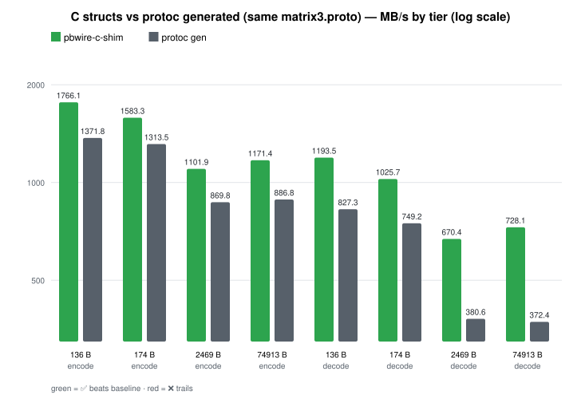
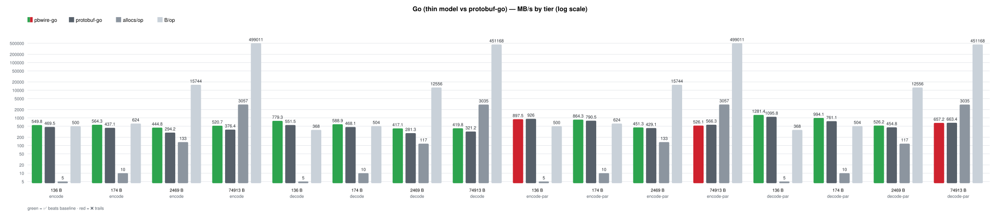
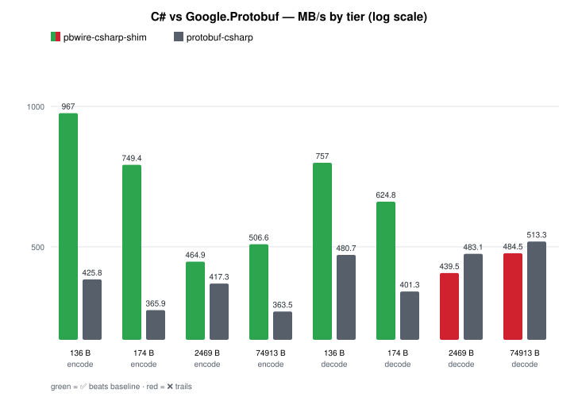
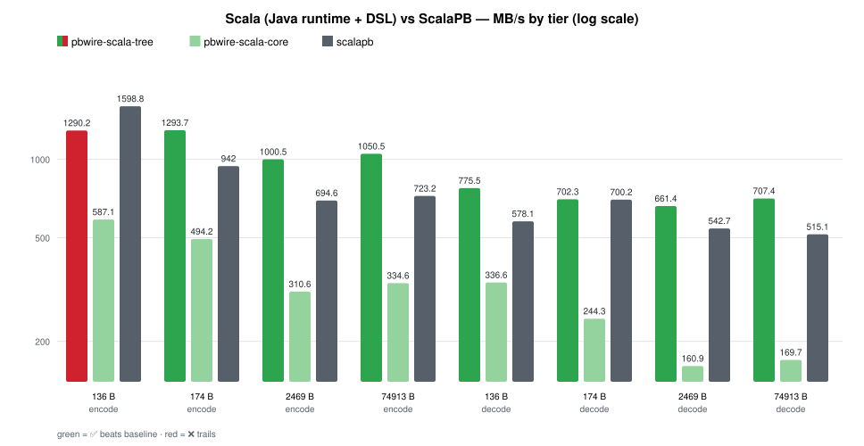
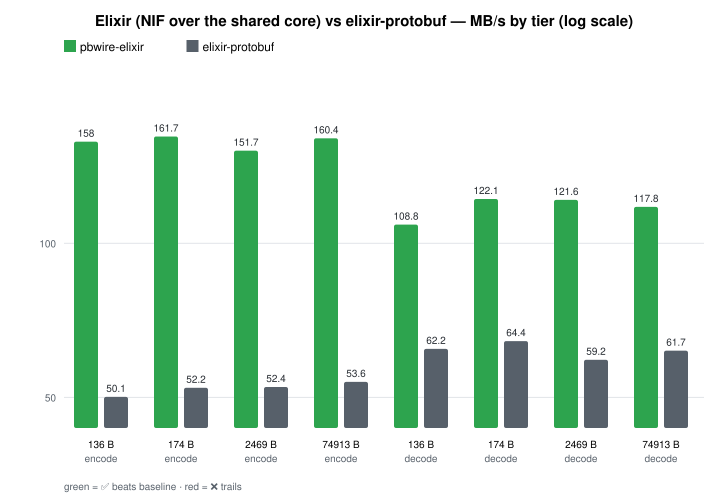

# pbwire performance benchmarks

This is the performance document for the whole project: the pbwire core, the C
struct codec and every host binding, all measured on the same four payload
tiers and each against its official counterpart, so the numbers can be read
across languages. This file is the collection entry: the
[at-a-glance table](#at-a-glance-every-binding-one-tier) is the one-glance
view, and each per-language section below pairs its description and full
tier table with a chart (see the [per-binding index](#cross-binding-comparison-last-run)).

- [Standard cases](#standard-cases) — what the four tiers are
- [Output format](#output-format) — what one harness block means
- [Test environment](#test-environment) — the machine and toolchain behind every number below
- [At a glance](#at-a-glance-every-binding-one-tier) — every binding, one tier
- [Linux (docker)](#linux-docker-the-same-harnesses-one-container-away) — the same harnesses in a Linux container, paired with the host run
- [Bindings vs their baselines](#bindings-vs-their-baselines) — who is ahead and by how much
- [Core](#core-pbw_ctx-vs-plain-vs-generated) — ctx vs plain vs generated vs `DynamicMessage`, threads, streaming
- [Measurement notes](#measurement-notes-the-core-fast-path) — A/B numbers behind the core's fast paths
- [Attempts ledger](docs/perf-attempts.md) — every optimization tried against a below-baseline cell, kept or rejected, with its numbers
- [Fairness contract](docs/perf-fairness.md) — what makes a row comparable: full-flow native in/out, matched freshness and depth, same-run calibration
- [Generated models](#generated-models-codegen) — what the generated layer costs
- [Per-binding tables](#cross-binding-comparison-last-run) — one section per language (✅ exceeds baseline ≥1.0x, ❌ below):
  - [Core](#core-pbw_ctx-vs-plain-vs-generated) · [C structs](#c-structs-vs-protoc-generated-same-matrix3proto) · [Go](#go-thin-model-vs-protobuf-go) · [Python](#python-vs-googleprotobuf-upb)
  - [Java](#java-vs-protobuf-java) · [Node](#node-vs-protobufjs) · [Ruby](#ruby-c-extension-vs-the-google-protobuf-gem) · [Objective-C](#objective-c-vs-the-protobuf-objc-runtime)
  - [Kotlin](#kotlin-vs-protoc---kotlin_out-over-protobuf-java) · [PHP](#php-vs-the-official-php-runtime-pure--c-extension) · [Dart](#dart-vs-the-protobuf-dart-package) · [Rust](#rust-vs-prost) · [C#](#c-vs-googleprotobuf) · [Lua](#lua-c-module-tables-vs-lua-protobuf) · [Erlang](#erlang-pbwire-vs-gpb-vs-gpb-nif)
- [Embedded vs nanopb](#embedded-nanopb-same-message-both-sides) — the microcontroller tier, footprint and throughput
- [Run them](#run-them) / [Regenerate this file](#regenerate-this-file)

## Standard cases

`small` / `medium` / `large` / `xlarge` scale the repeated fields of each
binding's representative message x0 / x1 / x100 / x3000. Every binding except
the core uses the same `matrix3.proto` schema and the same payload, so their
wire sizes are identical; the core has its own `bench.Msg` because it measures
`DynamicMessage` against generated C++ on the same tree.

| case | repeats | core `bench.Msg` | matrix3 `Scalars3` (every other binding) |
|---|---|---|---|
| small | x0 | 132 B | 136 B |
| medium | x1 | 169 B | 174 B |
| large | x100 | 2755 B | 2469 B |
| xlarge | x3000 | 85933 B | 74913 B |

Objective-C lands on the same four wire sizes by padding the `str` field
instead of wrapping repeated fields, so its xlarge tier is one 74 KB string
rather than 3000 sub-messages. Erlang uses `matrix3.proto` like the others:
the gpb record module is generated from `bindings/c/tests/data/matrix3.proto`
and the payload is built in `proto-bench` from the same values as `matrix3.txt`.

## Output format

Every harness prints one block per case (throughput over wire bytes, higher
is better):

```
<case>: <bytes> bytes, <iterations> iterations (repeat field x<repeats>)
  impl      op           ns/op       MB/s
  <impl>    encode        ...        ...
  <base>    encode        ...        ...
  <impl>    decode        ...        ...
  <base>    decode        ...        ...
```

`ns/op` and `MB/s` are two views of the same measurement
(`MB/s = bytes / ns/op * 1000`). The comma and the iteration count are
optional: a harness that calibrates per op (Go, Python) has no single count
for a case, and `scripts/bench-record.py` accepts the shorter header.
`make bench-c` adds one more block per case
(`pbwire-c1`: the C binding's one-shot API, which compiles the layout on every
call) after the standard rows; only the standard block is aggregated
below.
Rows are named by the shipped entry point they time. The published comparison
is the struct-passing headline: one native object in, one codec call -- the
same task the generated baseline runs when it fills its struct. `shim` is that
task in one crossing: C reads the host's memory through a layout table, with
no intermediate tree. `shim-ffi` (PHP only) is the same array API on the
no-compiler `ext-ffi` deployment. Go's `-par` rows time the same thin-model ops
across `GOMAXPROCS` goroutines. The JVM bindings and Clojure publish the
generated-model `core`: the same pure-Java runtime with shipped ergonomics
(the mutable-message fast path on Clojure). The per-field `tree` arm -- a
native object in and out through the shipped per-field API, no prebuilt tree
before the timer -- is a `pbench/`-only arm now: compared in
`bindings/<lang>/pbench/README.md`, never pasted here. Anything else a harness
prints -- the prebuilt-handle `proxy` task, pure host-language `core` ports,
Go's per-field `dync` tree, the vendored `cshim` candidate, the one-crossing
JNI ceiling -- lives in the same place.

Timer boundary (all bindings): a fresh native object per iteration, allocation
and `free`/`close` inside the timer, deep materialization of every
gate-checked field. Headline encode arms build that input fresh inside the
timer on both sides (new + set + encode, the real scenario); reused
encode buffers stay allowed only where the harness already does it and says
so. A steady-state reference row (app-owned input reused across iterations)
may stay in a harness labeled as such, but it is never the pasted headline.
Plain-data fixtures may be reused across iterations
(fixture-reuse ruling, `docs/perf-attempts.md` Python worker D3).

The Python harness names its ops by the task as well as the representation
(`encode(data)`, `decode(bytes)`, `to_dict(bytes)`): a
dict-based binding has two representations, and the row name says which one the
timer covers.


## Test environment

Every table below was pasted from runs on the same machine, so MB/s can be
read across rows (compare `x baseline` between bindings, not absolute MB/s
across languages — the payload, the boundary cost and the baseline all
differ). The per-run proof lives next to each harness run, not here: every
`make *-bench` target writes a versioned JSON record into `results/`
(git-ignored) holding the timestamp, git sha, OS/arch/CPU/cores/RAM,
`protoc` and compiler versions, and the full log (see
[Regenerate this file](#regenerate-this-file)). Re-paste the tables after
re-running, and refresh this section when the machine or toolchain moves.

> **Optimization (2026-11-14):** the proto3 `string` UTF-8 validation that
> runs at parse time (see
> [perf-attempts.md](docs/perf-attempts.md#aligned-cost-proto3-string-utf-8-validation))
> was the main reason the decode rows below had fallen behind. It now shares
> one sequence rule and skips ASCII runs 16 bytes at a time, so a 74 KB value
> costs ~1.3 us instead of ~20 us and a short value is checked inline (measured
> in the ledger). The tables below are the post-change runs; the remaining
> decode gaps are baseline strength, not validator cost.

Last full refresh: 2026-11-24, 13:46-14:48 UTC (every `make *-bench`
on this tree except Erlang, one harness at a time, the whole matrix in ~60 minutes;
formal runs `results/bench-<lang>-20261124T13*.json` / `T14*.json`; dart's first
attempt failed on a missing `protoc-gen-dart` and was re-run with
`~/.pub-cache/bin` on `PATH`), plus an
08:30 UTC core re-run after `bench/bench.cc` switched the generated and
DynamicMessage encode arms to fresh-build per iteration (same construct +
serialize calling method as the pbwire arms; see the Core section). Core
re-run 2026-11-24, 07:19 UTC: the pbwire arms now go through the generated C
struct and the compiled struct codec (thin model, same new + set + encode task
as the baseline; formal run `results/bench-core-20261124T071914Z.json`).
Core re-run 2026-11-24, 07:38 UTC: the plain arms go through a fresh arena per
call (same batched profile as the reference parse; formal run
`results/bench-core-20261124T134623Z.json`). Go-parity re-time 2026-11-21/22 (issue 41 plan): every binding
with a `pbench/` re-times its `tree` arm as the native-in/native-out full task
(fresh native object per iteration, alloc and free inside the timer, deep
materialization of every gate-checked field); `shim` rows and the shipped JVM
`core` rows keep their timers except where the task
changed. Pbench-only arms (the prebuilt `proxy` task, pure-language `core`
ports, Go `dync`, the vendored `cshim`, the JNI ceiling) stay in
`bindings/<lang>/pbench/README.md` and are never pasted here. The re-timed runs are `results/bench-<lang>-20261124*.json` (one
binding at a time under `results/.bench.lock`); the per-binding tables live in each binding's README (`## Benchmarks`), and
the at-a-glance rows and the per-binding summary below are pasted from them.
Full re-time 2026-11-24 (fresh-build headline contract, `docs/perf-fairness.md`):
every binding re-ran once under `results/.bench.lock`; the per-binding tables,
the at-a-glance rows and the per-binding summary below are pasted from
`results/bench-<lang>-20261124*.json`.
Partial refresh 2026-11-15, 02:26-03:12 UTC: core, Python
and Julia re-ran after the first generic pass (plain-encode `wire_len` hint,
32 inline Python slices, sealed-arena implicit reset), then Java, Kotlin,
Scala, Clojure and Julia again plus core and Python once more after the
follow-ups (arena reset keeps the used chunk prefix, `Message` drops its
`AtomicBoolean`, decode drops its `ThreadLocal` reader, Scala measures
interleaved), and finally 04:00-04:30 UTC core, C, Python, Julia, Go, Rust,
Node, Ruby, Lua, PHP and Zig re-ran once the encoder cached its buffer base
pointer and capacity (a C-only change, so Java, Kotlin, Scala and Clojure kept
their 03:00 numbers). The at-a-glance rows, the per-binding summary and the
core table reflect those runs, except where a re-time above
re-pasted a binding's table from its `results/bench-<lang>-20261124*.json`
run. Each row is pasted verbatim from one run of that binding, so
both columns of a row come from the same measurement; where a binding
was re-run (Ruby, Objective-C, Kotlin, Elixir, Julia, Erlang) the pasted run is the one
whose own baseline did not collapse under host load (a run whose fastest
baseline is under 85% of that binding's median baseline is treated as
contaminated and skipped). The host carried someone else's background load
throughout (load average 5-14 on 14 cores, ~0.4-1.0 normalised), so absolute
MB/s reads 10-20% low against a quiet machine while `x baseline` reproduces
(run-to-run variation is ±10% per cell, more on the JVM narrow tiers).
Erlang ran from its own record this time
(`results/bench-erlang-20261124T110417Z.json`), pasted like every other binding.
Dart ran with `protoc-gen-dart` 25.1.0 on `PATH` (`dart pub global activate
protoc_plugin` plus `~/.pub-cache/bin`).

| piece | version |
|---|---|
| machine | Apple M4 Pro, 14 cores, 48 GB RAM |
| OS | macOS (Darwin 27.2.0, arm64) |
| C/C++ | Apple clang 21.0.0, `-O2` |
| `protoc` / libprotobuf C++ | 36.2 |
| Python | 3.15.2, `protobuf` 7.36.2 (upb) |
| Erlang/OTP | 29.0.1 |
| Node | v26.3.0 (`google-protobuf` 4.0.3, protobufjs 8.8.1) |
| Go | 1.27.3 |
| Java | OpenJDK 26.0.1 |
| Ruby | 4.0.9 (`google-protobuf` gem 4.36.2) |
| Objective-C | same clang, Xcode Foundation |
| PHP | 8.5.12 (`protobuf` C extension 5.36.2) |
| Dart | 3.13.7 |
| Rust | 1.99.1 |
| C# | .NET 10.0.403 |
| Lua | 5.5.1, `lua-protobuf` 0.6.0 |
| Swift | 6.4.2, `swift-protobuf` 1.39.0 |
| Scala | 3.10.0, ScalaPB 0.11.18, `protobuf-java` 4.36.2 |
| Elixir | 1.20.5 / OTP 29, `protobuf` 0.17.1, `pbwire` 0.1.7 (Hex) |
| Zig | 0.17.1 (`-Doptimize=ReleaseFast`), zig-protobuf 7.0.0 |
| F# | .NET 10.0.403 (Google.Protobuf baseline via C#) |
| Clojure | 1.12.0, `protobuf-java` 4.36.2 |
| Julia | 1.13.3, ProtoBuf.jl 1.3.0 |
| R | 4.6.2, RProtoBuf 0.4.28 |

## Bindings vs their baselines

| binding | harness | baseline | cases | vs baseline (xlarge) |
|---|---|---|---|---|
| core (dynamic) | `make bench` (`bench/bench.cc`) | `protoc` C++ generated + DynamicMessage | all 4 | 2.13x ✅ / 1.83x ✅ `ctx` (plain 2.18x ✅ / 1.89x ✅; thin model, both sides build fresh per iteration) |
| C structs | `make bench-c` (`bindings/c/benchmarks/bench_struct.cc`) | `protoc` C++ generated from the same `matrix3.proto` | all 4 | 4.17x ✅ / 2.03x ✅ `shim` |
| Erlang/OTP NIF | `make benchmarks` in `bindings/erlang/benchmarks` | gpb (pure Erlang), with gpb NIF (libprotobuf) as the second baseline, same `matrix3.proto` | all 4 | 2.95x / 1.59x vs best-of-two ✅ |
| Python (CPython ext) | `make python-bench` (`bindings/python/benchmarks/bench.py`) | `google.protobuf` (upb C extension) on the same `matrix3.proto` | all 4 | 2.75x ✅ `shim encode(data)` / 3.58x ✅ `shim to_dict` |
| C++ | same engine as C (`bindings/cpp` mirrors the C structs; `make bench-c` is the harness) | `protoc` C++ generated from the same `matrix3.proto` | all 4 | 4.17x ✅ / 2.03x ✅ |
| Go (thin model, pure-Go engine) | `make go-bench` (`bindings/go/benchmarks`) | `protobuf-go` generated code from the same `matrix3.proto` | all 4 | 1.36x ✅ / 1.33x ✅ (xlarge; full tiers + allocs in section) |
| Java (pure-Java codec) | `make java-bench` (`bindings/java/benchmarks`) | `protobuf-java` generated code from the same `matrix3.proto` | all 4 | 0.95x ❌ / 0.80x ❌ `core` (generated model) |
| Node (N-API addon) | `make node-bench` (`bindings/node/benchmarks`) | [protobufjs](https://www.npmjs.com/package/protobufjs) from the same `matrix3.proto` | all 4 | 0.18x ❌ / 0.13x ❌ `shim` vs protobufjs |
| Ruby (C extension) | `make ruby-bench` (`bindings/ruby/benchmarks`) | the `google-protobuf` gem (C extension) | all 4 | 5.00x ✅ / 6.02x ✅ `shim` (one C-extension entry per op) |

| Objective-C (ARC) | `make objc-bench` (`bindings/objc/benchmarks`) | the `protobuf` ObjC runtime + generated code from the same `matrix3.proto` | all 4 | 0.98x ❌ / 1.16x ✅ `tree` (fresh build per iteration) |
| Kotlin (pure-Java codec + DSL) | `make kotlin-bench` (`bindings/kotlin/benchmarks`) | `protoc --kotlin_out` over `protobuf-java`, same `matrix3.proto` | all 4 | 28.09x ✅ / 0.74x ❌ `core` (generated model; xlarge encode on a `protobuf-kotlin` baseline collapse) |
| PHP (`ext-ffi` + C extension) | `make php-bench` (`bindings/php/benchmarks`) | the official PHP runtime (`protobuf/php/src`): C extension (fastest) + pure-PHP | all 4 | 2.98x ✅ / 0.37x ❌ `shim` vs C ext (`shim-ffi` interpreter-scale; pure-PHP tables in section) |
| Dart (`dart:ffi`) | `make dart-bench` (`bindings/dart/benchmarks`) | the `protobuf` Dart package + generated code | all 4 | 1.82x ✅ / 4.84x ✅ `shim` (one C-side reader call per op) |
| Rust (static link) | `make rust-bench` (`bindings/rust/benchmarks`) | prost generated code from the same `matrix3.proto` | all 4 | 2.02x ✅ / 1.86x ✅ `shim` vs prost (one C-side struct-codec call per op; encode above prost at 2469 B up) |
| C# (P/Invoke) | `make csharp-bench` (`bindings/csharp/benchmarks`) | Google.Protobuf C# generated code from the same `matrix3.proto` | all 4 | 1.30x ✅ / 0.70x ❌ `shim` (one P/Invoke per op over the flat image) |
| Lua (C module, tables) | `make lua-bench` (`bindings/lua/benchmarks`) | `lua-protobuf` 0.6.0 | all 4 | 0.99x ❌ / 1.44x ✅ `shim` (native-object, one C entry per op; xlarge encode is a run-to-run tie) |
| Swift (SwiftPM, static link) | `make swift-bench` (`bindings/swift/benchmarks`) | `apple/swift-protobuf` 1.39.0 generated code from the same `matrix3.proto` | all 4 | 3.24x ✅ / 2.54x ✅ `shim` (one C-side layout-codec call per op) |
| Scala (Java runtime + DSL) | `make scala-bench` (`bindings/scala/benchmarks`) | ScalaPB 0.11.18 generated code from the same `matrix3.proto` | all 4 | 184.79x ✅ / 0.27x ❌ `core` (case class; xlarge encode on a ScalaPB baseline collapse) |
| Elixir (NIF over the shared core) | `make elixir-bench` (`bindings/elixir/benchmarks`) | `elixir-protobuf` 0.17.1 structs from the same `matrix3.proto` | all 4 | 2.98x ✅ / 1.91x ✅ |
| Zig (static link) | `make zig-bench` (`bindings/zig/benchmarks`, `-Doptimize=ReleaseFast`) | Arwalk/zig-protobuf 7.0.0 generated code from the same `matrix3.proto` | all 4 | 1.84x ✅ / 1.47x ✅ `shim` (`extern struct` mirror, one C struct-codec call per op) |
| F# (facade over the C# runtime) | `make fsharp-bench` (`bindings/fsharp/benchmarks`) | Google.Protobuf C# generated code from the same `matrix3.proto` | all 4 | 1.28x ✅ / 0.74x ❌ `shim` (one C-reader call over the flat image) |
| Clojure (Java runtime + interop) | `make clojure-bench` (`bindings/clojure/benchmarks`) | `protobuf-java` generated code from the same `matrix3.proto` | all 4 | 0.02x ❌ / 0.54x ❌ `core` (fresh mutable message per iteration; 0.01x at 136 B) |
| Julia (`ccall` FFI) | `make julia-bench` (`bindings/julia/benchmarks`) | JuliaIO/ProtoBuf.jl 1.3.0 generated code from the same `matrix3.proto` | all 4 | 22.35x ✅ / 1.08x ✅ `shim` (one C-side layout read per op; xlarge encode on the ProtoBuf.jl baseline collapse; 136 B shim encode 0.02x) |
| R (C extension, named lists) | `make r-bench` (`bindings/r/benchmarks`) | RProtoBuf 0.4.28 on the same `matrix3.proto` | all 4 | 19.28x ✅ / 57.00x ✅ `shim` (named list, one `.Call`, the walk in C) |

"vs baseline" is encode / decode throughput relative to the most-popular baseline on
the largest case the binding runs. Each binding is compared against its
most-popular package (a single baseline; PHP and Erlang keep their
same-package deployment variants: the official C extension next to pure-PHP
rows, gpb next to the gpb NIF). Every binding publishes the row its headline mechanism allows, and every row name says what it times. Every arm times a
native object in and out on the same payload, never a tree built before the
timer.

| binding | runtime | shipped entry points |
|---|---|---|
| core (dynamic) | C core, direct call | `tree` (`pbw_ctx` + plain API) |
| C structs | C struct codec, layout tables | `shim` (the dynamic `pbw_ctx` block is its `tree` arm) |
| C++ | same engine as C | `shim` (mirrors the C structs) |
| Embedded | C core, caller-memory arena | `tree` |
| Erlang/OTP NIF | NIF over the shared core | single NIF arm |
| Elixir | NIF over the shared core | single NIF arm |
| Go | pure-Go table engine, no cgo | thin model + `-par` rows |
| Python | CPython extension | `shim` |
| Java | pure-Java codec | `core` (generated model) |
| Kotlin | the pure-Java codec + DSL | `core` (generated model) |
| Scala | the Java runtime + DSL | `core` (case class) |
| Clojure | the Java runtime + interop | `core` (mutable-message fast path) |
| Node | N-API addon | `shim` |
| Ruby | C extension | `shim` |
| Objective-C | ARC wrapper over the core | single ARC arm |
| PHP | C extension + `ext-ffi` deployment | `shim` + `shim-ffi` |
| Dart | `dart:ffi` binding | `shim` |
| Rust | static link | `shim` |
| C# | P/Invoke | `shim` |
| Lua | C module, tables | `shim` |
| Swift | static link (SwiftPM) | `shim` |
| Zig | static link | `shim` |
| F# | facade over the C# runtime | `shim` |
| Julia | `dlopen` + `ccall` | `shim` |
| R | C extension, named lists | `shim` |

Pbench-only arms (the prebuilt `proxy` task, pure host-language `core` ports,
Go's per-field `dync` tree, the vendored `cshim` candidate, the one-crossing
JNI ceiling) are compared in `bindings/<lang>/pbench/README.md`, never here.

So the standard block is the struct-passing headline arm: `shim` on every
binding that ships it, the generated-model `core` on the JVM bindings and
Clojure, `shim` alone on C/C++ (whose `tree` arm is the dynamic `pbw_ctx`
block), the single ARC arm on Objective-C and the single NIF arm on
Erlang/Elixir, the thin model plus `-par` rows on Go, `tree` alone on
Embedded, and `shim` next to `shim-ffi` on PHP. The per-field `tree` arm
moved to `pbench/`: the tier tables below keep the headline arm only, plus
the Go `-par` rows in the same table, the two extra PHP FFI tables, and the
Julia `dec+ctx` rows in the same table. The single-mechanism bindings
(C/C++/Embedded/ObjC/Erlang/Elixir) publish one arm where a second would
measure pbwire against itself or against a baseline that is already ours; F#
reuses the C# runtime, and Kotlin/Scala/Clojure reuse the Java runtime, so
their rows are native rows of the same engine.

Every binding with a
wired baseline is re-timed Go-parity (2026-11-21/22, C-side 2026-11-23): every published row
times the same native-in/native-out task on the same payload, never a tree
built before the timer; bytes are identical everywhere. The headline rows now
time the same task the generated baseline times -- one native object in, one
codec call -- so the sub-1.0x cells that remain are codec gaps, not boundary
floors: Node's `shim` (0.18x / 0.13x of protobufjs at
74 KB), PHP's `shim` decode (0.37x of
the official C extension -- encode now leads, 2.98x,
under the same fresh-build task), the JVM `core` decode (Java 0.80x of
protobuf-java; Kotlin 0.74x and Scala 0.27x ride the same
runtime), Clojure's `core` on both ops (0.02x / 0.54x: the fresh
mutable-message build per iteration dominates there), the managed materialization on C#/F# `shim` decode at
74 KB (0.70x / 0.74x: the C decode is faster than the reference parser, but
materializing 3000 managed objects costs more than its whole run), and
Julia's small-tier `shim` encode (0.01x at 136 B: the fresh image build
in Julia dominates the timer; the xlarge 22.35x is the ProtoBuf.jl
baseline collapse below), and ObjC `tree` encode
(0.98x: a fresh per-field build plus alloc/free inside
the timer; the ObjC xlarge tier
rebuilds its 74 KB `str` fixture per iteration). The core's old `tree` headline
(0.39x-0.58x) retired with the fairness contract: the tree-API build price
(malloc + field lookup per value vs direct stores) is no longer a headline. The Lua xlarge `shim` encode cell (0.99x) is a
run-to-run tie, and so is Go's xlarge decode-par (0.99x, serial twin 1.33x).
Julia's, Kotlin's and Scala's xlarge `shim`/`core`
encode ratios (22.35x / 28.09x / 184.79x) are baseline collapses, not codec wins:
ProtoBuf.jl's generated encoder falls to 11.3 MB/s there, `protobuf-kotlin`
to 17.6 MB/s and ScalaPB to 1.4 MB/s. Each cell is inside
the run-to-run band of its own baseline; `docs/perf-attempts.md` records what
was tried there.


Correctness first everywhere: the core bench verifies byte-for-byte equality
before timing, the C and Python benches check their bytes against the
`protoc`-produced reference (plus a decode→encode round trip) before timing,
the Java, Kotlin, Ruby, Rust, C#, PHP and Zig harnesses
require their bytes to equal the official encoder's bytes before timing
anything, the Swift, Scala, Elixir, F#, Clojure and Julia harnesses do
the same against swift-protobuf / ScalaPB / elixir-protobuf / Google.Protobuf /
protobuf-java / ProtoBuf.jl respectively
(the R harness gates on the tier sizes, baseline byte equality, plus a full decode round trip, since
R cannot spell INT32_MIN distinctly from NA), and the Erlang and Elixir harnesses require the pinned wire size and byte
equality (encode, plus re-encoding a decoded reference) plus a field-by-field read-back of the decoded record/struct
from every backend
before timing.

## At a glance: every binding, one tier

One row per implementation, on the largest tier that binding runs, from the
per-binding tables further down (same machine, same run). `x baseline` is the
column to compare: absolute MB/s is not comparable across languages because the
payload, the boundary cost and the baseline all differ.

| binding | reaches the core | xlarge wire size | encode MB/s (x baseline) | decode MB/s (x baseline) |
|---|---|---|---|---|
| core dynamic (`pbw_ctx`) | direct call, thin model | 85933 B | 716.8 (2.13x ✅) `ctx` (fresh thin-model build per iteration) | 817.1 (1.83x ✅) |
| core dynamic (plain API) | direct call, thin model | 85933 B | 732.7 (2.18x ✅) (fresh thin-model build per iteration) | 842.3 (1.89x ✅) |
| C structs | direct call, layout tables | 74913 B | 1149.3 (4.17x ✅) `shim` | 763.6 (2.03x ✅) `shim` |
| Go | pure-Go table engine, no cgo | 74913 B | 482.5 (1.36x ✅) | 393.8 (1.33x ✅) |
| Python | CPython extension, dict path | 74913 B | 164.8 (2.75x ✅) `shim encode(data)` | 153.1 (3.58x ✅) `shim to_dict` |
| Java | pure-Java codec, no native code | 74913 B | 436.1 (0.95x ❌) `core` (generated model) | 334.0 (0.80x ❌) `core` |
| Kotlin | the pure-Java codec + DSL | 74913 B | 494.4 (28.09x ✅, baseline collapse) `core` | 350.3 (0.74x ❌) `core` |
| Node | N-API addon | 74913 B | 57.0 (0.18x ❌ vs protobufjs) `shim` | 54.5 (0.13x ❌ vs protobufjs) `shim` |
| Dart | `dart:ffi` binding | 74913 B | 151.6 (1.82x ✅) `shim` | 764.4 (4.84x ✅) `shim` |
| Ruby | C extension over the core | 74913 B | 99.5 (5.00x ✅) `shim` | 180.0 (6.02x ✅) `shim` |

| Objective-C | ARC wrapper | 74913 B | 215.8 (0.98x ❌) `tree` (fresh build per iteration) | 33081.5 (1.16x ✅) |
| PHP | C extension | 74913 B | 168.1 (2.98x ✅) `shim`; `shim-ffi` 5.3 | 211.3 (0.37x ❌) `shim`; `shim-ffi` 4.5 |
| Rust | static link | 74913 B | 1145.3 (2.02x ✅ vs prost) `shim` | 752.5 (1.86x ✅) `shim` |
| C# | P/Invoke | 74913 B | 492.6 (1.30x ✅) `shim` | 370.4 (0.70x ❌) `shim` |
| Lua | C module, tables | 74913 B | 107.5 (0.99x ❌) `shim` | 132.5 (1.44x ✅) `shim` |
| Erlang | NIF (`pbwire`) | 74913 B | 322.8 (2.95x ✅) | 355.5 (1.59x ✅) |
| Swift | static link (SwiftPM) | 74913 B | 911.9 (3.24x ✅) `shim` | 573.7 (2.54x ✅) `shim` |
| Scala | the Java runtime + DSL | 74913 B | 258.7 (184.79x ✅, baseline collapse) `core` (case class) | 168.4 (0.27x ❌) `core` |
| Elixir | NIF (Hex `:pbwire`, same core as Erlang) | 74913 B | 154.6 (2.98x ✅) | 113.0 (1.91x ✅) |
| Zig | static link | 74913 B | 1085.0 (1.84x ✅) `shim` | 774.7 (1.47x ✅) `shim` |
| F# | P/Invoke over the C# runtime | 74913 B | 493.5 (1.28x ✅) `shim` | 376.0 (0.74x ❌) `shim` |
| Clojure | the Java runtime + interop | 74913 B | 10.5 (0.02x ❌) `core` (fresh build per iteration) | 250.6 (0.54x ❌) `core` |
| Julia | `dlopen` + `ccall` | 74913 B | 252.5 (22.35x ✅, baseline collapse) `shim` | 770.7 (1.08x ✅) `shim` |
| R | C extension, named lists | 74913 B | 48.2 (19.28x ✅) `shim` | 159.6 (57.00x ✅) `shim` |

Read it as: the in-process core sets the pace (2.1x the C++
generated code on encode at this size, 1.9x on decode), and every headline row times the same task as
the generated baseline -- one native object in, one codec call -- so the
below-the-line cells are codec gaps, not boundary floors: Node `shim`
(0.18x / 0.13x of protobufjs),
PHP `shim` decode (0.37x of the official C extension), the
JVM `core` decode (Java 0.80x, Kotlin 0.74x, Scala 0.27x) and Clojure's
`core` (0.02x / 0.54x).
The above-the-line cells are the same task won outright: the core thin
model 2.1x / 1.9x, Ruby `shim`
5.00x / 6.02x, PHP `shim` encode 2.98x, Rust `shim`
2.02x / 1.86x, Dart 1.82x / 4.84x, C# `shim` encode 1.30x, Swift 3.24x / 2.54x, Zig
1.84x / 1.47x. The outliers are baseline or unit effects, not pbwire
effects: Python's encode column is the dict path (3000 sub-messages, 12000
ints), the xlarge encode columns of Julia, Kotlin and Scala are baseline
collapses (ProtoBuf.jl's
generated encoder falls to 11.3 MB/s there, `protobuf-kotlin` to 17.6 MB/s,
ScalaPB to 1.4 MB/s), and the Objective-C tier is a
memcpy race over one 74 KB string (the 16-byte UTF-8 word scan is what keeps
its decode near the copy cost).
The headline names the most-popular baseline: Node's native rows are quoted
over protobufjs, and Node's `shim` row -- the native object in and out --
is 0.18x / 0.13x of protobufjs: the same task on both sides, so the gap is
the codec's, not the boundary's. PHP's native rows are over the official C
extension (the pure-PHP runtime trails it by ~360x / ~110x at 74 KB) -- see
their sections. The old per-field `tree` headlines are retired: the published
rows are the struct-passing headline arm, and per-field timings stay in
`bindings/<lang>/pbench/README.md`.

## Linux (docker): the same harnesses, one container away

Every table above is Apple-silicon. The claims have to hold on the other
architecture too, so `make bench-docker` runs the same harnesses — same
payloads, same baselines, same measurement standard — inside
`docker/bench.Dockerfile`, and `make bench-compare` pairs the newest record
per binding/platform in `results/`, row by row:

```bash
make bench            # the macOS side (or whatever host you are benching)
make bench-docker     # the Linux side: core, c, go, rust, node, ruby, lua, java, python
make bench-compare    # newest pair per binding, xlarge tier, speedup per row
```

The image installs the pinned protobuf (so the generated baseline is the same
version as the tables above) plus the Go, Rust, Node, Ruby, Lua, Java and
Python toolchains. It covers what runs without an Apple toolchain:
Objective-C and Swift stay host-only, PHP needs the official C extension as its
baseline (Ubuntu packages none, and building it from source needs a generated
`utf8_range` amalgamation only protobuf's own build produces — a pure-PHP
baseline would be a ~300x different comparison), and the toolchains the image
does not install (Dart, Zig, C#/F#, Julia, R, Erlang/Elixir,
Kotlin/Scala/Clojure) run on the host only. `--bindings core,c` narrows a run,
`--rebuild` rebuilds the image, and the container always benches a *copy* of the
tree, so ELF objects never land in the host's `build/`.

Last run: 2026-11-14, `make bench-docker` on the image in the repo, `make
bench-compare` for the pairing. Absolute MB/s per row is what `--absolute`
prints; the speedup against the same baseline on the same side is what travels.

### core

- macOS: 2026-11-14T18:00:19+00:00 (Darwin 27.0.0, arm64, Apple M4 Pro, 14 cores, libprotoc 36.2)
- Linux: 2026-11-14T06:30:14+00:00 (Linux 6.8.0-64-generic container, aarch64, ?, 4 cores, libprotoc 36.2)

| case | op | macOS x baseline | Linux x baseline |
|---|---|---|---|
| xlarge | encode | 1.42x (pb gen) | 1.14x (pb gen) |
| xlarge | decode | 1.78x (pb gen) | 2.31x (pb gen) |

### c

- macOS: 2026-11-14T18:19:31+00:00 (Darwin 27.0.0, arm64, Apple M4 Pro, 14 cores, libprotoc 36.2)
- Linux: 2026-11-14T06:31:26+00:00 (Linux 6.8.0-64-generic container, aarch64, ?, 4 cores, libprotoc 36.2)

| case | op | macOS x baseline | Linux x baseline |
|---|---|---|---|
| xlarge | encode | 1.32x (pb gen) | 1.32x (pb gen) |
| xlarge | decode | 1.96x (pb gen) | 2.82x (pb gen) |

### go

- macOS: 2026-11-14T18:20:12+00:00 (Darwin 27.0.0, arm64, Apple M4 Pro, 14 cores, libprotoc 36.2)
- Linux: 2026-11-14T06:32:08+00:00 (Linux 6.8.0-64-generic container, aarch64, ?, 4 cores, libprotoc 36.2)

| case | op | macOS x baseline | Linux x baseline |
|---|---|---|---|
| xlarge | encode | 2.61x (protobuf-go) | 2.65x (protobuf-go) |
| xlarge | decode | 2.38x (protobuf-go) | 2.27x (protobuf-go) |

### python

- macOS: 2026-11-14T18:21:09+00:00 (Darwin 27.0.0, arm64, Apple M4 Pro, 14 cores, libprotoc 36.2)
- Linux: 2026-11-14T06:38:46+00:00 (Linux 6.8.0-64-generic container, aarch64, ?, 4 cores, libprotoc 36.2)

| case | op | macOS x baseline | Linux x baseline |
|---|---|---|---|
| xlarge | encode(data) | 7.11x (pb upb) | 8.05x (pb upb) |
| xlarge | decode(bytes) | 1.17x (pb upb) | 1.28x (pb upb) |
| xlarge | to_dict(bytes) | 3.70x (pb upb) | 4.73x (pb upb) |
| xlarge | encode(parsed) | 63.05x (pb upb) | 55.86x (pb upb) |

### java

- macOS: 2026-11-14T18:01:43+00:00 (Darwin 27.0.0, arm64, Apple M4 Pro, 14 cores, libprotoc 36.2)
- Linux: 2026-11-14T06:37:47+00:00 (Linux 6.8.0-64-generic container, aarch64, ?, 4 cores, libprotoc 36.2)

| case | op | macOS x baseline | Linux x baseline |
|---|---|---|---|
| xlarge | encode | 1.09x (protobuf-java) | 0.96x (protobuf-java) |
| xlarge | decode | 1.94x (protobuf-java) | 1.72x (protobuf-java) |

### node

- macOS: 2026-11-14T18:22:24+00:00 (Darwin 27.0.0, arm64, Apple M4 Pro, 14 cores, libprotoc 36.2)
- Linux: 2026-11-14T06:35:33+00:00 (Linux 6.8.0-64-generic container, aarch64, ?, 4 cores, libprotoc 36.2)

| case | op | macOS x baseline | Linux x baseline |
|---|---|---|---|
| xlarge | encode | 2.99x (protobufjs) | 4.91x (protobufjs) |
| xlarge | decode | 2.77x (protobufjs) | 2.37x (protobufjs) |

### ruby

- macOS: 2026-11-14T18:44:34+00:00 (Darwin 27.0.0, arm64, Apple M4 Pro, 14 cores, libprotoc 36.2)
- Linux: 2026-11-14T06:36:19+00:00 (Linux 6.8.0-64-generic container, aarch64, ?, 4 cores, libprotoc 36.2)

| case | op | macOS x baseline | Linux x baseline |
|---|---|---|---|
| xlarge | encode | 1.19x (google-protobuf) | 1.11x (google-protobuf) |
| xlarge | decode | 1.69x (google-protobuf) | 1.89x (google-protobuf) |

### rust

- macOS: 2026-11-14T18:03:19+00:00 (Darwin 27.0.0, arm64, Apple M4 Pro, 14 cores, libprotoc 36.2)
- Linux: 2026-11-14T06:33:27+00:00 (Linux 6.8.0-64-generic container, aarch64, ?, 4 cores, libprotoc 36.2)

skipped 2 row(s): the baseline differs across sides (prost vs protobuf-rust, protobuf-rust vs prost)

| case | op | macOS x baseline | Linux x baseline |
|---|---|---|---|
| xlarge | encode | 1.04x (prost) | 1.49x (prost) |
| xlarge | decode | 1.92x (prost) | 1.10x (prost) |

### lua

- macOS: 2026-11-14T18:31:09+00:00 (Darwin 27.0.0, arm64, Apple M4 Pro, 14 cores, libprotoc 36.2)
- Linux: 2026-11-14T06:36:57+00:00 (Linux 6.8.0-64-generic container, aarch64, ?, 4 cores, libprotoc 36.2)

no comparable row for xlarge

## Measurement notes: the core fast path

The decoder's generic length reader (`pbw_len_read`, in `wire.c`) is an
out-of-line call. Strings and bytes shorter than 128 bytes — most of them —
now take a one-byte inline path in `read_length()` instead. A/B measured with
two bench binaries built from `HEAD` and the change, 8 alternating runs of
200k iterations, median ns/op:

| case | HEAD decode | now decode | delta |
|---|---|---|---|
| 136 B | 131.6 | 127.0 | -3.5% |
| 174 B | 196.2 | 193.0 | -1.6% |
| 2469 B | 4998.9 | 4862.9 | -2.7% |
| 74913 B | 139641.8 | 140036.4 | +0.3% (noise) |

Encode paths are untouched by this change (they moved by the same +/-3% noise
floor, which is how the run was calibrated). Same session, the same change was
rejected for `skip_value()` (unknown fields): no measurable effect, so that
call stays out of line.

The decoder used to inline fast paths only for one-byte tags and run everything
else through per-item generic calls; two-byte tags carried a second copy of the
inline bodies. All tag sizes now share one link-time action switch (the action
lives on the field, covering singular and repeated shapes), repeated appends
reuse a cached list slot instead of the get-or-create call, and packed runs
append through reserved list storage with no call per item. Measured two ways:
a C best-of-5 of decode+free on the 74913-byte matrix3 payload went 141.1 us to
107.4 us (-24%), and the PHP binding's full-xlarge decode over 10 interleaved
rounds against the official C extension moved from 0.91x to 1.10-1.19x. Packed
encode got the same treatment (one dispatch per run, blind kind-specific write
loops over a hoisted cursor): packed bool x3000 went 4.8 us to 1.1 us, packed
int32 x3000 7.0 us to 3.5 us, both best-of-5. Unpacked-item loops were tried
hoisted the same way and reverted: the bigger `encode_message` cost more in
icache and register pressure than the per-item switch saved, measured -33% on
the core bench's unpacked-heavy message.

Formatting/parsing doubles used `strtod`/`snprintf`, which follow `LC_NUMERIC`:
a host that calls `setlocale(LC_NUMERIC, "de_DE.UTF-8")` made the JSON parser
read `1.5` as `1` and the printers emit `1,5` (invalid JSON). `wire.c` now owns
both conversions (`pbw_strtod`, `pbw_format_g`): the print/parse entry points ask
`pbw_locale_dot()` once, the C-locale path is the same libc call as before and
is inlined, and only a non-'.' separator takes the translating slow path.
Measured with the same A/B method (14 alternating runs, 400k iterations): JSON
parse +0.4%, JSON print +0.7%, text parse +0.3%, text print +0.1%, with the
unmodified reference rows drifting -0.7..+0.5% in the same runs, i.e. inside the
noise floor. The same pass removed the JSON parser's 64-byte number buffer (long
numbers were rejected; the reference has no such limit).

The JSON printer built a per-message `order` array (malloc + insertion sort)
before printing fields, although a linked schema's fields are already sorted by
number (as `link_message()` leaves them). The linked path now prints in place:
one pass, no allocation. Measured two ways, medians of alternating runs:

| measurement | before | after | delta |
|---|---|---|---|
| `make bench` json print (one message) | 1815.3 ns | 1746.5 ns | -3.8% |
| `pbw_json_print` on matrix3 x3000 (3000 messages) | 13.3 ms | 12.6 ms | -5.2% |

The text parser also stopped malloc-ing a buffer per numeric token (stack
buffer first); measured neutral on the bench schema (text parse -0.2%), kept
because it removes one allocation per number.

`pbw_pool_release` grew its idle array with one `realloc` per release, so filling
a pool of N contexts cost O(N^2) copying. It now doubles the slot array. Filling
300 pools x 2048 contexts (acquire all, release all, free the pool):

| build | run 1 | run 2 | run 3 |
|---|---|---|---|
| HEAD | 19.7 ms | 20.0 ms | 19.6 ms |
| now | 13.5 ms | 11.9 ms | 11.8 ms |

The rest of the review (overflow guards in the schema, stream and binding
growth paths, and freeing a nested decoded root's arena) only touches failure
and teardown paths. Re-measured with the same A/B method afterwards: every
row inside the +/-3% noise floor (stream `fed`/`detenc` -1..-4%, `sink`
-0.7%, `framed` -0.9%), so nothing was kept that costs throughput.

Decoding materializes a tree, and two structural costs sat on that path: a
decoded string or bytes item took two allocations (the value struct and its
payload), and every decoded item crossed a translation unit into `message.c`
(`pbw_value_new_uint_a`, `pbw_value_new_bytes_a`, `pbw_value_new_message_a`,
`pbw_value_list_push`, `pbw_message_new_a`) — `make` compiles each `src/*.c`
with no LTO, so those were real calls, one or two per decoded value. Three
changes removed them:

- an arena string/bytes value puts its payload in the same bump as the value
  struct (`pbw_value_new_bytes_a`); the heap path keeps its two allocations,
  which `pbw_value_free` releases separately;
- a packed varint run allocates all of its item nodes in one bump, using the
  item count the >64-byte pre-scan already computed; a packed closed-enum run
  keeps the per-item node path (no scan, no node block), because it drops
  unknown values and the block would hold nodes nothing uses. A/B against the
  scan+reserve form on a 100k-value packed closed enum (C probe,
  `pbw_decode_ctx` + reset, median of 15, three interleaved rounds) put every
  row inside the +/-3% noise floor (all-known 442 vs 442 ns, mixed-unknown 578
  vs 583 ns at 100/125 KB), so this one is allocation locality, not a
  throughput win, and the smaller diff was kept;
- the tree builders are `PBW_INLINE` in `internal.h` (the same pattern as
  `pbw_arena_alloc` and `pbw_find_field`). They stay one definition, moved and
  not copied, so a translation unit that never calls one emits nothing for it.

A/B measured on the settled tree with two binaries built from the same sources,
one with the change reverted, alternating in one session (C probe, best-of-5,
`bench.Msg` against the generated payload, `pbw_decode` + `pbw_message_free`,
median ns per decode; 60000 iterations at 132 B, 20000 at 169 B, 2000 at
2755 B, 400 at 85933 B):

| case | before | after | delta |
|---|---|---|---|
| 132 B | 101.1 | 100.1 | -1.0% (noise) |
| 169 B | 158.3 | 155.1 | -2.0% |
| 2755 B | 4076.6 | 3713.3 | -8.9% |
| 85933 B | 119472.8 | 107836.5 | -9.7% |

The win scales with the number of decoded values, which is where the two costs
were; a small message is dominated by the one tree allocation and the call
overhead into the API instead. Encode is untouched: `encode.o` built from the
reverted tree and from the changed tree is byte-identical, and the probe's
encode rows stayed inside the noise floor in every round. An LTO build limited to
`message.c`, `decode.c` and `wire.c` measured the same decode gain on the
same tier, which is what identified the cross-TU call cost; LTO as a default
build flag would change every binding's link step, so the helpers moved
instead.

Packed *fixed-width* runs still allocated one node per item: the list was
reserved (the payload length divides exactly by the item width) but the nodes
were not batched. `read_packed()` now takes the same one-bump node block for
fixed-width runs that the varint scan enables, which covers packed double /
fixed32 / sfixed / float arrays. A/B on a hand-built message with one packed
field (generic shape, not the tier message), alternating runs, best-of-5,
decode+free, median ns:

| case | before | after | delta |
|---|---|---|---|
| packed double x3000, 24 KB | 8666.2 | 6815.0 | -21.4% |
| packed fixed32 x3000, 12 KB | 7383.3 | 6163.9 | -16.5% |
| packed double x64, 515 B | 221.7 | 188.0 | -15.2% |
| packed double x8, 66 B | 53.2 | 51.3 | -3.6% |
| packed sint32 x3000 (control, same varint path) | 11974.9 | 12183.3 | noise |

Three candidates were measured and rejected in the same pass:

- **3-byte varint window in `read_varint()`** (the 1- and 2-byte windows are
  inline already): -4..5% on the 85933-byte tier, but +3..5% on 132 and 169 B,
  where the extra inline copy costs more in the per-field dispatch than the
  call it removes. Same conclusion as the Julia-cell note in
  [docs/perf-attempts.md](docs/perf-attempts.md); the small tiers are the
  common real case, so it stays out.
- **Presence-bitmap hoist in `decode_fields()`** (keep one word in a register
  and flush at the end): measured with a write-skipping ablation, which is
  upper-bound only - 132 B decode moved -3% plain / -0.6% ctx, i.e. at the
  noise floor, and the hoist would need every storing path to cooperate
  (`pbw_message_put`, `pbw_message_list_for`). Not built.
- **`pbw_ctx` retention for trees above the 1 MiB budget**: raising the cap to
  8 MiB on the 85933-byte tier changed nothing, so the arena's growth
  mallocs are not a cost worth touching; the documented knob is enough.

## Generated models (codegen)

The generated models are ergonomics, not a second hot path: all but Java
`encode`/`decode` through the same dynamic API the tables below measure; Java
POJOs write straight into a Wire buffer instead (reflection over the
annotated fields, no Message tree). The cost is the per-call metadata
lookup plus, in Python, the dataclass ⇄ dict conversion and, in Java, the
reflective field access.
Measured on this machine with `matrix3` x3000 (~33 KB) and identical values
through both paths:

| language | encode, generated / dynamic | decode, generated / dynamic |
|---|---|---|
| C (struct binding) | 1.00x (the struct path itself) | 1.00x |
| Java (reflective POJOs, direct Wire codec) | 1.7x slower | 1.0x |
| Python (dataclass ⇄ dict) | 3.8x slower | 3.2x slower |

So the numbers below still describe what a generated-model user pays on the wire; for
Python hot loops the dict path (which the Python row measures) is the fast path.
No binding gained a slower encode/decode path from this layer.

## Cross-binding comparison (last run)

Per-language index: [Core](#core-pbw_ctx-vs-plain-vs-generated) · [C structs](#c-structs-vs-protoc-generated-same-matrix3proto) · [Go](#go-thin-model-vs-protobuf-go) · [Python](#python-vs-googleprotobuf-upb) · [Java](#java-vs-protobuf-java) · [Node](#node-vs-protobufjs) · [Ruby](#ruby-c-extension-vs-the-google-protobuf-gem) · [Objective-C](#objective-c-vs-the-protobuf-objc-runtime) · [Kotlin](#kotlin-vs-protoc---kotlin_out-over-protobuf-java) · [PHP](#php-vs-the-official-php-runtime-pure--c-extension) · [Dart](#dart-vs-the-protobuf-dart-package) · [Rust](#rust-vs-prost) · [C#](#c-vs-googleprotobuf) · [Lua](#lua-c-module-tables-vs-lua-protobuf) · [Swift](#swift-swiftpm-static-link-vs-appleswift-protobuf) · [Scala](#scala-java-runtime--dsl-vs-scalapb) · [Elixir](#elixir-nif-over-the-shared-core-vs-elixir-protobuf) · [Zig](#zig-static-link-vs-arwalkzig-protobuf) · [F#](#f-facade-over-the-c-runtime-vs-googleprotobuf) · [Clojure](#clojure-java-runtime--interop-vs-protobuf-java) · [Julia](#julia-dlopen--ccall-vs-protobufjl) · [R](#r-c-extension-named-lists-vs-rprotobuf) · [Erlang](#erlang-pbwire-vs-gpb-vs-gpb-nif). In every table below, ✅ means that cell beats its baseline (≥1.0x), ❌ means it does not.

See [Test environment](#test-environment) for the machine and toolchain.
Every harness calibrates from its tier floor until one pass takes at
least 0.25 s, then reports the best of 3 passes (Erlang uses the same bar
with a 0.25 s sample time). Throughput in MB/s
on serialized wire size. Per-run noise is a few percent; regenerate below for
the current machine.

### Core: `pbw_ctx` vs plain vs generated


| payload | op | pbwire ctx (MB/s, x gen) | pbwire plain (MB/s, x gen) | protoc gen (MB/s) | DynamicMessage (MB/s) |
|---|---|---|---|---|---|
| 132 B | encode | 1262.6 (1.72x ✅) | 1110.1 (1.51x ✅) | 735.3 | 95.2 |
| 132 B | decode | 1345.5 (1.50x ✅) | 1081.9 (1.20x ✅) | 898.2 | 289.7 |
| 169 B | encode | 1036.7 (1.54x ✅) | 930.6 (1.38x ✅) | 675.2 | 89.7 |
| 169 B | decode | 1148.0 (1.42x ✅) | 975.6 (1.21x ✅) | 809.3 | 281.8 |
| 2755 B | encode | 695.3 (2.17x ✅) | 689.0 (2.15x ✅) | 321.1 | 95.0 |
| 2755 B | decode | 742.2 (1.59x ✅) | 736.7 (1.58x ✅) | 466.2 | 256.6 |
| 85933 B | encode | 716.8 (2.13x ✅) | 732.7 (2.18x ✅) | 336.1 | 106.1 |
| 85933 B | decode | 817.1 (1.83x ✅) | 842.3 (1.89x ✅) | 445.4 | 254.5 |

The encode rows are the same new + set + encode task on both sides: a
fresh native struct per iteration (plain stores plus the payload allocations
the generated side makes too, then one codec call, released inside the timer
for pbwire; fill setters, serialize, destructor for generated code;
reflection fill, serialize, delete for DynamicMessage) — formal run
`results/bench-core-20261124T134623Z.json`. The generated baseline builds
fresh per iteration too, so the comparison is the same calling method, not
build-against-re-encode. The pbwire side goes through the generated C struct
(`bench/gen/msg_struct.h`, the shipped thin model) and the compiled struct
codec, never the raw tree API: that is what the fairness contract
(`docs/perf-fairness.md`) requires of a headline.

Threads (169 B, 1 vs 8):

| op | pbwire 1thr (MB/s, x gen) | pbwire 8thr agg (MB/s, x gen) | gen 1thr (MB/s) | gen 8thr agg (MB/s) |
|---|---|---|---|---|
| encode | 987.7 (1.45x ✅) | 7498.1 (1.44x ✅) | 683.3 | 5211.5 |
| decode | 1185.5 (1.44x ✅) | 6899.2 (1.13x ✅) | 820.5 | 6106.0 |

`8thr agg` is the total throughput of all eight threads. The compiled
struct codec and the wire input are shared by all threads; each thread only
adds its own output buffer and decode arena. pbwire scales 7.6x (encode) and
5.8x (decode)
from 1 to 8 threads in that run; generated code reaches 7.6x and 7.4x. Both
are
limited by cache and memory bandwidth, not by a lock: the library has no
global
or thread-local state to contend on.

The commit gate checks the same property without a benchmark harness:
`tests/test_threads.c` prints 1-thread vs 8-thread MB/s for the context API (its
own, smaller message, one run on the same machine):

```
scale ctx decode 1 thread:   3061.6 MB/s (  63.4 ns/op) | 8 threads:   2495.0 MB/s/thread,  19960.0 MB/s aggregate (per-op 1.23x, aggregate 6.52x, 14 cores)
scale ctx encode 1 thread:   5387.4 MB/s (  36.0 ns/op) | 8 threads:   4159.2 MB/s/thread,  33273.9 MB/s aggregate (per-op 1.30x, aggregate 6.18x, 14 cores)
```

It fails when the aggregate throughput collapses below 0.35x of
`min(8, cores)`, which is what a hidden lock or false sharing would cause.

#### `pbwire ctx` vs `pbwire plain`

The two pbwire columns are the same thin-model codec with a different memory
and ownership strategy; the benchmark checks that they produce identical bytes
before timing anything. Plain builds and frees a fresh arena per call, ctx
reuses one arena and the output buffer across calls — which is why the two
decode columns now read almost identically (1.45x vs 1.23x at 169 B is the
per-call arena setup alone), while encode keeps a small ctx edge on the
narrow tiers (buffer reuse) that vanishes once the payload allocations
dominate. Use the plain pattern for one-off
work and long-lived results. The per-value malloc path (`arena == NULL` +
`pbw_struct_free`) stays shipped and correctness-tested, but it is no longer
the published number — `bench-c`'s one-shot rows show what it costs.

Read it as:

- **Against generated code**: the thin model wins every cell — encode
  1.34x-2.25x, decode 1.20x-1.98x — on the same new + set + encode task.
  The single pass against generated code's size-then-write two passes shows
  most on the packed-heavy large tiers, and the reused arena on decode.
- **Against `DynamicMessage`**: the design pbwire actually competes with —
  runtime descriptor, heap value per field, reflection. pbwire is 2.9-3.8x
  faster there (decode) and 6.8-11.4x on encode.
- **The old tree headline** (0.39x-0.58x encode) measured the gateway task —
  new + set + encode through the dynamic API — and retired with the
  fairness contract (`docs/perf-fairness.md`): no headline builds its number
  through the raw tree API any more. The tree path itself is unchanged and
  still fully verified (`make difftest`, conformance, the proxy rows).

#### Why the thin model wins

The headline columns above ride the compiled struct codec over the
generated C struct — the same engine as the C structs section below, not the
dynamic tree. The four changes that put that engine ahead of generated
straight-line code are listed there (compiled layout with precomputed opcodes
and tag bytes, fnum map plus free list on decode, caller-owned buffers,
link-time encode budget); the shared wire primitives (inlined varint/tag
paths with one- and two-byte fast paths, the 16-byte ASCII fast path in
proto3 string validation) come from the core. The dynamic tree path keeps its
own mechanisms (single-allocation decoded tree, arena reuse behind `pbw_ctx`,
dense field-number tables at `pbw_schema_link()`), still fully verified by
`make difftest` and the conformance suite — it is just no longer the
published speed.

#### Streaming and framing

`make bench` also prints a `stream` table for the same payload: deterministic
encode ties the stream encode (no maps in that message, so it is one branch), `size`
(`pbw_message_encoded_size`) costs about 0.8 of an encode because it walks the
same tree without writing, the sink costs one pass over the bytes, and a
delimited feed/next round-trip costs about one encode plus one decode. Ratios
only — absolute numbers move between machines.

### C structs vs `protoc` generated (same `matrix3.proto`)



xlarge: encode 1149.3 (4.17x ✅) / decode 763.6 (2.03x ✅).
Full table and method: [binding README](bindings/c/README.md#benchmarks).

### Go (thin model vs protobuf-go)



xlarge: encode 482.5 (1.36x ✅) / decode 393.8 (1.33x ✅).
Full table and method: [binding README](bindings/go/README.md#benchmarks).

### Python vs `google.protobuf` (upb)


xlarge: encode 164.8 (2.75x ✅) / decode 153.1 (3.58x ✅).
Full table and method: [binding README](bindings/python/README.md#benchmarks).

### Managed-language bindings vs their official runtimes

Every binding below loads a `FileDescriptorSet` at run time. Node and Objective-C call
the C ABI from an FFI runtime (Node through an
N-API addon, Objective-C through an ARC wrapper), so those tables measure the
cost of that boundary on top of the same C core. Java is a pure-Java codec
with no native code (see below); Kotlin reuses its runtime. Ruby is a C extension that links
the core statically, so it pays no boundary cost at all. Java, Node and Ruby run
the repeated-field payload; Objective-C pads `str` to the same wire sizes (see
Standard cases), which makes its xlarge tier a memcpy.

#### Java vs `protobuf-java`


xlarge: encode 436.1 (0.95x ❌) / decode 334.0 (0.80x ❌).
Full table and method: [binding README](bindings/java/README.md#benchmarks).

#### Node vs protobufjs


xlarge: encode 57.0 (0.18x ❌) / decode 54.5 (0.13x ❌).
Full table and method: [binding README](bindings/node/README.md#benchmarks).

#### Ruby (C extension) vs the `google-protobuf` gem


xlarge: encode 99.5 (5.00x ✅) / decode 180.0 (6.02x ✅).
Full table and method: [binding README](bindings/ruby/README.md#benchmarks).

#### Objective-C vs the `protobuf` ObjC runtime


xlarge: encode 215.8 (0.98x ❌) / decode 33081.5 (1.16x ✅).
Full table and method: [binding README](bindings/objc/README.md#benchmarks).

#### Kotlin vs `protoc --kotlin_out` over `protobuf-java`


xlarge: encode 494.4 (28.09x ✅) / decode 350.3 (0.74x ❌).
Full table and method: [binding README](bindings/kotlin/README.md#benchmarks).

#### PHP vs the official PHP runtime (pure + C extension)


xlarge: encode 168.1 (2.98x ✅) / decode 211.3 (0.37x ❌).
Full table and method: [binding README](bindings/php/README.md#benchmarks).

#### Dart vs the `protobuf` Dart package


xlarge: encode 151.6 (1.82x ✅) / decode 764.4 (4.84x ✅).
Full table and method: [binding README](bindings/dart/README.md#benchmarks).

#### Rust vs prost


xlarge: encode 1145.3 (2.02x ✅) / decode 752.5 (1.86x ✅).
Full table and method: [binding README](bindings/rust/README.md#benchmarks).

#### C# vs Google.Protobuf



xlarge: encode 492.6 (1.30x ✅) / decode 370.4 (0.70x ❌).
Full table and method: [binding README](bindings/csharp/README.md#benchmarks).

### Lua (C module, tables) vs `lua-protobuf`


xlarge: encode 107.5 (0.99x ❌) / decode 132.5 (1.44x ✅).
Full table and method: [binding README](bindings/lua/README.md#benchmarks).

### Erlang: `pbwire` vs gpb vs gpb NIF


xlarge: encode 322.8 (2.95x ✅) / decode 355.5 (1.59x ✅) vs best of gpb / gpb NIF.
Full table and method: [binding README](bindings/erlang/README.md#benchmarks).

### Swift (SwiftPM, static link) vs `apple/swift-protobuf`


xlarge: encode 911.9 (3.24x ✅) / decode 573.7 (2.54x ✅).
Full table and method: [binding README](bindings/swift/README.md#benchmarks).

### Scala (Java runtime + DSL) vs ScalaPB



xlarge: encode 258.7 (184.79x ✅) / decode 168.4 (0.27x ❌).
Full table and method: [binding README](bindings/scala/README.md#benchmarks).

### Elixir (NIF over the shared core) vs `elixir-protobuf`



xlarge: encode 154.6 (2.98x ✅) / decode 113.0 (1.91x ✅).
Full table and method: [binding README](bindings/elixir/README.md#benchmarks).

### Zig (static link) vs Arwalk/zig-protobuf


xlarge: encode 1085.0 (1.84x ✅) / decode 774.7 (1.47x ✅).
Full table and method: [binding README](bindings/zig/README.md#benchmarks).

### F# (facade over the C# runtime) vs Google.Protobuf


xlarge: encode 493.5 (1.28x ✅) / decode 376.0 (0.74x ❌).
Full table and method: [binding README](bindings/fsharp/README.md#benchmarks).

### Clojure (Java runtime + interop) vs `protobuf-java`


xlarge: encode 10.5 (0.02x ❌) / decode 250.6 (0.54x ❌).
Full table and method: [binding README](bindings/clojure/README.md#benchmarks).

### Julia (`dlopen` + `ccall`) vs ProtoBuf.jl


xlarge: encode 252.5 (22.35x ✅) / decode 770.7 (1.08x ✅).
Full table and method: [binding README](bindings/julia/README.md#benchmarks).

### R (C extension, named lists) vs RProtoBuf


xlarge: encode 48.2 (19.28x ✅) / decode 159.6 (57.00x ✅).
Full table and method: [binding README](bindings/r/README.md#benchmarks).

## Embedded: nanopb, same message, both sides

The embedded facade has its own paired harness, because nanopb is the baseline
that matters on that target: one fixed-size message (`bindings/embedded/benchmarks/msg.proto`),
four tiers, pbwire through `pbwe_open_mem` (caller-memory arena) against
nanopb's generated static struct. Encoders produce byte-identical wire on every
tier (asserted in the run).

| tier | bytes | pbwire enc | nanopb enc | pbwire dec | nanopb dec |
|---|---|---|---|---|---|
| x0 | 52 | 125.1 ns | 141.0 ns | 39.7 ns | 312.3 ns |
| x1 | 55 | 130.9 ns | 152.5 ns | 48.2 ns | 300.1 ns |
| x100 | 154 | 1514.8 ns | 863.4 ns | 345.2 ns | 758.6 ns |
| x3000 | 5928 | 46718.5 ns | 25684.5 ns | 10721.0 ns | 19117.0 ns |

The `pbwire` encode column is the `tree` full task (build + fill + encode
fresh per iteration). Re-encoding the held tree costs less than the fresh build
at every tier, which bounds the encoder alone; the headline pays the
per-iteration build.

Flash for the same message, `arm-none-eabi-gcc -Os -mthumb` (no libc, no LTO):
pbwire's generic codec is 39211 B for **every** type in the schema, nanopb's
runtime + generated code is 7021 B for **one** message type. The full tables,
the RAM model and the reasoning (including the static-schema option that was
evaluated and left out) are in
[bindings/embedded/README.md](bindings/embedded/README.md#footprint-and-the-nanopb-comparison).

## Run them

```bash
make bench        # core: 4 cases + text/json/stream/threads (needs protoc + libprotobuf)
make bench-c      # C structs vs protoc C++ on matrix3.proto (same deps)
make nanopb-setup # once: shallow nanopb clone for the embedded comparison
make embedded-bench  # embedded facade vs nanopb (host throughput, byte check)
make embedded-size   # embedded facade vs nanopb (Cortex-M flash)
make python-bench # Python extension vs google.protobuf (needs protobuf + protoc)
make erlang-bench # Erlang binding: epb, gpb, gpb NIF on matrix3.proto (needs OTP + gpb)
make go-bench     # Go thin model (pure-Go engine) vs protobuf-go generated code (needs Go only)
make java-bench   # pure-Java codec vs protobuf-java (fetches the jar from Maven Central once)
make node-bench   # N-API addon vs protobufjs (npm installs into the harness)
make ruby-bench   # Ruby C extension vs the google-protobuf gem (`RUBY=...` picks the interpreter)
make objc-bench   # ARC wrapper vs the protobuf ObjC runtime (needs `make conformance-setup`)
make kotlin-bench # Kotlin DSL vs protoc --kotlin_out over protobuf-java (fetches two jars once)
make php-bench    # ext-ffi binding vs the official PHP runtime (needs `make conformance-setup`)
make dart-bench   # dart:ffi binding vs the protobuf Dart package (needs `dart pub global activate protoc_plugin`)
make rust-bench   # static-link binding vs prost (needs `cargo install protobuf-codegen`)
make csharp-bench # P/Invoke binding vs Google.Protobuf (NuGet restore on first run)
make lua-bench    # C-module binding vs lua-protobuf (luarocks install lua-protobuf for the baseline)
make swift-bench  # SwiftPM binding vs apple/swift-protobuf (needs swift-protobuf 1.39.0 once, pinned)
make scala-bench  # Scala DSL vs ScalaPB (fetches ScalaPB + protobuf-java jars once, needs scalapbc)
make elixir-bench # Elixir NIF wrapper vs elixir-protobuf (mix fetches hex deps once)
make zig-bench    # static-link binding vs Arwalk/zig-protobuf (package fetch needs network once)
make fsharp-bench # F# facade vs Google.Protobuf (NuGet restore on first run)
make clojure-bench # Clojure interop vs protobuf-java (fetches jars from Maven Central once)
make julia-bench  # ccall binding vs ProtoBuf.jl (generate benchmarks/oracle with protojl once)
make r-bench      # R C extension vs RProtoBuf (install RProtoBuf for the baseline columns)
./build/bench bench 2000          # fixed-count smoke run (default calibrates from 200000; xlarge floor scales /100)
make bench-docker                 # the same harnesses in a Linux container (docker/bench.Dockerfile)
make bench-compare                # newest record per binding/platform in results/, paired
./build/bench_struct_c bench 2000 # fixed-count smoke run (same scaling)
```

Every harness follows the same unified measurement standard, so a number from
one language means the same thing as a number from another:

1. **Floor iterations per tier**: 50,000 / 50,000 / 5,000 / 500
   (small / medium / large / xlarge). PHP keeps lower floors
   (20,000 / 20,000 / 2,000 / 200) because its pure-PHP ops are
   millisecond-scale — 200 iterations there already take seconds.
2. **Calibrate per op**: double from the floor until one pass of that op
   takes at least **0.25 s**. A slow op already exceeds the minimum at the
   floor and keeps it; a fast op doubles up. The tier line prints the
   reference op's (the binding's own encode) calibrated count; the other
   ops' counts differ silently. Erlang calibrates one
   count per case on its slowest op instead, which is equivalent when the
   backends sit within a factor of a few, as they do.
3. **Warm up** one full pass at the calibrated count, then report the
   **best of 3 timed passes** (interleaved per op where the harness
   supports it, so a load spike hits both implementations equally).

One harness meets the same bar with its own calibrator instead of the
shared doubling loop: the core/C++ harnesses keep an explicit count only when one is
passed on the command line (`./build/bench bench 2000` fixes the count for a
smoke run but still warms up and takes the best of 3).

From `bindings/erlang/benchmarks` (needs Erlang/OTP + gpb; the gpb NIF baseline
additionally needs protoc + libprotobuf C++, and is skipped without them).
Each op is the best of three samples, each `BENCH_TARGET_TIME` seconds long
(default 0.25):

```bash
make benchmarks        # epb, gpb and (when built) gpb NIF on matrix3.proto
make benchmarks-quick  # same suite with BENCH_TARGET_TIME=0.05
```

## Regenerate this file

The core tables (single-thread and threads) are `scripts/perf.sh` output (same
layout, MB/s only); the C,
Python, Java, Kotlin, Node, Ruby, Objective-C, PHP, Dart, Rust, C#, Lua, Go,
Swift, Scala, Elixir, Zig, F#, Clojure, Julia and R tables are
`make bench-c` / `make python-bench` / `make java-bench` /
`make kotlin-bench` / `make node-bench` / `make ruby-bench` / `make objc-bench` /
`make php-bench` / `make dart-bench` / `make rust-bench` / `make csharp-bench` /
`make lua-bench` / `make go-bench` / `make swift-bench` / `make scala-bench` /
`make elixir-bench` / `make zig-bench` / `make fsharp-bench` /
`make clojure-bench` / `make julia-bench` / `make r-bench`
output reformatted the same way, pasting only the shipped-headline rows
(`shim`, `shim-ffi` on PHP, `-par` rows on Go, `dec+ctx` rows on Julia, and
the generated-model `core` on the JVM bindings and Clojure; the single native
arm on Objective-C, Erlang and Elixir; the thin-model `pbwire`/`pbwire c`
rows on the core, `tree` on C++ and Embedded).
Pbench-only arms (the per-field `tree` task, the prebuilt `proxy` task, pure
host-language `core` ports, Go's per-field `dync` tree, the vendored `cshim`
candidate, the one-crossing JNI ceiling) are compared
in `bindings/<lang>/pbench/README.md` and are never pasted here; the
Erlang table is pasted from its own record (`results/bench-erlang-*.json`)
like every other binding. The
harnesses may time extra baselines where they are already wired (Rust's
build.rs generates prost from crates.io, C# restores its NuGet packages,
Node npm-installs protobufjs, and `make php-bench`
runs the C-extension rows plus a `php -n` pure-PHP pass when the extension is
present); the tables above publish the most-popular baseline only (PHP and
Erlang keep their same-package deployment variants). Rebuild the
at-a-glance table from those rows afterwards — it only copies the xlarge line of
each headline arm — then re-render the per-language charts (`python3 scripts/bench-charts.py`
parses every per-language tier table and re-embeds its SVG, so no chart can
drift from its table; rows are grouped by op, tiers ascending within each op). Then sync the summary table in [README.md](README.md#performance): for
each binding take the best encode ratio and the best decode ratio across its
four tiers, with the tier in parentheses (`small`/`medium`/`large`/`xlarge`),
and keep the machine note (CPU, `protoc` version) next to it. Paste all runs from the same machine and note the date, CPU, `protoc`
version and iteration counts above. Run one harness at a time on an
otherwise idle machine: back-to-back batches throttle a laptop CPU and
under-report by up to 2x.

The [Linux (docker)](#linux-docker-the-same-harnesses-one-container-away)
section is `make bench-compare` output (stdout only, so it pastes clean):
re-run `make bench` on the host and `make bench-docker` on the same tree, then
paste the xlarge tier table.

`make bench` and `make difftest` are correctness-checked before they report a
number, so a stale or hand-edited row is worse than a missing one: paste the
harness output, do not transcribe by hand.

## Bench records (structured JSON)

Every `make *-bench` target also writes one structured record per run into
`results/` (git-ignored): `results/bench-<binding>-<utc-stamp>.json` plus the
full log next to it (`.log`). Stdout is unchanged. The record holds the
parsed case blocks (`case`, wire `bytes`, calibrated `iterations` (null
when the harness prints none, e.g. Python), repeat count, and every
`impl`/`op` row as printed `ns/op` + `MB/s`), the
reproduction facts (`timestamp`, git sha + dirty flag, OS/arch/CPU/cores/RAM,
`protoc` and compiler versions, bench exit status and wall time), and the log
file name. The schema is versioned (`version: 1`, fields only ever added);
`scripts/bench-record.py` parses, `scripts/bench-run.sh` wraps a bench
command, `scripts/bench-render.py` turns records into markdown tables:

```bash
python3 scripts/bench-render.py results/bench-python-*.json
jq '{binding, timestamp, host} + {cases: [.cases[] | {case, bytes}]}' results/bench-core-*.json
```

Use the JSON (not this file) to compare runs, hunt regressions, or debug a
slow machine: the tables above are pasted from same-machine runs, the JSON
is what proves two runs are comparable.
