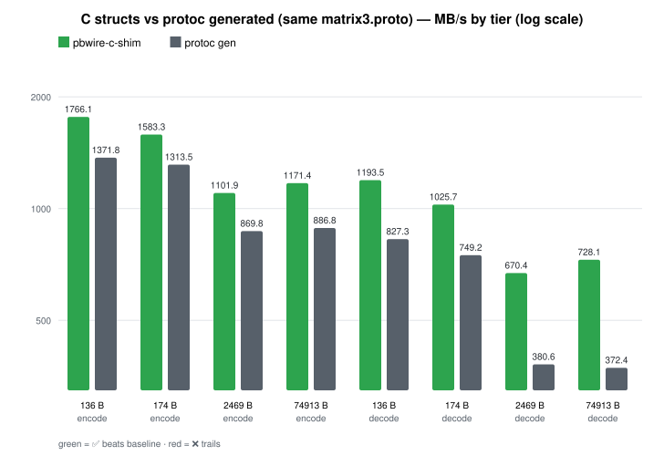

# pbwire C binding

Three pieces, like every language binding in this repo:

| Piece | Path | Role |
|---|---|---|
| 1. Binding runtime | [`runtime/`](runtime/) | generic struct codec: layout table, direct wire <-> struct (`pbw_struct_encode/decode/free`, plus the compiled `pbw_struct_codec`) |
| 2. Compiler plugin | [`plugin/`](plugin/) | `protoc-gen-pbwire-c`: `.proto` -> structs + layout tables |
| 3. Example | [`examples/`](examples/) | addressbook round-trip on plain structs |

The C binding is the core library itself plus this thin struct layer: no
wrapper objects, no code generation at build time, no runtime dependencies
beyond a C99 compiler (the plugin needs Go, but only maintainers run it).

Mechanisms: `tree` (the dynamic `pbw_ctx` value tree, `pbwire-c-tree` in
`make bench`) and `shim` (the struct codec reading C memory in place through
layout tables, `pbwire-c-shim` in `make bench-c`). No `core` arm: the C binding
*is* the shipped `src/`, so the third mechanism is the shipped core itself.
Contract: [`../README.md#pbench-three-arms-one-contract`](../README.md#pbench-three-arms-one-contract).

## Layout

| Piece | Path | Role |
|---|---|---|
| runtime | [`runtime/`](runtime/) | the struct codec (`pbw_struct.{h,c}`) |
| plugin | [`plugin/`](plugin/) | `protoc-gen-pbwire-c` (Go): `.proto` -> structs + layout tables |
| examples | [`examples/`](examples/) | addressbook round trip on plain structs |
| tests | [`tests/`](tests/) | byte-parity and failure-path self-checks (`matrix2`, `matrix3`, addressbook) |
| benchmarks | [`benchmarks/`](benchmarks/) | structs vs `protoc --cpp_out` on four tiers |
| conformance | [`conformance/`](conformance/) | how the official suite covers this binding |

## 1. Runtime

[`runtime/pbw_struct.h`](runtime/pbw_struct.h) declares the layout row
(field number -> struct offset) and the codec entry points. Application
structs stay plain data; the codec walks the layout rows and reads/writes
wire bytes directly — no `pbw_message` tree in between, which is what beats
generated code instead of merely keeping up with it (the same design as the
Erlang binding's hand-written `ep_encoder.c` / `ep_decoder.c`):

```c
static const pbw_struct_field_t person_fields[] = {
    {1, PBW_SF_STRING, 0, offsetof(Person, name), 0, 0, 0, 0, NULL, 0,
     PBW_TYPE_STRING, 2, 0, 0},
    ...
};
pbw_struct_encode(schema, "tutorial.Person", person_fields, 4, &person, &wire, &len);
```

The last four members (`type`, `wire`, `packed`, `required`) are the field's
wire facts, emitted by the plugin so the codec needs no schema lookup on the
hot path. A row that leaves `type` at 0 makes the codec resolve the field
through the schema instead, which is slower but identical — that is how
hand-written tables (and the tests) keep working. The `pbw_schema` stays the
truth for field numbers and proto2/proto3 semantics: the row count must match
the descriptor, and a row whose kind/wire type disagrees with its own `type`
is `PBW_ERR_INVALID`.

`decode` allocates (strings, bytes, arrays, sub-messages) into a zeroed struct.
`pbw_struct_arena_new_mem` gives that decode a caller-owned block instead of a
growable one: the block is the whole budget, an allocation that does not fit is
`PBW_ERR_NOMEM`, and freeing the arena releases nothing (the caller's memory
stays reusable) — the heap-free shape for firmware, next to `pbw_ctx_new_mem`
in the core.
Repeated fields grow by doubling from the count member, so a message with
empty repeated fields allocates nothing. Maps are repeated entry structs
into (no hash table: insertion order is the wire order, and a repeated key
is kept as two entries -- protobuf map semantics say last-wins, which this
array model does not collapse for you); oneof members share a union gated by
a case word (last one wins, like the reference); groups encode as
`START_GROUP` + message + `END_GROUP`. Extensions do get generated rows (see
`tests/gen/extensiontest.h`); `message_set_wire_format` extendees are
rejected at generation time because their framing is not representable.

### Two levels: one-shot calls and a compiled codec

The calls above resolve the schema and re-derive the wire facts on every
invocation. That is fine for a single message, but a hot loop wants the
layout compiled once:

```c
pbw_struct_codec *codec = NULL;
pbw_struct_buf out = {0};              /* reusable output buffer */
pbw_struct_arena *arena = NULL;        /* owns decoded memory */

pbw_struct_codec_init(&codec, schema, "tutorial.Person", person_fields, 4);
pbw_struct_codec_encode(codec, &person, &out);   /* out.data / out.len */
pbw_struct_codec_decode(codec, out.data, out.len, &arena, &got);
...
pbw_struct_arena_free(arena);          /* also invalidates `got` */
pbw_struct_buf_free(&out);
pbw_struct_codec_free(codec);
```

`pbw_struct_codec_init` resolves the message once and precomputes, per field,
an opcode (which value transform applies), the tag bytes, the struct offsets
and the sub-message plan. Encode and decode then dispatch on one small
opcode per field instead of looking facts up every time — that single change
is what closes the gap to `protoc --cpp_out`'s straight-line code.

Two buffers make the loop allocation-free:

- `pbw_struct_buf` is the encode output. It keeps its capacity, so repeated
  encodes reuse the same allocation. `pbw_struct_buf_free` releases it.
- `pbw_struct_arena` owns everything a decode allocates. Each decode resets
  it (so the previous tree becomes invalid), the blocks themselves are
  reused, and `pbw_struct_arena_free` releases them. Because the arena never
  moves a block, the pointers stored in the decoded struct stay valid.

With `arena == NULL` the decoder instead mallocs every string, array and
sub-message, exactly like the one-shot `pbw_struct_decode`; that tree is
released by `pbw_struct_free(fields, nfields, base)`. Never pass an
arena-decoded struct to `pbw_struct_free`: its pointers do not point at
individual allocations. Use the one-shot calls (or a NULL arena) when a
single message should own its memory.

## 2. Plugin

`plugin/` is a self-contained Go module (only dependency:
`google.golang.org/protobuf`). Its harness (`internal/pluginutil`,
`internal/core`) is ported from webpb's protoc plugin framework; the
generator (`internal/cgen`) is new.

```shell
make -C bindings/c/plugin test    # golden tests, protoc-free (replay dumps)
make -C bindings/c/plugin regen    # needs protoc: rebuild the pinned headers + descriptor sets
make -C bindings/c/plugin dump     # needs protoc: re-capture testdata dumps
```

Golden tests compare generator output byte-for-byte against
[`example/gen/addressbook.h`](examples/gen/addressbook.h) and
[`tests/gen/matrix{2,3}.h`](tests/gen/matrix3.h),
which are also the files the example and the self-check compile against:
the test and the build can never disagree. Each `.proto` has a single
source (`examples/addressbook.proto`, `tests/data/matrix{2,3}.proto`);
`testdata/` stores only the captured `CodeGeneratorRequest` dumps plus the
regen commands, so `make test` at the repo root never needs protoc.

```shell
make test    # from the repo root: also runs bindings/c/tests/test_struct
```

[`tests/test_struct.c`](tests/test_struct.c) is the binding self-check
(no framework, no dependencies): the generated structs encode to the exact
bytes `protoc --encode` produces (pinned `.bin` next to each `.proto`, from
the checked-in `.txt`), decode recovers every field, and layout mismatches,
missing required fields, truncated input and bad arguments all fail loudly.

A proto2 `required` scalar carries a `has_` flag too (the generated header
adds `int has_id;` next to `int32_t id`). The encoder still writes the value
unconditionally — a struct is encoded as it stands — but the decoder sets the
flag as the value arrives and a decode missing it fails with
`PBW_ERR_REQUIRED`, so a wire that drops a required scalar cannot pass as
complete. Pointer kinds (`required string`/`bytes`/message) need no flag:
NULL is the absence signal, and repeated fields use their count.

## 3. Example

[`example/addressbook.c`](examples/addressbook.c) mirrors the shared
[`examples/addressbook.proto`](../../examples/addressbook.proto) (the
classic tutorial schema) with plain structs and the generated wrappers:

```c
tutorial_person_t people[] = {
    { .name = "Alice", .id = 1, .phones = alice_phones, .n_phones = 1 },
    ...
};
tutorial_address_book_t book = { .people = people, .n_people = 2 };
tutorial_address_book_encode(schema, &book, &wire, &wire_len);
tutorial_address_book_decode(schema, wire, wire_len, &got);
tutorial_address_book_free(&got);
```

The schema comes from [`examples/addressbook.desc`](../../examples/addressbook.desc)
(written by `protoc --descriptor_set_out`, never embedded): the generated
header only provides its path (`ADDRESSBOOK_DESC_PATH`), and one
`pbw_struct_schema_load()` call loads every message in the file. No
per-message setup and no hand-written schema code remain in the example.
Run from the repo root so the relative path resolves.

Run it: `make examples` from the repo root.

Every binding example in this repo follows the same shape (the C++ one
in [`bindings/cpp/`](../cpp/) mirrors it line for line):

1. Fill the generated structs with literals (the language's own
   assignment: designated initializers in C, aggregate init in C++).
2. Load the schema once (`pbw_struct_schema_load` reads the whole
   `FileDescriptorSet`, so every message in the file comes with it).
3. `encode` the struct, `decode` the bytes back, compare the two structs
   field by field.
4. Silent on success: no output, exit code only (`0` = equal).

Two things to notice when reading the example:

- The `.proto` is proto2 (`required` fields), so the schema switches
  dialect with `pbw_schema_set_proto3(schema, 0)`.
- Absent enums decode to their proto default (`type = 2 [default = HOME]`
  yields `HOME` with `has_type == 0`); the layout row carries it.

## Benchmarks

[`benchmarks/bench_struct.cc`](benchmarks/bench_struct.cc) measures the
generated structs against the official C++ generated code (`protoc
--cpp_out`) on the same `tests/data/matrix3.proto` message, at the four
standard tiers from [`../../BENCHMARKS.md`](../../BENCHMARKS.md) (small /
medium / large / xlarge scale the repeated fields x0 / x1 / x100 / x3000).
Tables use the same `impl op ns/op MB/s` columns as `bench/bench.cc`, so the
root document can aggregate them.

```shell
make bench-c    # from the repo root; needs protoc + libprotobuf like `make bench`
```

It checks struct encode == `protoc` bytes (plus a decode→encode round trip)
before timing. Both sides reuse their output storage: generated code an
`std::string` that keeps its capacity, the struct codec one `pbw_struct_buf`
and one `pbw_struct_arena`.

With the compiled codec the struct binding is ahead of `protoc --cpp_out` on
every tier and both ops. The link-time encode budget (one suffix sum per plan
level, a single reserve per message) closed the last small-tier gap, where
generated straight-line code has so little work per field that the per-field
dispatch used to be all that was left to pay. The gap grows with message size
because `SerializeToString` walks the message twice (size, then write) while
the struct encoder writes in one pass:

The harness also prints a `pbwire-c1` block: the one-shot API, which compiles
the layout on every call and mallocs every value. It is 3-5x slower, which is
the price of that convenience — the point of the extra block is to keep the
trade-off visible rather than hidden.

### C structs vs `protoc` generated (same `matrix3.proto`)



The `pbwire-c-shim` rows are the struct codec reading C memory in place. Both
sides build a fresh native struct per iteration inside the timer (fill +
encode + free); the output buffer stays reused per side, the same reuse the
harness always had. The dynamic tree still appears in `make bench`'s proxy
rows for the same message, and `pbwire-c1` stays the one-shot probe.

| payload | op | pbwire-c-shim (MB/s, x gen) | protoc gen (MB/s) |
|---|---|---|---|
| 136 B | encode | 1693.2 (2.37x ✅) | 715.9 |
| 136 B | decode | 1292.5 (1.45x ✅) | 892.2 |
| 174 B | encode | 1211.9 (1.89x ✅) | 641.4 |
| 174 B | decode | 1098.6 (1.38x ✅) | 794.2 |
| 2469 B | encode | 1128.1 (3.96x ✅) | 284.9 |
| 2469 B | decode | 701.6 (1.75x ✅) | 401.5 |
| 74913 B | encode | 1148.2 (4.10x ✅) | 280.2 |
| 74913 B | decode | 754.5 (2.01x ✅) | 375.6 |

The struct codec writes and reads wire bytes directly from the layout tables;
there is no dynamic message tree in between. Four changes got it ahead of
generated straight-line code instead of ~1.7x behind it:

- a compiled codec (`pbw_struct_codec`) that resolves the schema once and
  precomputes an opcode and the tag bytes per field, so the per-field work is
  one small dispatch instead of a schema/type lookup;
- an fnum -> field map plus a precomputed free list on the decode side, so a
  field tag is one indexed load and releasing a tree only visits the rows that
  own memory;
- caller-owned buffers: one reused `pbw_struct_buf` for the output and one
  reused `pbw_struct_arena` for decoded memory, so a steady-state loop does not
  touch the allocator at all (an arena block never moves, so decoded pointers
  stay valid);
- a link-time encode budget (`tail`, one suffix sum per plan level): a
  single reserve at level entry covers every singular scalar, so those write
  through a hoisted cursor with no capacity check at all (measured 136 B
  encode 0.93x -> 1.05x; per-field reserves chained every check through
  `b->len`, which is what the last 7 ns were).

The struct encoder's single pass
(where `SerializeToString` walks the message twice: size, then write) and the
decode arena (no per-value malloc, no free walk) dominate at every tier; the
link-time budget above is what closed the last small-tier gap, where
generated straight-line code has no per-field dispatch at all.

The harness also prints a `pbwire-c1` block: the one-shot API, which compiles
the layout per call and mallocs per value (7.1x / 6.0x slower at 136 B, 4.0x /
4.6x at 174 B, and down to ~1.0x / ~1.7x from 2.5 KB up, where the per-call layout
compile is amortised). It stays in the
output so that trade-off is visible rather than hidden.

Concurrency (same tree, `build/test_concurrency`, 8 threads x 200 iters:
3200 verifications, 0 failures): scale encode 1thr 286.7 MB/s (669.6 ns/op),
8thr 262.9 MB/s/thread, agg 2103.6 MB/s. The C++ mirror
(`build/test_cpp_concurrency`, same engine, no separate bench section) passes
the same way: 8 threads x 200 iters, 4800 verifications, 0 failures; scale
encode 1thr 292.9 MB/s (655.6 ns/op), 8thr agg 1234.2 MB/s (155.6 ns/op).

## Generated models

The struct binding *is* the generated model: `plugin/` generates the C structs, the
enum typedefs and the layout tables, with the `.proto` type named in each field
comment (`int32_t color; /* optional, structtest.Color3 */`). `tests/gen/` and
`examples/gen/` hold the pinned output; `examples/addressbook.c` assigns struct
literals and calls the generated `*_encode`/`*_decode` wrappers only.

For every other language, `../../codegen/` generates the same kind of generated layer;
see `../../codegen/README.md`.

