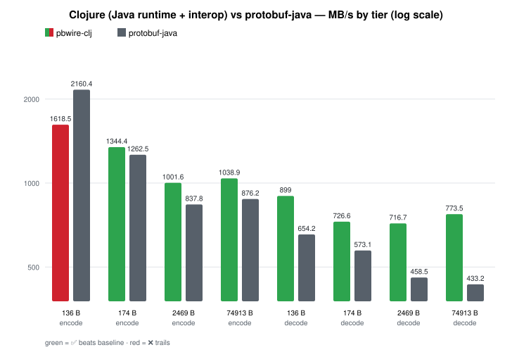

# pbwire Clojure binding

`bindings/clojure/runtime` is the Clojure binding. Clojure runs on the JVM, so
it uses the Java binding's runtime (`bindings/java/runtime`: the pure-Java
codec, no JNI, no native library) through plain interop, exactly how Kotlin
reuses the same runtime. There is no second codec and no second schema path --
a `FileDescriptorSet` is loaded at run time and the Java codec owns the bytes.
Clojure adds only the idiom: persistent maps in and out, plus thin
`encode`/`decode` fns.

```clojure
(require '[pbwire.core :as pb])

(def schema (pb/load-schema "tests/data/sample.desc"))
(def ty (pb/message-type schema "pbwire.test.Sample"))

(def wire (pb/encode ty {:string_field "alice"
                         :numbers [1 2]
                         :inner {:x 7}}))

(pb/decode ty wire)
;; => {:string_field "alice", :inner {:x 7}, :numbers [1 2]}
(pb/close! schema)
```

Maps take keywords or strings as keys (`(name k)` is the lookup, so both
work); decoded maps use keywords. Singular integers are longs (`uint64` above
`Long/MAX_VALUE` reads as the same raw bits, i.e. negative), floats and
doubles are doubles, bytes fields are byte arrays, nested messages are maps,
and repeated fields are sequentials. Absent fields are absent from decoded
maps; encoding skips nil values, writes fields in schema order, and throws on
an unknown key or a wrong value kind. A field the schema does not declare has
no name, so it decodes to nothing -- use the Java API directly if you need
the raw unknown bytes.

## Build and run

```shell
./build.sh          # javac the Java runtime, fetch the Clojure jars once,
                    # run the clojure.test suite and the example
```

`build.sh` needs JDK 17+ and network access to Maven Central on first run
(Clojure 1.12.0 + spec.alpha + core.specs.alpha, pinned; override with
`CLOJURE_JAR` / `SPEC_ALPHA_JAR` / `CORE_SPECS_ALPHA_JAR`). Everything else
is checked in: the fixture descriptor sets live next to the Java binding's
tests, and no `protoc` run is needed. `deps.edn` declares the same sources
for editors (`:test` / `:examples` / `:bench` / `:conformance` aliases add
each leaf directory); the compiled Java runtime still comes from `build.sh`
(plain `javac`, like the Java binding itself).

## API

| fn | role |
|---|---|
| `load-schema` / `load-schema-bytes` | `FileDescriptorSet` path or bytes → schema |
| `message-type` | fully qualified name → type |
| `encode` | type + map → wire `byte[]` |
| `decode` | type + wire `byte[]` → persistent map |
| `close!` | retires a schema |

## Benchmarks

```shell
./benchmarks/bench.sh    # vs protobuf-java generated code, four tiers
```

The four tiers are small / medium / large / xlarge (the repeated fields scaled
x0 / x1 / x100 / x3000). The baseline is `protoc --java_out` code compiled at bench
time; both sides must produce identical bytes before anything is timed, and
both allocate per call. The baseline is
a direct `toByteArray` call: the measured value carries a type hint so the
call compiles direct. An unhinted local reflects (~800 ns a call here) and
never warms, which once inflated this row past 9x. The persistent-map fns
stay for convenience and are gated for parity, but hot loops use the
mutable path.

The small tiers are where a persistent map per message would lose: 3000
submaps and 12000 boxed ints on the xlarge tier plus a per-field interop
call cannot race a generated straight-line writer, and map materialization on decode is the same structural cost the Python dict path pays against upb. If a hot loop needs the Java row's speed, call the Java runtime directly -- it is already on the classpath.

### Clojure (Java runtime + interop) vs `protobuf-java`



| payload | op | pbwire-clj-core (MB/s, x protobuf-java) | protobuf-java (MB/s) |
|---|---|---|---|
| 136 B | encode | 19.8 (0.01x ❌) | 1476.3 |
| 136 B | decode | 41.9 (0.06x ❌) | 672.7 |
| 174 B | encode | 19.0 (0.02x ❌) | 956.2 |
| 174 B | decode | 38.7 (0.07x ❌) | 585.0 |
| 2469 B | encode | 10.7 (0.03x ❌) | 420.5 |
| 2469 B | decode | 174.3 (0.37x ❌) | 476.4 |
| 74913 B | encode | 10.8 (0.02x ❌) | 477.9 |
| 74913 B | decode | 268.3 (0.58x ❌) | 464.3 |

`core` is the mutable-message fast path and the published comparison: a fresh `Message` per iteration (build + fill + encode + close; decode plus a deep read-back of every gate-checked field), the generated
model's native object with no map walk. The persistent-map API stays for
convenience and is gated for parity, but hot loops use the mutable path — the
same split the README documents (maps for convenience, the mutable path for
hot loops) and Lua documents (table vs builder). The per-field `tree` map-API
arm is compared in `pbench/` (see its README), not here.
Formal run
`../../results/bench-clojure-20261124T110510Z.json`.

The timed path builds a fresh mutable message per iteration (fill + encode + close, with the same deep read-back as the tree arm on decode and no map materialization), like the Java row, and the
baseline builds a fresh message per iteration for its direct `toByteArray` call: the measured type carries a hint so
the call compiles direct. An unhinted local reflects (~800 ns a call here)
and never warms, which once inflated this row past 9x. The persistent-map
fns stay for convenience and are gated for parity, but hot loops use the
mutable path — the same split Lua documents (table vs builder). Same codec
as Java/Scala underneath (plain interop over the Java runtime, no second
wire implementation), byte parity per tier.

The stale community alternative,
[ninjudd/clojure-protobuf](https://github.com/ninjudd/clojure-protobuf)
(last release 2013, protobuf 2.x), is not a baseline: it cannot read current
descriptor sets.

## Conformance

`conformance/testee.clj` speaks the runner's wire protocol (4-byte
little-endian framing) on the same dynamic schema as the Java testee: binary
in both directions through `to-json`/`from-json`/`to-text`/`from-text`, only JSPB answers `skipped` (the binding has no printers,
like the Python and Ruby testees). The parent wires the `make
conformance-clojure` target; from `conformance/`:

```shell
java -cp <clojure jars>:../../java/out/classes:../runtime/src:. \
  clojure.main -m testee ../../build/conformance.desc
```

## Why not a copy of the Java runtime?

A second copy of the codec tables would be a second thing to keep in sync
with the descriptor format for zero benefit: Clojure calls Java methods with
no marshalling cost, and the JVM is the same host either way. The ownership
and threading rules are the Java binding's: a schema is safe to share between
threads, a message belongs to one thread, and `close!` retires a schema
(the per-call messages `encode`/`decode` build are already closed when they
return).

The one wart is honest: `MessageType` keeps its field table in a
package-private slot, and Clojure is not in the package, so `pbwire.core`
reads it once per type with `setAccessible` and caches the result. If the
Java binding ever exposes its field list, that reflection (five lines in
`type-info`) should go away.

## Generated models

`protoc-gen-pbwire` (in `../../codegen`) emits `<base>.clj` (map
constructors plus `encode`/`decode` over this same dynamic API) and
`<base>_meta.clj` (the embedded descriptor set plus its loader).
`--pbwire_opt=lang=clojure[,model=bool][,register=bool][,registry=bool]`
(all default `true`): `model=false` skips the constructors for
dynamic-only users; `register=false` delays type resolution so
`init-schema` (embedded bytes by default, external bytes for the
descriptor mode) must run first; `registry=false` drops `message-names`
+ `preload`.

