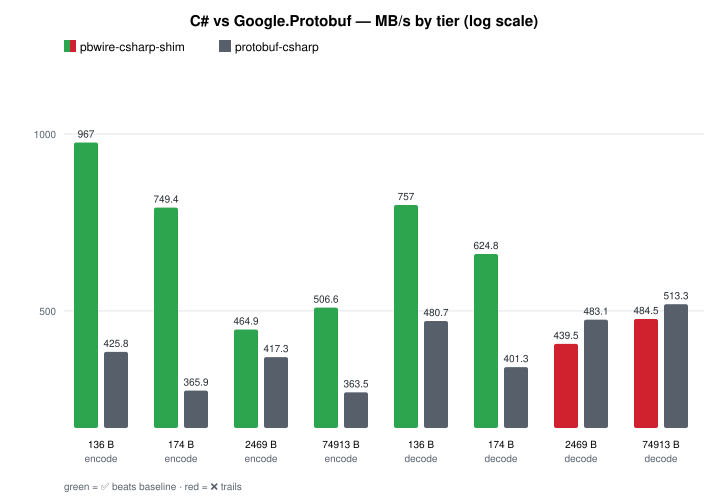

# pbwire C# binding

`bindings/csharp/Pbwire` is the C# binding: `DllImport` over the C ABI in
[`include/pbwire.h`](../../include/pbwire.h), with a `DllImportResolver` that
loads `PBWIRE_LIB` (else `build/libpbwire.{dylib,so}` found above the working
directory). A `FileDescriptorSet` (`protoc --descriptor_set_out`) becomes the
schema at run time; there is no generated code and no C glue. The wire format
lives in the C core, so a C# message and a C message are the same bytes by
construction.

```csharp
using Pbwire;

using var schema = Schema.FromFile("tests/data/matrix3.desc");
var ty = schema.Message("structtest.Scalars3");
var innerTy = schema.Message("structtest.Inner3");

using var msg = ty.NewMessage()
    .Set("i32", -42L)
    .Set("str", "alice");
foreach (var tag in new[] { "a", "bb" })
{
    msg.Set("tags", tag);                       // repeated: appends
}
msg.SetMessage("inner")                         // nested: created in place
   .Set(innerTy.Field("name"), "kid")
   .Set(innerTy.Field("value"), 42L);

var wire = msg.Encode();
using var decoded = ty.Decode(wire);            // unknown fields preserved
if (!decoded.Encode().SequenceEqual(wire))
{
    throw new InvalidOperationException("round trip differs");
}
```

Fields are addressed by name (`"i32"`) or by a `Field` handle from
`ty.Field("i32")`; the handle skips the name lookup and is what a hot loop should
reuse.

## Requirements

The .NET SDK 8+ (built and tested with 10), `make shared`, and nothing else: the
binding project has no package references. `PBWIRE_LIB` overrides the library
path.

## Build and run

```shell
dotnet run --project tests -- ../c/tests/data/matrix3.desc      # self-check
dotnet run --project examples -- ../c/tests/data/matrix3.desc   # example
```

## Benchmarks

```shell
./benchmarks/bench.sh    # vs Google.Protobuf C#, four tiers
```

Needs `protoc` and NuGet access (`dotnet restore` fetches `Google.Protobuf`).
The four tiers are small / medium / large / xlarge (the repeated fields scaled
x0 / x1 / x100 / x3000). `pbwire-csharp-shim` is the published native-object entry, one call per
op (see `pbench/README.md` for the recorded deviation: the C core has no
offset reader, so every field still crosses once); the per-field `tree` build is a
`pbench/`-only arm (see `pbench/README.md`):

#### C# vs Google.Protobuf



| payload | op | pbwire-csharp-shim (MB/s, x protobuf-csharp) | protobuf-csharp (MB/s) |
|---|---|---|---|---|
| 136 B | encode | 919.6 (2.24x ✅) | 409.9 |
| 136 B | decode | 757.8 (1.61x ✅) | 471.2 |
| 174 B | encode | 698.5 (1.99x ✅) | 350.7 |
| 174 B | decode | 603.6 (1.57x ✅) | 385.4 |
| 2469 B | encode | 446.5 (1.02x ✅) | 435.8 |
| 2469 B | decode | 373.4 (0.77x ❌) | 483.7 |
| 74913 B | encode | 483.0 (1.32x ✅) | 365.5 |
| 74913 B | decode | 385.3 (0.77x ❌) | 498.9 |

The pbwire column is the native-in/native-out full task
(`pbench/`, formal run
`../../results/bench-csharp-20261124T191013Z.json`): `shim` runs it in one P/Invoke
per op. The per-field `tree` arm is compared in
`pbench/README.md`, not here.

`pbwire-csharp-shim` is the shipped native-object path:
the generated model is copied into one contiguous unmanaged image per op and
**one** `P/Invoke` (`native/pbw_cs_shim.c`, built by
`make csharp-shim-native`) walks it through the C layout codec, so no field
crosses the boundary. It is above Google.Protobuf on every encode tier
(1.02x-2.24x) and on the two small decode tiers (1.61x/1.57x). The 2469 B and
74913 B decode rows are below the baseline (0.77x, 0.77x): the C decode itself
is faster than the reference parser, but materialising 3000 ints, 3000 strings,
3000 sub-messages and 3000 bools into managed objects costs more than the
reference parser's whole run.

The native `shim` rows land at ~500 MB/s encode and ~380 MB/s decode on the
xlarge tier: by 2.5 KB the per-call boundary is invisible and the C layout
codec plus the managed materialisation are what is being measured. That is the
point of the schema-at-runtime design -- the binding owns ergonomics, the core
owns the format.

The pure-C# core port is compared in `pbench/README.md`, not here.

Strings cross as NUL-terminated C strings, so `Set(field, string)` stops at the
first NUL byte: use the `ReadOnlySpan<byte>` overload for binary payloads (a
`string` field accepts them too, which is how protobuf's wire format works).

## Pure-C# core (no native library)

`bindings/csharp/Pbwire/Core/` is a second, self-contained engine with no
`DllImport`: it reads the same `FileDescriptorSet`, builds its own schema, and
encodes/decodes the same bytes, so a deployment with no C toolchain and no
`libpbwire` still uses pbwire. Nothing in `Pbwire.cs` changes: the P/Invoke
binding stays the default. The F# facade still rides the P/Invoke binding;
wiring it to this core is a separate change.

```csharp
using Pbwire.Core;

var schema = Schema.FromFile("../c/tests/data/matrix3.desc");
var ty = schema.Message("structtest.Scalars3");
var msg = ty.NewMessage().Set("i32", -42).Set("str", "alice");
msg.Add("tags", "a").Add("tags", "bb");        // repeated: appends (converted)
msg.NewMessage("inner").Set("name", "kid");

byte[] wire = ty.Encode(msg);                  // byte-identical with the C core
Msg back = ty.Decode(wire);                    // unknown fields retained
byte[] again = ty.Encode(back);                // byte-exact round trip
```

`ty.DecodeObject(wire)` / `ty.EncodeObject(dict)` are the plain-object forms the
pbench `core` arm times (prebuilt plain object in, conversion plus codec per
call -- the honest full task, not a prebuilt tree). Scope is the binary codec and the same subset the C
core owns: descriptor reader, encode, decode with unknown retention, groups,
packed runs, oneof, presence, proto2 required fields, depth/size limits, strict
tags and lengths, UTF-8 validation on proto3 strings. There is no JSON or text
printer and no deterministic/delimited/WKT helper in this core (use the P/Invoke
binding for those). `long`/`ulong` edges round-trip exactly, and no field takes
a `byte[]` on the hot path: repeated elements are boxed slots, strings/bytes
decoded off the wire stay slices of the input until read.

`make conformance-csharp` runs the official binary suite through it: 1412
successes, 1403 skipped (JSON/text input and output), 2 expected failures, 0
unexpected, same failure set as the C core. Numbers: `BENCHMARKS.md` and
`pbench/README.md`; the honest full-task row trails the generated codec on
most cells (small-encode 0.67x/0.71x is its best) because every op converts
the plain object into the boxed tree and back, so it is the no-toolchain
arm, not the shipped fast path.

## Ownership and threads

A `Schema` and a root `Message` own native memory: `Dispose()` frees it. A
`MessageType` keeps its `Schema` (and a `Message` its `MessageType`) reachable,
so the GC cannot free the schema under a live type or message; `Dispose()` is
still the caller's promise that nothing else uses it. A nested message is a view
of its parent, holds it alive through a `Parent` reference, and never frees
anything. Nothing is shared, so one tree belongs to one thread, like the C core.

## Generated models

`protoc-gen-pbwire` (in `../../codegen`) generates Google.Protobuf-shaped
sealed classes: the same property names, `RepeatedField<T>` for repeated,
`KindOneofCase` for oneofs, `Has`+`Clear` for optional, and
`Parser.ParseFrom` / `ToByteArray` / `WriteTo` / `CalculateSize` /
`Clone` / `Equals` over the embedded schema — no schema argument at use
sites. Each file splits in two: `<base>.cs` (models) and
`PbwireFile_<Stem>.cs` (the holder: embedded set plus its loader).
`--pbwire_opt=lang=csharp[,model=bool][,register=bool][,registry=bool]`
(all default `true`): `model=false` leaves the holder for dynamic-only
users; `register=false` drops the eager static constructor so `Init()`
(embedded) or `UseSchema()` (external `Schema`, dual registration) must run
first; `registry=false` drops `MessageNames` + `Preload()`.
Deliberate deltas from protoc output: no `IMessage` (a streaming
`MergeFrom` would need a second wire reader) and no `Descriptor`; use the
dynamic `Schema` for reflection. The committed output is `generated/gen/` (tests)
and `examples/gen/` (example); `oracle/gen_oracle/` holds the pinned
protoc output (`extern alias Oracle` in `GeneratedTest.cs` proves byte and field
parity, T1–T6). See `../../codegen/README.md`.

## Core coverage

P/Invoke reaches the whole core through the binding; nothing is re-implemented:

| member | what it does |
|---|---|
| `MessageType.ParseJson(text, ignoreUnknown, maxBytes, maxDepth)` / `Message.PrintJson()` | JSON mapping, bounded |
| `MessageType.ParseText(text, maxBytes, maxDepth)` / `Message.PrintText(printUnknown)` | text format, bounded |
| `Message.EncodeDeterministic()` | map entries sorted by key |
| `Message.EncodeDelimited()` / `MessageType.DecodeDelimited(wire)` | framing, returns `consumed` |
| `Message.EncodedSize()` | exact size without writing |
| `MessageType.Visit(wire, callback)` | single-level scan; `false` stops it without throwing |
| `MessageType.AnyPack(url, payload)`, `Message.AnyTypeUrl()`/`AnyPayload()`, `MessageType.TimestampFromMillis(ms)` (+ duration), `Message.TimestampMillis()`/`DurationMillis()`, `Message.FieldMaskPaths()` | WKT helpers |
| `Schema.ServiceCount()`/`ServiceAt(i)`/`Service(name)`, `Schema.ResolveMethod(service, method)` | routing metadata |

