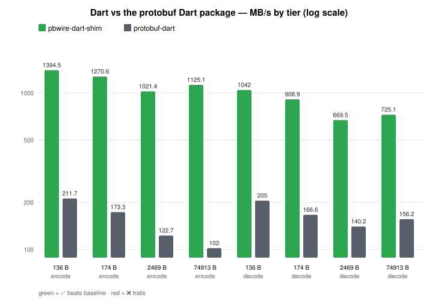

# pbwire Dart binding

`bindings/dart/lib/pbwire.dart` is the Dart binding: `dart:ffi` over the C ABI in
[`include/pbwire.h`](../../include/pbwire.h). A `FileDescriptorSet`
(`protoc --descriptor_set_out`) becomes the schema at run time; there is no
generated code and no C glue. The wire format lives in the C core, so a Dart
message and a C message are the same bytes by construction.

```dart
import 'package:pbwire/pbwire.dart';

final schema = Schema.load('tests/data/matrix3.desc');
final ty = schema.message('structtest.Scalars3');
final innerTy = schema.message('structtest.Inner3');

final msg = ty.newMessage()
  ..setInt('i32', -42)
  ..setString('str', 'alice');
for (final tag in ['a', 'bb']) {
  msg.setString('tags', tag);                       // repeated: appends
}
msg.setMessage('inner')                             // nested: created in place
  ..setString(innerTy.field('name'), 'kid')
  ..setInt('value', 42);

final wire = msg.encode();
final decoded = ty.decode(wire);                    // unknown fields preserved
assert(decoded.at('tags', 1)?.asString() == 'bb');
assert(_equals(decoded.encode(), wire));            // byte-exact round trip
```

Fields are addressed by name (`'i32'`) or by a `Field` handle from
`ty.field('i32')`; the handle skips the name lookup and is what a hot loop should
reuse.

## Requirements

The Dart SDK (3.x) and `make shared` (`build/libpbwire.dylib` / `.so`).
`PBWIRE_LIB` points at the library; otherwise it is found by walking up from the
working directory or the entry script. The only package dependency is
`package:ffi`, for `malloc` and `toNativeUtf8`/`toDartString`.

## Build and run

```shell
dart pub get
./build.sh                                          # the C-side layout reader (libpbwire_dart)
dart run tests/selftest.dart                        # self-check vs pinned protoc bytes
dart run tests/layout_test.dart                     # the native-object `shim` path
dart run examples/roundtrip.dart                    # example
```

`./build.sh` compiles `native/pbw_dart_shim.c` with the C binding's
`pbw_struct` codec and the core into `build/libpbwire_dart.{dylib,so}` (found by
`PBWIRE_DART_LIB`, else by walking up). On a x86_64/host toolchain this is just
`cc` and `build/libpbwire.a`; `make dart-test` and `make conformance-dart` build
it first.

## Benchmarks

```shell
cd benchmarks && dart pub get && ./bench.sh         # vs the protobuf Dart runtime, four tiers
make dart-bench                                     # the recorded run (results/)
```

Needs `dart pub global activate protoc_plugin` (it provides `protoc-gen-dart`;
add `~/.pub-cache/bin` to `PATH`). The four tiers are small / medium / large /
xlarge (the repeated fields scaled x0 / x1 / x100 / x3000).

#### Dart vs the `protobuf` Dart package



| payload | op | pbwire-dart-shim (MB/s, x protobuf-dart) | protobuf-dart (MB/s) |
|---|---|---|---|
| 136 B | encode | 287.7 (2.73x ✅) | 105.2 |
| 136 B | decode | 1062.4 (5.16x ✅) | 205.7 |
| 174 B | encode | 254.6 (2.67x ✅) | 95.2 |
| 174 B | decode | 917.0 (5.33x ✅) | 171.9 |
| 2469 B | encode | 143.9 (1.56x ✅) | 92.3 |
| 2469 B | decode | 707.6 (4.80x ✅) | 147.3 |
| 74913 B | encode | 153.6 (1.80x ✅) | 85.1 |
| 74913 B | decode | 784.0 (4.96x ✅) | 158.1 |

The pbwire column is the native-in/native-out full task
(`pbench/`, formal run
`../../results/bench-dart-20261124T103430Z.json`): `shim` runs it in one FFI call
over the flat `<Message>Layout`. The per-field `tree` arm is compared in
`pbench/README.md`, not here.

`pbwire-dart-shim` is the shipped native-object path: the
generated `<Message>Layout` is a `dart:ffi` `Struct`, and
`native/pbw_dart_shim.c` walks that image in place through the C
binding's `pbw_struct` codec -- one FFI call per op, no per-field crossing. It
is above the baseline at every tier (1.56x-2.73x encode, 4.80x-5.33x decode)
because
the codec runs in C and the boundary is paid once; only the `Uint8List` copy of
the result remains. The shim row is the headline for native objects.

The pure-Dart core port is compared in `pbench/README.md`, not here.

`pbwire-dart-shim` is the published native-object entry; the per-field `tree`
build lives in `pbench/`. The three pbench arms:

| arm | mechanism | what it answers |
|---|---|---|
| `tree` | the prebuilt `Message` handle: one `set` per field to build, `encode()`; `decode()` then one `get` per field | what the per-field downcall task costs once the tree exists |
| `shim` | the generated `<Message>Layout` (`dart:ffi` `Struct`) is the native object; `PbwireLayout.encode` / `decodeInto` make one FFI call and `native/pbw_dart_shim.c` walks that memory in place through `pbw_struct_codec_*` | is a boundary worth paying for at all |
| `core` | the pure-Dart core (`lib/core/`, no `dart:ffi`, no `dart:io`): one entry per field on a `Msg` tree, `encode()`; `decode()` then one `get` per field | what the wire costs with no boundary at all, and the only arm that runs on dart2js/dart2wasm |

The `shim` row is the one a caller with its own native image pays, and `core` is the row for targets
without a C library. The gate, the provisional table and the verdict are in
[`pbench/README.md`](pbench/README.md).

## Conformance

`make conformance-dart` runs the official binary/JSON/text suite through
`conformance/testee.dart` on `build/conformance.desc`; it passes with the same
two expected failures as the C testee. `make conformance-dart-core` runs the
same suite through the pure core (`conformance/testee_core.dart`): binary in
and out, 1412 successes, 1403 JSON/text requests skipped, 2 expected failures,
0 unexpected. `make dart-core-web` compiles the core to dart2js and dart2wasm
and runs the edge-value check under node (`int` is a double there, so every
64-bit kind is BigInt).

Strings cross as NUL-terminated C strings, so `setString()` stops at the first
NUL byte: use `setBytes()` for binary payloads (a `string` field accepts them
too, which is how protobuf's wire format works).

## Ownership and threads

A `Schema` and a root `Message` own native memory: `close()` frees it, and a
`Finalizer` catches the ones that are not closed. A `Type` keeps its `Schema`
(and a `Message` its `Type`) reachable, so garbage collection cannot free the
schema under a type or message; an explicit `close()` is still the caller's
promise that nothing else uses it. A nested message is a view of its parent,
holds it alive, and never frees anything. `dart:ffi` state is per-isolate, and a
message tree is not shared: one tree belongs to one isolate, like the C core.

## Generated models

`protoc-gen-pbwire` (in `../../codegen`) generates Dart classes with typed
fields in protobuf-dart shape (`create`, `writeToBuffer`/`fromBuffer`,
`hasX`/`clearX`/`ensureX`, `whichX` for oneofs, `ProtobufEnum` enums, `Int64`
for 64-bit fields) over the dynamic API, with the `FileDescriptorSet`
embedded: no `.desc` file at use time, and the wire stays in the C core. The
committed output is `tests/gen/` (plus the protoc-gen-dart oracle in
`tests/gen_oracle/`, pinned in `pubspec.lock`) and `examples/gen/`;
`examples/roundtrip.dart` assigns typed fields only. Beside each message the
emitter also writes a `final class <Message>Layout extends ffi.Struct`, the
`<message>LayoutRows` table (field number, kind, offset, presence/count slots,
sub-message full name, oneof case, precomputed wire facts) and the
`<message>LayoutOffsets`/`<message>LayoutNumbers` lists; the C-side reader
consumes those rows through the C binding's `pbw_struct` codec. Each file
splits in two:
`<base>.dart` (facades) and `<base>_meta.dart` (the embedded descriptor set
plus its loader, imported by the models file).
`--pbwire_opt=lang=dart[,model=bool][,register=bool][,registry=bool]`
(all default `true`): `model=false` leaves the schema library for
dynamic-only users; `register=false` drops the lazy per-isolate load so
`initSchema()` (embedded bytes) or `useSchema()` (an external `Schema`,
dual registration) must run first; `registry=false` drops `messageNames` +
`preload()`. See `../../codegen/README.md`
and `../../codegen/testdata/TESTSPEC.md` (T1–T6, run by `tests/generated_test.dart`).

## Core coverage

Every core entry point the binding adds is a thin `dart:ffi` wrapper over the
same C implementation:

| member | what it does |
|---|---|
| `Type.parseJson(text, ignoreUnknown:, maxBytes:, maxDepth:)` / `Message.printJson()` | JSON mapping, bounded |
| `Type.parseText(text, maxBytes:, maxDepth:)` / `Message.printText([printUnknown])` | text format, bounded |
| `Message.encodeDeterministic()` | map entries sorted by key |
| `Message.encodeDelimited()` / `Type.decodeDelimited(wire)` | framing, with `consumed` |
| `Message.encodedSize()` / `Message.encodeTo(nativeBuffer, cap)` | exact size; encode into caller-allocated native memory |
| `Type.visit(wire, cb)` | single-level scan, no tree (`NativeCallable`) |
| `Message.anyTypeUrl()`/`anyPayload()`, `Type.anyPack(...)`, `Message.timestampMillis()`/`Type.timestampFromMillis(ms)` (+ duration), `Message.fieldMaskPaths()` | WKT helpers |
| `Schema.serviceCount`/`serviceAt`/`service(name)`, `Schema.resolveMethod(service, method)` | routing metadata |
| `decodeLimits(..., maxBytes:, maxDepth:)` and the same options on every parse | input bounds |

