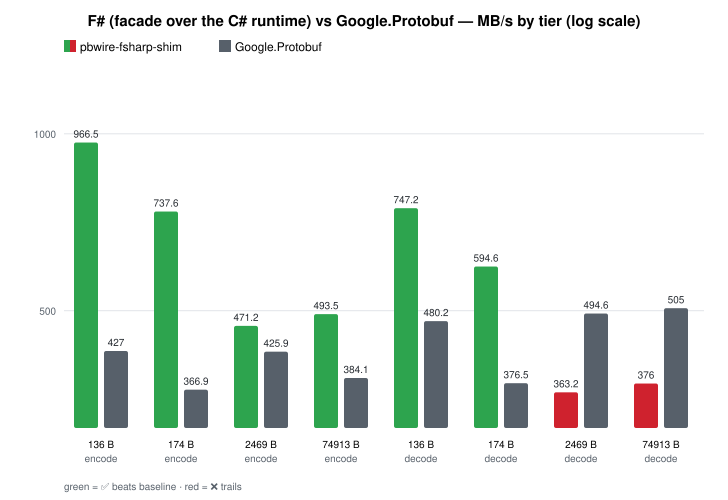

# pbwire F# binding

`bindings/fsharp/runtime` is the F# binding: an idiomatic facade over the C#
binding's dynamic API (`../csharp/Pbwire`), which is P/Invoke over the C ABI in
[`include/pbwire.h`](../../include/pbwire.h). Like Kotlin over Java, this adds
no wire code and no second schema path: a `FileDescriptorSet`
(`protoc --descriptor_set_out`) becomes the schema at run time, and the wire
format lives in the C core, so an F# message and a C message are the same bytes
by construction.

```fsharp
open Pbwire.FSharp

use schema = Pbwire.schema "tests/data/matrix3.desc"
let ty = Pbwire.messageType schema "structtest.Scalars3"
let innerTy = Pbwire.messageType schema "structtest.Inner3"

use msg =
    Pbwire.build ty (fun msg ->
        Pbwire.setAll msg [ "i32", Int -42L; "str", Text "alice" ] |> ignore
        msg.Set("tags", "a") |> ignore
        Pbwire.nested msg "inner" (fun inner ->
            inner.Set(innerTy.Field "name", "kid") |> ignore)
        |> ignore)

let wire = Pbwire.encode msg
use decoded = Pbwire.parse ty wire            // unknown fields preserved
if decoded.Encode() <> wire then
    failwith "round trip differs"
```

Fields are addressed by name (`"i32"`) or by a `Field` handle from
`ty.Field("i32")`; the handle skips the name lookup and is what a hot loop
should reuse. `FieldValue` (`Int`/`Bool`/`Float`/`Double`/`Text`/`Bytes`) is the
record-friendly write path for `setAll`; singular reads come back as options
(`tryString`, `tryBytes`, `tryMessage`), repeated items via `count`/`at`, and
refused input as `Error` through `tryParse` instead of an exception.

Strings cross as NUL-terminated C strings, so `Text` stops at the first NUL
byte: use `Bytes` for binary payloads (a `string` field accepts them too, which
is how protobuf's wire format works).

## Requirements

The .NET SDK 8+ (built and tested with 10), `make shared`, and nothing else:
the runtime project has no package references (only a `ProjectReference` to the
C# binding). `PBWIRE_LIB` overrides the library path. The benchmarks and the
generated-code baseline need NuGet access (`dotnet restore` fetches
`Google.Protobuf`).

## Build and run

```shell
dotnet run --project tests -- ../c/tests/data/matrix3.desc        # self-check
dotnet run --project examples -- ../c/tests/data/matrix3.desc     # example
```

The F# facade has no separate port: `make fsharp-bench` prints
`pbwire-fsharp-shim` (the C# generated model's native-object entry) and a
same-run `pbwire-fsharp-proxy` (held handle, published, never the headline)
through the C# runtime, so both rows measure the same shipped code the
C# binding publishes.

## Benchmarks

```shell
./benchmarks/bench.sh    # vs Google.Protobuf C#, four tiers
```

The four tiers are small / medium / large / xlarge (the repeated fields scaled
x0 / x1 / x100 / x3000). Measured on Apple M4 Pro, .NET 10.0.403; higher is
better, MB/s over wire bytes (the official baseline itself moves ±10% between
runs, so the ratios are in-run):

| payload | op | pbwire-fsharp-shim (MB/s, x) | Google.Protobuf (MB/s) |
|---|---|---|---|
| 136 B | encode | 1172.1 (2.52x ✅) | 464.5 |
| 136 B | decode | 738.3 (1.47x ✅) | 501.4 |
| 174 B | encode | 932.4 (3.05x ✅) | 306.2 |
| 174 B | decode | 533.5 (1.38x ✅) | 387.9 |
| 2469 B | encode | 632.2 (1.11x ✅) | 569.2 |
| 2469 B | decode | 365.1 (0.75x ❌) | 486.1 |
| 74913 B | encode | 657.0 (1.34x ✅) | 490.0 |
| 74913 B | decode | 362.8 (0.70x ❌) | 518.9 |

Same-run `proxy` rows (held handle, never the headline): encode
1538.2 / 1521.1 / 1393.8 / 1649.5 MB/s, decode
891.7 / 831.8 / 678.9 / 735.1 MB/s. Formal run
`results/bench-fsharp-20261123T054655Z.json`.

Every tier is gated before timing: the official bytes must land on the pinned
size, the fresh-build `tree` arm must encode byte-identical bytes, the decode
must expose every gate-checked field, and re-encoding must return the same
bytes.

## Conformance

```shell
dotnet run --project conformance -- ../../build/conformance.desc   # needs `make conformance-setup`
```

`conformance/Testee.fs` speaks the runner's wire protocol through the facade
only (the request/response envelopes are dynamic messages too, exactly like the
Java testee). Binary in → binary out is fully covered (2750 successes, 0
unexpected failures — the same 2 expected failures the C testee lists in
`conformance/failure_list_pbwire.txt`); JSON and text in both directions go
through the C# binding's printers and parsers, so only JSPB answers `skipped`. The testee binary needs the .NET runtime on
the runner's path (`DOTNET_ROOT_ARM64` when `dotnet` lives outside
`/usr/local/share/dotnet`, e.g. Homebrew).

## Ownership and threads

A `Schema` and a root `Message` own native memory: `Dispose()` (`use`) frees
it. A nested message is a view of its parent and never frees anything. Nothing
is shared, so one tree belongs to one thread, like the C core.

## Generated models

`protoc-gen-pbwire` (in `../../codegen`) emits `<base>.fs` (records) and
`<base>_meta.fs` (the embedded descriptor set plus its loader).
`--pbwire_opt=lang=fsharp[,model=bool][,register=bool][,registry=bool]`
(all default `true`): `model=false` leaves the schema module for
dynamic-only users; `register=false` drops the eager load so `initSchema`
(embedded bytes) or `useSchema` (an external `Schema`, dual registration)
must run first; `registry=false` drops `messageNames` + `preload`.

## Core coverage

The facade passes every call to the C# binding, so the whole core is reachable
without a second implementation:

| member | what it does |
|---|---|
| `printJson`/`parseJson` and `printText`/`parseText` | JSON mapping and text format |
| `encodeDeterministic` | map entries sorted by key |
| `encodeDelimited`/`decodeDelimited` | framing, with `consumed` |
| `encodedSize` | exact size without writing |
| `visit` | single-level scan; `false` stops it without throwing |
| `anyPack`, `anyTypeUrl`/`anyPayload`, `timestampFromMillis`/`timestampMillis` (+ duration), `fieldMaskPaths` | WKT helpers |
| `serviceCount`/`serviceAt`/`service`, `resolveMethod` | routing metadata |
| `decodeLimits(ty, wire, maxBytes, maxDepth)` | input bounds |

## Benchmarks

### F# (facade over the C# runtime) vs Google.Protobuf



| payload | op | pbwire-fsharp-shim (MB/s, x) | Google.Protobuf (MB/s) |
|---|---|---|---|
| 136 B | encode | 971.3 (2.31x ✅) | 421.1 |
| 136 B | decode | 759.0 (1.52x ✅) | 498.5 |
| 174 B | encode | 744.2 (2.05x ✅) | 363.3 |
| 174 B | decode | 611.9 (1.49x ✅) | 410.6 |
| 2469 B | encode | 473.1 (1.10x ✅) | 431.4 |
| 2469 B | decode | 371.3 (0.76x ❌) | 485.9 |
| 74913 B | encode | 496.0 (1.25x ✅) | 396.3 |
| 74913 B | decode | 389.6 (0.73x ❌) | 531.6 |

Same class as Kotlin: F# reuses the C# binding's project via
`ProjectReference` and adds only an F#-idiomatic facade — no second runtime,
no packages, schema from a `FileDescriptorSet` at run time. The baseline is
`protoc`-generated C# compiled in a sibling project (F# cannot compile
`.cs`). Byte parity per tier before timing. Both rows come from the C#
runtime: `pbwire-fsharp-shim` is the C# generated model's native-object entry
(`../csharp/pbench/Shim.cs`), i.e. the same one-call C reader over the
flat image, so F# has no separate port and no second wire implementation.
Formal run `../../results/bench-fsharp-20261124T104000Z.json`.

`pbwire-fsharp-shim` is the published comparison: the
generated model is copied into one contiguous unmanaged image per op and one
C-reader call walks it, so no field crosses the boundary. It is above
Google.Protobuf on every encode tier (1.10x-2.31x) and on the two small
decode tiers (1.49x-1.52x). The 2469 B and 74913 B decode rows are below the
baseline (0.76x, 0.73x): the C decode itself is faster than the reference
parser, but materialising 3000 ints, 3000 strings, 3000 sub-messages and 3000
bools into managed objects costs more than the reference parser's whole run.
These F# rows are native-in/native-out rows.
