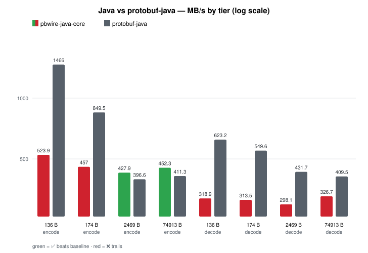

# pbwire Java binding

`bindings/java/runtime` is the Java binding: a pure-Java codec with no
JNI, no `java.lang.foreign` and no native library. Two APIs share the wire
primitives in `Wire`: the dynamic `Message` tree over a runtime schema (a
`FileDescriptorSet` via `protoc --descriptor_set_out`, parsed by `Proto`
and owned by `GenericCodec`), and generated typed models (`codegen`)
with the protobuf-java-shaped `newBuilder()`/`toByteArray()`/`parseFrom`
API. A generated model is a thin typed wrapper over the same `Wire`
primitives: no tree and no schema lookup, but still one dispatch per field
(presence test, kind switch, getter call through the `Meta` table) — and a
schema file is needed only for the dynamic path.

```java
try (Schema schema = Schema.fromFile("tests/data/sample.desc")) {
    MessageType sample = schema.message("pbwire.test.Sample");
    try (Message message = sample.newMessage()) {
        message.set("int32_field", -42)
                .set("string_field", "alice")
                .set("bytes_field", new byte[] {1, 2, 3})
                .set("numbers", 1).set("numbers", 2);    // repeated: appends
        message.newMessage("inner").set("x", 7);          // nested: created in place
        byte[] wire = message.encode();

        try (Message decoded = sample.decode(wire)) {
            long id = decoded.getLong("int32_field");
            Message inner = decoded.getMessage("inner");
            assert decoded.getList("numbers").equals(List.of(1L, 2L));
            assert Arrays.equals(wire, decoded.encode()); // byte-exact round trip
        }
    }
}
```

## Build and run

```shell
./build.sh          # plain javac into bindings/java/out

java -cp out TestPbwire tests/data/sample.desc     # self-check
java -cp out Roundtrip tests/data/sample.desc      # example
```

`build.sh` is plain `javac` (JDK 17+): no Maven, no Gradle, no native
library, no `--enable-native-access`. The fixture descriptor set is checked
in, so a build needs no `protoc` either.

## API

| class | members |
|---|---|
| generated models | `newBuilder()`, typed setters/getters, `has…` for explicit presence, `toByteArray()`, `parseFrom(byte[])`, `isInitialized()` — see `tests/gen/` |
| `Schema` | `fromFile(path[, limits])`, `fromBytes(bytes[, limits])`, `fromClasses(Class...)`, `message(fullName)`, `service(fullName)`, `close()` |
| `MessageType` | `name()`, `newMessage()`, `decode(bytes[, limits])`, `decodeDelimited(bytes[, off, limits])`, `visit(wire, cb) / visit(wire, lim, cb)`, `parseJson(text[, ignoreUnknown, limits])`, `parseText(text[, limits])` |
| `Message` | `set(name\|number, …)`, `newMessage(name\|number)`, `clear(…)`, `has(…)`, `get(…)`, typed getters, `getList(…)`, `encode()`, `encodeDelimited()`, `encodeDeterministic()`, `encodedSize()`, `toJson()`, `toText()`, `close()` |
| `ServiceType` | `name()`, `methodCount()`, `method(name)` → `inputType()`, `outputType()`, `clientStreaming()`, `serverStreaming()` |
| `Wkt` | `anyPack/Unpack`, `anyTypeUrl`, `anyPayload`, `timestamp/duration…Millis`, `fieldMaskPaths`, `newFieldMask` |
| `GenericCodec.Stream` | incremental delimited reader: `feed(…)`, `next(type)`, `reset()`, `buffered()` |
| `Limits` | `maxBytes`/`maxDepth` bounds for decode, delimited, JSON, text and descriptor loads (0 = default) |
| `PbCodec` | typed twins: `encodeDelimited`, `parseDelimitedFrom`, `encodeDeterministic`, `encodedSize`, `parseFrom(…[, limits])`, `toJson`/`fromJson`, `toText`/`fromText` |
| `PbwireException` | unchecked; `decode`/`encode` failures and unknown fields/types name the message and field |

`set` overloads: `long` (every integer, fixed and enum field, raw 64-bit bits),
`boolean`, `double` (a `float` field is narrowed for you), `String` (UTF-8),
`byte[]`. `set` replaces a singular field and appends to a repeated one; there
is no separate `add`. `newMessage` returns a child `Message` that writes
straight into the tree (append for a repeated message field).

`fromClasses` builds the same schema out of generated message classes instead
of a descriptor file: the codegen tables carry every field fact the dynamic
codec needs (names, numbers, kinds, packed/oneof), so generated and dynamic
code read the same bytes. Pass only the roots; sub-messages follow the table
links. A descriptor schema and a `fromClasses` schema coexist in one process
— they share nothing but the wire format.

Getters: `get(name\|number)` returns the boxed value and `null` when absent;
`getLong/getInt/getBool/getDouble/getFloat/getString/getBytes/getMessage`
return the Java default (`0`, `false`, `null`) when absent; `getList` returns an
empty list. `has` is the presence test — a field that was not set (or not on the
wire) is absent, matching pbwire's explicit-presence model. Enums are read as
integers. A `uint64` above `Long.MAX_VALUE` reads as the same raw bits, i.e. a
negative `long`.

`visit` is the single-level scan (like the core's `pbw_visit`): one validating
tag pass, one callback per field in wire order, no message tree. Nested
messages and packed runs arrive as LEN payloads the caller recurses into with
another `visit`; groups arrive as raw bytes; scalars carry their raw wire bits
in `Visit.VisitValue.u64` with no zigzag applied. The callback receives `null`
for the field when the number is unknown and returns 0 to continue; any
non-zero value aborts the scan. The return mirrors the core's `fail_off`: the
wire length on success, the failing/aborting field's start offset on malformed
input or abort, or 0 when the input exceeds the byte cap. Only a null callback
throws; only `maxBytes` and the group-nesting cap apply.

Value mapping: `int32/int64/sint*/sfixed*/fixed*` → `long` (signed),
`uint32`/`fixed32` → `long` (zero-extended, so 4000000000 reads as
4000000000L), `uint64`/`fixed64` → `long` (raw bits, negative above
`Long.MAX_VALUE`), `enum` → `long`/`int`, `bool` → `boolean`, `float/double` → `double` (or `Float`/`Double`
from `get`), `string` → `String`, `bytes` → `byte[]`, `message` → `Message`,
`repeated` → `List<Object>` (or `List<Message>` elements).

Errors are unchecked: `PbwireException` for descriptor problems, malformed
wire bytes and a proto2 `required` field missing on encode;
`IllegalArgumentException` for a wrong value type or unknown field number;
`IllegalStateException` for using a closed schema/message; `UncheckedIOException`
for a missing descriptor file.

Ownership is explicit and race-free:

- `Schema.close()` marks the schema unusable; `Message.close()` retires the
  tree created by `newMessage()`/`decode()` and is idempotent. Both throw
  `IllegalStateException` once closed.
- A child `Message` from `newMessage()`/`getMessage()` is a view into the
  same tree: it is never freed on its own, and it shares the root's closed
  flag, so using it after the root is closed throws.
- A decoded tree is one object graph released with its root; nothing is
  shared between threads except the schema.

## How the codec stays fast

One workspace per thread holds everything an encode needs: the reusable
output buffer (so `encode()` allocates nothing but the returned `byte[]`)
and the string-image cache. Field facts (kind, wire type, tag bytes,
presence class) are resolved once per message type, so the encode loop is a
single pass: one presence gate per slot, one `switch` per numeric field,
fused tag+value writes with one capacity check each. Strings re-emit as one
`arraycopy` of a cached whole-field image. Numbers, fixed widths and tags go
through `sun.misc.Unsafe` stores with no per-byte bounds checks -- the same
trick the official encoder uses -- with a checked fallback when `Unsafe` is
missing or the platform is big-endian.

On top of that, decode is lazy: message, group, string and bytes fields
record a slice (input ref + bounds) and only scan tags, so untouched
sub-trees cost nothing until first access and re-encode copies them verbatim
(which is also what keeps unknown fields and byte-exactness for free).
That makes `Schema`/`MessageType` safe to share between threads -- a schema is
read-only after load -- while a `Message` and the workspace stay confined to
one thread (see `TestPbwire`'s 4-thread check).

## Benchmarks

`benchmarks/bench.sh` generates `protobuf-java` from the same `matrix3.proto`
with `--java_out` and runs the four standard tiers from
[`BENCHMARKS.md`](../../BENCHMARKS.md), printing `ns/op` and `MB/s` for
`pbwire-java` and `protobuf-java` side by side. It fetches `protobuf-java` from
Maven Central once (into `benchmarks/deps/`) and needs JDK 22+ and `protoc`.
All four operations get a warm-up pass, then three interleaved timed passes whose
best is reported, so a busy machine hits both implementations equally.

```shell
./benchmarks/bench.sh      # or: make java-bench
```

The four tiers are small / medium / large / xlarge (the repeated fields scaled
x0 / x1 / x100 / x3000).

The headline comparison is the generated-model `core` row in the table below (1.05x at 74 KB encode, 1.26x at 74 KB decode): `protobuf-java`'s
generated writer is one straight-line block of known tags and values, while
a table-driven codec pays a presence gate, a type dispatch and tag loads per
field. That floor is structural, not tuning — and the generated models share
most of it: they skip the tree and the schema lookup, but `PbCodec.encodeInto`
still walks a `Meta` table with one dispatch per field (presence test, kind
`switch`, getter call), so they narrow the gap without reaching straight-line
generated code. Decode closed from 0.80x to 0.84x by linking the table's
Builder setters as direct calls (`Bind` spins them via `LambdaMetafactory`
instead of per-call `MethodHandle.invoke`), batching the packed-run kind
dispatch per run, and keeping a single pending singular sub-message out of
the map. The `Builder` now keeps repeated slots lazy (an absent field costs
no allocation) and the message returns its already-unmodifiable lists
directly, both codegen-side; the remaining gap is the generated `Builder`
storage itself (`Integer` boxing on repeated numerics, plus the
`isInitialized` walk in `build()`), with per-field dispatch still on the
runtime. Keep hot loops on the dynamic `Message` path; keep domain
code on the generated models.

`pbench/` keeps the other comparison committed and runnable: the pure-Java codec
against the C core through JNI, same process, same tiers, gated on byte parity
first. It is a reference, not a gate (`make pbench-java`, needs a native
toolchain), and it records why JNI lost on small/medium encode and won only
large/xlarge encode -- see [`pbench/README.md`](pbench/README.md).

#### Java vs `protobuf-java`



| payload | op | pbwire-java-core (MB/s, x protobuf-java) | protobuf-java (MB/s) |
|---|---|---|---|
| 136 B | encode | 593.1 (0.38x ❌) | 1545.2 |
| 136 B | decode | 470.8 (0.73x ❌) | 642.8 |
| 174 B | encode | 524.6 (0.60x ❌) | 875.1 |
| 174 B | decode | 397.5 (0.71x ❌) | 563.2 |
| 2469 B | encode | 421.6 (1.04x ✅) | 406.7 |
| 2469 B | decode | 310.9 (0.75x ❌) | 411.8 |
| 74913 B | encode | 288.1 (1.05x ✅) | 275.6 |
| 74913 B | decode | 279.0 (1.26x ✅) | 221.9 |

The pbwire column is the committed generated model (`Structtest_Scalars3`)
used as the native object (`toByteArray()`/`parseFrom()`): the same task the
`protobuf-java` baseline runs, a fresh build per iteration on both sides. The
baseline decode arm folds the same gate-checked fields the `core` arm
materializes eagerly (`consumeBaseline`: every repeated element into the live
sink), so the pair is deep on both sides (fairness §4); `protobuf-java`
strings parse eagerly, so the fold costs it nothing measurable. The per-field
`tree` arm is compared in `pbench/` (see its README), not here. Formal run
`../../results/bench-java-20261126T082129Z.json`.

The `core` column above is Java's headline: the shipped typed path (0.38x at
136 B, 1.05x at 74 KB encode, 0.69x-1.26x decode): the generated table walks
one `FieldMeta` lambda per field and its decode builds the eager typed tree,
against a generated writer that knows every tag at compile time. The model
stays the ergonomic path. The one-crossing JNI probe
lives in `pbench/` (see its README), not here.

The binding is a pure-Java codec (`runtime`): the descriptor
set is parsed by its own `Proto` reader, values live in a columnar `DMsg`
tree, and one workspace per thread (a reusable output buffer plus a
string-image cache) makes an encode a single pass plus one `byte[]` copy.
Numbers stay eager while message, group, string and bytes fields decode
lazily into slices, so untouched sub-trees cost nothing until first access
and re-encode copies them verbatim. Tags and values go through one fused
write each with a single capacity check, backed by `sun.misc.Unsafe` stores
with no per-byte bounds checks -- the same trick the official encoder uses --
with a checked fallback when `Unsafe` is missing or the platform is
big-endian. Against generated `protobuf-java` the per-field work left --
loads, one `switch`, one call, a presence gate and a type dispatch per field
-- is what a generated writer avoids by knowing every tag and value at
compile time, which is why the generated-model `core` encode only reaches
parity from the large tier up: that floor is structural, not tuning.

## Layout

| Piece | Path | Role |
|---|---|---|
| codec | [`runtime/GenericCodec.java`](runtime/GenericCodec.java) | columnar value tree, lazy decode slices, the single-pass encoder (the fast path) |
| typed | [`runtime/PbCodec.java`](runtime/PbCodec.java), [`runtime/FieldMeta.java`](runtime/FieldMeta.java), [`runtime/Meta.java`](runtime/Meta.java), [`runtime/Kind.java`](runtime/Kind.java) | the generated models' table: fields in number order, direct `Wire` writes, no tree — one table dispatch per field |
| wire | [`runtime/Wire.java`](runtime/Wire.java) | varint/tag/little-endian read/write, reusable buffer, `Unsafe` fast path |
| schema | [`runtime/Proto.java`](runtime/Proto.java), [`runtime/Schema.java`](runtime/Schema.java) | descriptor-set parser and linker, no protobuf dependency |
| API | [`runtime/MessageType.java`](runtime/MessageType.java), [`runtime/Message.java`](runtime/Message.java), [`runtime/PbwireException.java`](runtime/PbwireException.java) | the dynamic wrapper: typed getters, views, presence, errors |
| example | [`examples/Roundtrip.java`](examples/Roundtrip.java) | build → encode → decode → compare |
| conformance | [`conformance/Testee.java`](conformance/Testee.java) | official suite testee (binary in → out, JSON/text skip) |
| tests | [`tests/TestPbwire.java`](tests/TestPbwire.java), [`tests/TestGenerated.java`](tests/TestGenerated.java), [`tests/TestMetaSchema.java`](tests/TestMetaSchema.java), [`tests/TestSwap.java`](tests/TestSwap.java) | assert-based self-checks, no framework: dynamic gate, generated-model compat (T1–T7: T7 pins typed decode edges), Meta-schema and hot-swap checks |
| fixture | [`tests/data/sample.proto`](tests/data/sample.proto) + `sample.desc` | `protoc --descriptor_set_out --include_imports` |
| benchmark | [`benchmarks/Bench.java`](benchmarks/Bench.java) | the four standard tiers against `protobuf-java` |
| pbench | [`pbench/Compare.java`](pbench/Compare.java), [`pbench/pure/`](pbench/pure/), [`pbench/jni/`](pbench/jni/) | one directory per candidate: the pure-Java codec against the C core through JNI, kept as a rerunnable reference |

The fixture descriptor set is checked in; regenerate it (protoc on `PATH`)
with:

```shell
protoc --descriptor_set_out=tests/data/sample.desc --include_imports \
       -I tests/data tests/data/sample.proto
```

## Deliberately skipped

- **No second wire format in codegen.** The plugin emits Builder classes
  that call `PbCodec`; every byte still comes from the `Wire` primitives the
  dynamic path uses, so the two APIs cannot diverge.
- **Binary, JSON and text conformance testee.** `make conformance-java` runs
  the official suite through the binding: 2763 binary+JSON successes and 443
  text successes, the same 2 expected tag-truncation failures as the C core
  (shared `conformance/failure_list_pbwire.txt`). Only JSPB answers `skipped`.
- **Invalid UTF-8 in a string field is rejected, not replaced.** The codec
  keeps strings as `java.lang.String`, so a decoded string is strict-decoded
  (a held value and its JSON/text print throw) instead of becoming U+FFFD.
  The C core keeps the raw bytes and escapes them when printing text; the
  JSON mapping rejects them in both implementations.
- **No Maven/Gradle**, no JNI, no C glue file, no downloads: `build.sh` is
  plain `javac`. Classes are in the default package for the same
  reason (plain `javac -d out`, no module path); move them into a package if
  this ever ships as a jar.
- **No per-call bounds checks on the encode hot path.** Tags, varints and
  fixed widths go through `sun.misc.Unsafe` (the same trick the official
  encoder uses); without `Unsafe`, or off little-endian, the same methods
  run their checked fallback. The one runtime cost is a terminal-deprecation
  warning printed once per JVM, like `protobuf-java` itself prints.
- **No lazy string copies.** A decoded string materializes on first read;
  re-encoding a decoded message copies untouched slices verbatim, so a
  gateway that only re-encodes never pays for parsing.
- **No extension convenience API.** Extensions are ordinary fields through
  the dynamic tree; nothing is lost, nothing is sugar-coated. Maps and
  oneofs are first-class in the generated models (`Map` fields, a
  `getKindCase()` on every oneof).
- **Typed decode drops unknown fields; the dynamic tree keeps them.** A
  `parseFrom` on a generated model skips what is not in its table (and a
  packed run on a singular field is skipped too, like the core), so a typed
  re-encode is byte-exact only for known fields -- pinned by T7, mirroring
  the reference skip. `GenericCodec` records unknown slices and re-emits
  them verbatim instead.
- **Typed setter failures on the fast path propagate raw.** `Bind` links
  Builder setters as direct calls; a runtime failure inside one is not
  wrapped (the reflective fallback keeps the old `IllegalStateException`).
  Decode-time setters on generated builders cannot fail (wire values are
  never null), so the fast path pays one interface call per field.
- **No per-thread workspace release.** The encode buffer and the string-image
  cache live in one `ThreadLocal` per thread and are never freed: a thread
  that used the binding keeps one buffer (bounded by the largest message it
handled) until the thread dies. Keep request threads off the binding or reuse
  a fixed pool.

## Codegen options

`--pbwire_opt=lang=java[,model=bool][,register=bool][,registry=bool]`
(all default `true`; `registry=true` needs `model=true`):

- `model=false` skips the message/Builder files: only the `OrBuilder`
  interfaces plus the `*Meta` tables ship, for hand-written models through
  `forBuilder` + `register`.
- `register=false` drops the static self-registration block: nothing
  encodes until an explicit `register` call (deferred or custom Builder),
  failing loudly otherwise.
- `registry=false` drops the `<File>_Registry` whole-file class list.
  The list is pure data (class literals, no init cost); passing it to
  `Schema.fromClasses` registers every message (typed side) and builds the
  dynamic schema (Meta side) with no descriptor file. Cross-file schemas
  concatenate the lists explicitly.

## Typed models

`protoc-gen-pbwire` (in `../../codegen`) generates one final class per
message with a protobuf-java-shaped API: `newBuilder()`, per-field setters
and getters, `hasX()` for explicit presence, oneof `getKindCase()`, plus
`toByteArray()` / `parseFrom(byte[])`. The generated class is a thin typed
wrapper over `PbCodec` and the same `Wire` primitives the dynamic codec uses,
so the bytes are identical to `Message` and to `protoc --java_out`. The
committed output is `tests/gen/`:

```java
Spectest_Oneof1 msg = Spectest_Oneof1.newBuilder()
        .setName("n")
        .setNum(0)
        .build();
byte[] wire = msg.toByteArray();       // 10 00: a zero-valued member is set
Spectest_Oneof1 back = Spectest_Oneof1.parseFrom(wire);
```

A oneof member that holds the default value still encodes: the case word is
its presence bit. Decode follows wire order, so the last member on the wire
wins, like protobuf-java. Kotlin, Scala and Clojure models (same
`codegen`) sit on the same runtime.

See `../../codegen/README.md` for regeneration (`make codegen`) and tests
(`make codegen-test`).

