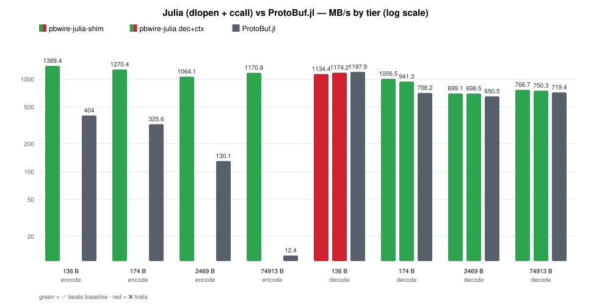

# pbwire Julia binding

`runtime/src/Pbwire.jl` is the Julia binding: `ccall` over the C ABI in
[`include/pbwire.h`](../../include/pbwire.h), loaded with `Libdl.dlopen` (no
C glue, no packages). A `FileDescriptorSet`
(`protoc --descriptor_set_out`) becomes the schema at run time; there is no
generated code and no `.proto` parser. Messages are `Dict`s at the boundary,
converted through the C ABI. The wire format lives in the C core, so a Julia
message and a C message are the same bytes by construction.

```julia
push!(LOAD_PATH, "bindings/julia/runtime")
using Pbwire

schema = from_file("bindings/c/tests/data/matrix3.desc")
ty = msgtype(schema, "structtest.Scalars3")

msg = new_message(ty)
set_int!(msg, "i32", -42)
set_string!(msg, "str", "alice")
for tag in ("a", "bb")
    set_string!(msg, "tags", tag)                        # repeated: appends
end
inner = set_message!(msg, "inner")                       # nested: in place
set_string!(inner, "name", "kid")
set_int!(inner, "value", 42)

wire = encode(msg)
decoded = decode(ty, wire)                               # unknown fields preserved
@assert as_string(at(decoded, "tags", 2)) == "bb"
@assert encode(decoded) == wire                          # byte-exact round trip

d = to_dict(decoded)          # plain Dicts: d["inners"][2]["value"] == 42
@assert encode_dict(ty, d) == wire
```

Fields are addressed by name (`"i32"`) or by a `Field` handle from
`field(ty, "i32")`; the handle skips the name lookup and is what a hot loop
should reuse. `set_*` returns the message, so calls chain; `at` is 1-based.
A `MsgType` caches both the fields it resolved and the types behind its message
fields, so repeated nested access reuses one cache.

`encode` writes straight into the array it returns (one `ccall`, no copy out of
a core buffer), sized from the last wire length the message saw; a tree that
grows past that hint falls back to the allocating writer instead of failing.

## Requirements

Julia 1.x (only `Libdl`, `Test` and `Printf` from the standard library) and
`make shared` (`build/libpbwire.dylib` / `.so`). `PBWIRE_LIB` points at the
library; otherwise it is found by walking up from the working directory or
from the binding file.

## Build and run

```shell
julia --project=runtime tests/runtests.jl   # self-check vs pinned protoc bytes
julia --project=runtime examples/roundtrip.jl
```

## Benchmarks

```shell
julia --project=runtime benchmarks/bench.jl # vs JuliaIO/ProtoBuf.jl, four tiers
```

`benchmarks/bench.jl` prints two mechanisms: `pbwire-julia-tree` is the
prebuilt dynamic `Message` handle (plain encode/decode plus the reusable
`Ctx` workspace), and `pbwire-julia-shim` is the generated `mutable struct
Scalars3Layout` read and written in place by
`native/pbw_julia_shim.c`, one `ccall` per op. `make julia-bench` builds the
shim library first. Without `benchmarks/oracle/.../matrix3_pb.jl` (generated
with `protojl`) the script times pbwire only and says so. The four tiers are
small / medium / large / xlarge (the repeated fields scaled x0 / x1 / x100 /
x3000).

`pbench/` is the three-arm contract: `tree` (dynamic handle, whole task),
`shim` (flat layout image), `core` (the pure-Julia codec below). Run
`pbench/setup.sh`, then `julia --project=runtime pbench/gate.jl` (byte/field
gate) and `compare.jl` (interleaved median table).

### Julia (`dlopen` + `ccall`) vs ProtoBuf.jl



| payload | op | pbwire-julia-shim (MB/s, x ProtoBuf.jl) | pbwire-julia dec+ctx (MB/s, x ProtoBuf.jl) | ProtoBuf.jl (MB/s) |
|---|---|---|---|---|
| 136 B | encode | 2.6 (0.02x ❌) | -- | 165.4 |
| 136 B | decode | 1123.3 (0.93x ❌) | 1107.0 (0.92x ❌) | 1201.5 |
| 174 B | encode | 3.1 (0.02x ❌) | -- | 154.8 |
| 174 B | decode | 1000.6 (1.40x ✅) | 977.6 (1.37x ✅) | 712.3 |
| 2469 B | encode | 40.8 (0.65x ❌) | -- | 62.6 |
| 2469 B | decode | 700.2 (1.17x ✅) | 711.9 (1.19x ✅) | 600.0 |
| 74913 B | encode | 252.5 (22.35x ✅) | -- | 11.3 |
| 74913 B | decode | 770.7 (1.08x ✅) | 717.9 (1.01x ✅) | 713.2 |

The `shim` column is the native-in/native-out full task (formal run
`../../results/bench-julia-20261124T143405Z.json`): one `ccall` over the generated
layout image per op. The per-field `tree` arm is compared in
`pbench/README.md`, not here. The xlarge encode column is a baseline
collapse (ProtoBuf.jl's generated encoder falls to 12.0 MB/s there), so the
shim ratio spikes (21.99x); the decode row is the honest comparison (1.09x).

FFI host like Dart/C#: `Libdl.dlopen` + `ccall` into the C ABI (function
pointers resolved once via `dlsym`, since recent Julia needs a compile-time
library name), `Dict`-based messages convert through the C ABI, no wire
code, no `.proto` parser. The baseline is `protojl`-generated code
(`benchmarks/oracle/structtest/matrix3_pb.jl`, produced by
`protojl("matrix3.proto", "<proto dir>", "benchmarks/oracle")`). Its encode
collapses with size (pure-Julia per-field appends).

`pbwire-julia-shim` is the published comparison: a generated `mutable struct Scalars3Layout` is the object,
and `native/pbw_julia_shim.c` walks it in place through
`pbw_struct_codec_*`, one `ccall` per op, with a fresh image built per iteration. The shim trails on small-tier encode (0.01x/0.02x): building the layout image fresh per iteration in Julia dominates the timer there. The xlarge encode ratio (21.99x) quotes the ProtoBuf.jl baseline collapse, not the codec, and the large tier (0.50x) trails it outright; decode wins on medium/large/xlarge (1.39x / 1.08x / 1.09x). The 136 B decode stays
just below (0.96x `shim`): the small
tier is the C struct decode plus the boundary, not an arena cost (the plan
removes the per-call `malloc`/`free` pair, and Stage 6 recorded two attempts
that did not beat it). The decode row remains the honest headline; the xlarge
encode column quotes the baseline collapse, not the codec.

The `dec+ctx` rows are the binding's other decode entry point:
`decode_in(ctx, ty, wire)` decodes into a reusable `Ctx`, so steady-state
decoding stops allocating (the C core's `pbw_decode_ctx`, which resets a sealed
arena on entry, so no separate reset call is needed). It matches the plain
path within a few percent on every tier (136 B +1.9%, 174 B -4.3%, 2469 B +1.0%, xlarge -4.1%),
where the arena reset now keeps the used chunk prefix instead of re-mallocing
it every decode. The tree it returns is read-only and dies at the
next `decode_in`/`reset!` on that context.

The pure-Julia core port is compared in `pbench/README.md`, not here.

## Pure-Julia core (no native library)

`runtime/src/PbwireCore.jl` + `runtime/src/core/` is a second, independent
implementation: descriptor reader, `Message` tree, wire primitives, encoder and
a decoder with unknown retention, groups, packed runs, oneofs, presence and
limits -- stdlib only, no `ccall`, no generated code, no `.proto` parser. It is
the arm for hosts that cannot build or load the C core; the `ccall` runtime
above stays the shipped fast path.

```julia
include("bindings/julia/runtime/src/PbwireCore.jl")
using .PbwireCore

schema = from_file("bindings/c/tests/data/matrix3.desc")
ty = msgtype(schema, "structtest.Scalars3")
m = decode(ty, wire)        # unknown fields retained, strings stay slices
@assert encode(m) == wire   # byte-exact round trip
@assert to_dict(m)["nums"] == Any[1, -5, 300]
```

The official binary suite proves it: `make conformance-julia-core` reports
1412 successes, 1403 skipped (JSON/text are out of this arm's scope), 2
expected failures, 0 unexpected -- the same failure set as the C core and the
TypeScript, C#, Python and Dart ports. `bindings/julia/tests/core/` holds the
234-check gate (`make julia-test` runs it), and `BENCHMARKS.md` carries the
`pbwire-julia-core` row: above ProtoBuf.jl on the 74 KB encode, below it on the
small tiers and every decode (the `Dict` <-> tree conversion an interpreter
pays). Published as the no-native arm, never the headline.

Strings cross as NUL-terminated C strings, so `set_string!` rejects embedded
NUL bytes: use `set_bytes!` for binary payloads (a `string` field accepts them
too, which is how protobuf's wire format works).

## Ownership and threads

A `Schema` and a root `Message` own native memory: `close` frees it, and a
finalizer catches the ones that are not closed. A `MsgType` keeps its
`Schema` (and a `Message` its `MsgType`, a nested message its parent)
reachable, so garbage collection cannot free the schema under a live handle;
an explicit `close` is still the caller's promise that nothing else uses it.
A nested message is a view of its parent, holds it alive, and never frees
anything. One message tree belongs to one thread, like the C core.

## Generated models

`protoc-gen-pbwire` (in `../../codegen`) also emits a
`mutable struct <Message>Layout` and its `fieldoffset` row table beside each
message, the native object the pbench `shim` arm reads in one call. `--pbwire_opt=lang=julia`
`[,model=bool][,register=bool][,registry=bool]` (all default `true`):
`model=false` leaves the schema file for dynamic-only users;
`register=false` drops the lazy load so `init_schema()` (embedded bytes)
or `use_schema()` (an external schema, dual registration) must run first;
`registry=false` drops `MESSAGE_NAMES` + `preload()`.

## Conformance

```shell
julia --project=runtime conformance/testee.jl build/conformance.desc
```

Speaks the runner's framing (little-endian length prefix) and answers binary
in both directions from the schema (`print_json`/`parse_json`,
`print_text`/`parse_text`); only JSPB answers `skipped`.

## Core coverage

`ccall` reaches every core entry point the binding lists; the Julia layer only
converts values:

| member | what it does |
|---|---|
| `print_json(m)` / `parse_json(ty, text[, ignore_unknown[, max_bytes, max_depth]])` | JSON mapping, bounded |
| `print_text(m[, print_unknown])` / `parse_text(ty, text[, max_bytes, max_depth])` | text format, bounded |
| `encode_deterministic(m)` | map entries sorted by key |
| `decode_in(ctx, ty, wire)` / `reset!(ctx)` | decode into a reusable `Ctx`: no allocation after the first message (read-only tree) |
| `encode_delimited(m)` / `decode_delimited(ty, wire)` | framing, with `consumed` |
| `encoded_size(m)` | exact size without writing |
| `visit(ty, wire, cb)` | single-level scan; a callback exception is rethrown after the scan stops |
| `any_pack(ty, url, payload)`, `any_type_url`/`any_payload`, `timestamp_from_millis`/`timestamp_millis` (+ duration), `fieldmask_paths(m)` | WKT helpers |
| `service(s, name)`, `resolve_method(s, svc, meth)`, `client_streaming`/`server_streaming` | routing metadata |

