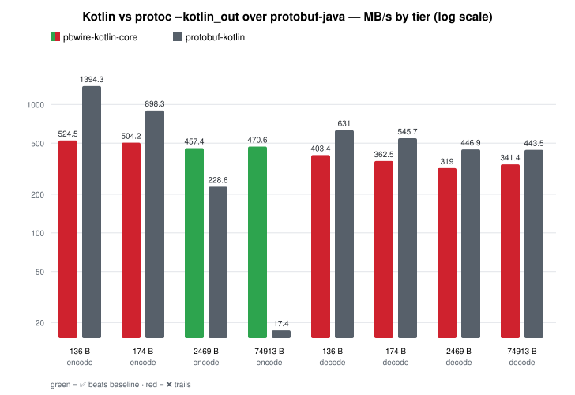

# pbwire Kotlin binding

`bindings/kotlin/runtime` is the Kotlin binding. Kotlin runs on the JVM, so it
uses the Java binding's pure-Java codec (`bindings/java/runtime`, no JNI and no
native library) and adds the DSL that official Kotlin support also is:
`protoc --kotlin_out` generates Kotlin over protobuf-java, never a second
runtime. There is no new wire code and no second schema path -- a
`FileDescriptorSet` is loaded at run time and the Java codec owns the bytes.

```kotlin
schema("tests/data/matrix3.desc").use { schema ->
    val ty = schema.message("structtest.Scalars3")

    ty.build {
        set("i32", -42L)
        set("str", "alice")
        for (tag in listOf("a", "bb")) {
            set("tags", tag)                 // repeated: appends
        }
        message("inner") {                   // nested: created in place
            set("name", "kid")
            set("value", 42L)
        }
    }.use { msg ->
        val wire = msg.encode()
        ty.parse(wire).use { decoded ->
            assert(decoded.getLong("i32") == -42L)
            assert(decoded.getList("tags") == listOf("a", "bb"))
            assert(decoded.encode().contentEquals(wire))   // byte-exact round trip
        }
    }
}
```

The runtime is four helpers (`schema`, `build`, `parse`, `message`); everything
else is the Java binding's API, which Kotlin calls directly.

## Build and run

```shell
./build.sh          # make shared + javac the Java runtime + kotlinc into out/pbwire.jar
```

`build.sh` prints the run commands (plain `java`/`kotlin`, no native library
path and no `--enable-native-access`, exactly like the Java binding). Kotlin
cannot import from Java's default package, which is why the runtime file declares
none.

## Benchmarks

```shell
./benchmarks/bench.sh    # vs protoc --kotlin_out over protobuf-java, four tiers
```

Downloads `protobuf-java` and `protobuf-kotlin` from Maven Central on first run.
The four tiers are small / medium / large / xlarge (the repeated fields scaled
x0 / x1 / x100 / x3000).

#### Kotlin vs `protoc --kotlin_out` over `protobuf-java`



| payload | op | pbwire-kotlin-core (MB/s, x protobuf-kotlin) | protobuf-kotlin (MB/s) |
|---|---|---|---|
| 136 B | encode | 521.2 (0.38x ❌) | 1387.8 |
| 136 B | decode | 386.5 (0.62x ❌) | 626.4 |
| 174 B | encode | 521.6 (0.56x ❌) | 930.9 |
| 174 B | decode | 366.9 (0.65x ❌) | 561.9 |
| 2469 B | encode | 452.3 (1.97x ✅) | 229.6 |
| 2469 B | decode | 325.3 (0.73x ❌) | 447.4 |
| 74913 B | encode | 488.3 (27.74x ✅) | 17.6 |
| 74913 B | decode | 339.9 (0.77x ❌) | 440.8 |

Kotlin reuses the Java runtime (`../java/runtime`), so these numbers are
`pbwire-java`'s: one workspace lookup plus one `byte[]` copy per call. `core`
is the same committed generated Java model the Kotlin DSL builds (the
`tests/gen/matrix3.kt` factories are inline sugar over it) and the published
comparison here; it tracks Java's `core` row (1.00x encode / 0.84x decode at 74 KB after Task 5) for the same reason: a generated writer knows
every tag at compile time while the dynamic tree walk derives them, the same
structural floor the Java section explains. The xlarge encode ratio (27.74x)
rides a `protobuf-kotlin` baseline collapse (17.6 MB/s there); decode is the
honest comparison. The `core` column is eager. The
per-field `tree` arm is compared in `../java/pbench/` (see its README),
not here. The `Message`-wrapper cut (no per-decode
`AtomicBoolean`, no volatile open flag) removes the binding's own per-call
overhead on top, so the narrow tiers track the codec instead of the wrapper.
Formal run
`../../results/bench-kotlin-20261124T201156Z.json`. The `protobuf-kotlin`
decode arm folds the same gate-checked fields the gate asserts
(`consumeBaseline`, mirroring Java Task 5; measured ~4% on xlarge, the
same nil-effect direction), so both headline sides observe the full
payload.

## Why not a copy of the Java runtime?

A second copy of the codec tables would be a second thing to keep in sync for
zero benefit: Kotlin calls Java classes with no
marshalling cost, and the JVM is the same host either way. The ownership and
threading rules are the Java binding's: a `Schema` or `Message` belongs to one
thread, `use`/`close` frees a root, and a nested message is a view of its parent.

## Generated models

`protoc-gen-pbwire` (in `../../codegen`) generates Kotlin `data class`es with
typed properties, `fun encode(schema)` and a `companion object { fun decode }`.
The committed output is `tests/gen/`; `examples/Roundtrip.kt` uses only typed
assignments. See `../../codegen/README.md`.

