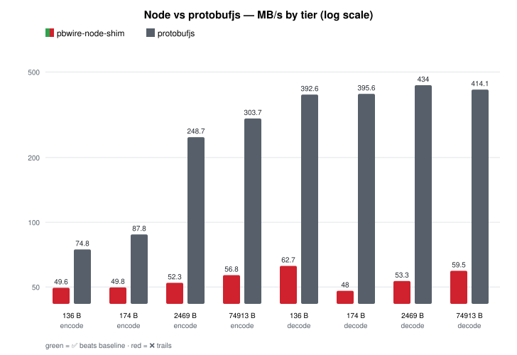

# pbwire Node.js binding

The runtime is `runtime/addon.c`, an N-API addon in C over `libpbwire.a`;
the `Schema`/`Message` surface is `lib/pbwire.js`. No npm dependencies.

Most code never touches that surface: generate a protobufjs-static-shaped
facade once (`make -C codegen gen-node`) and use it like the
library it mirrors — same `create`/`encode`/`decode`/`verify` calls,
same observable behavior, but the wire format stays in the C core:

```js
const { Person } = require('./tests/gen/addressbook.js');

const msg = Person.create({name: 'alice', id: 7});
Person.verify(msg);                       // null: valid
const wire = Person.encode(msg).finish(); // Buffer
const back = Person.decode(wire);
back.name;                                // 'alice'
back.toJSON();                            // {name: 'alice', id: 7, ...}
```

The generated file embeds its own `FileDescriptorSet`, so there is no
`.desc` to ship: `require` it and go. int64 reads as `BigInt`; `create`/
`fromObject` also take `number|string|Long-like`. `toObject()` keys are
camelCase (protobufjs convention); pass `{keepCase: true}` for proto
names. `fromObject` rejects bad shapes with `TypeError`; `verify`
returns the same reason strings as protobufjs. The one deliberate
difference: direct post-hoc writes of an implicit zero (`m.i32 = 0`)
are not marked present — set values through `create`/`fromObject` to
write explicit zeros.

The dynamic API is still there for gateways and schemas known only at
runtime:

```js
const { Schema } = require('./lib/pbwire');

const schema = Schema.fromFile('tests/data/demo.desc');
const person = schema.message('demo.Person');

const wire2 = person.encode({name: 'alice', id: 7, inner: {x: 42}});
const back2 = person.decode(wire2);
back2.get('name');      // 'alice'
back2.get('inner').x;   // 42
back2.encode().equals(wire2);   // true: byte-exact re-encode
back2.free();
```

## How it works

A message is one of two things, and both live behind the same API:

- **A built message** (`newMessage()`/`set()`) is a `pbw_message` value tree in
  C. Field writes go straight into it, and `encode()` runs the core encoder
  into a per-type reusable buffer, so re-encoding a message never crosses the
  boundary again.
- **A decoded message** (`decode()`) is the bytes it came from plus one 12-byte
  slice per wire field: decode validates the payload once while recording those
  slices, `get()` materializes a single field on demand, and `encode()` hands
  the same bytes back. A round trip is therefore byte-exact — unknown fields,
  field order and non-canonical encodings included — and nothing is built for
  fields that are never read.

The wire form holds no native state: the bytes are a JS `Buffer` and the slices
a `Uint32Array`, both owned by the message object. That is deliberate. Attaching
a finalizer to native memory costs N-API ~250 ns per object, which is more than
the entire decode of a small message, so only the built form (which has no
JS-visible storage) pays for one.

Writing to a decoded message promotes it to a tree (one `pbw_decode` of the
retained bytes), so `set()` works on either form and only callers that actually
edit a parsed message pay for the tree.

Field facts (number, type, wire type, label, oneof, closed enum, sub-message)
are resolved once per descriptor into a cached table with a name hash and a
number index, so `get()`/`set()` and the wire scan never walk the descriptor.

## Build and run

Needs Node (headers ship with it) and a C compiler. No `npm install`, no
`node-gyp`.

```sh
bindings/node/build.sh          # build the addon, then run the tests
bindings/node/build.sh build    # build only
node bindings/node/test/test_pbwire.js    # the tests alone (node:test)
node bindings/node/examples/roundtrip.js  # the example
```

`build.sh` builds `build/libpbwire.a` first when it is missing (the root `make`
default goal is the shared library, so it asks for the archive by name), then
compiles the addon with clang against `$(node -p ...)/include/node` and links
the static core. Set `NODE_INCLUDE` if a packaging splits the Node headers away
from the binary. Output: `bindings/node/build/pbwire_node.node`.

## API

`Schema`
| member | meaning |
|---|---|
| `Schema.fromBytes(buffer)` | load a `FileDescriptorSet`; throws on malformed input |
| `Schema.fromFile(path)` | same, from a file |
| `schema.message(name)` | the message type `name` (`"pkg.Msg"`); throws when it is not a message |

`MessageType`
| member | meaning |
|---|---|
| `type.name` / `type.schema` | dotted full name and owning schema |
| `type.newMessage()` | empty `Message` (the mutable tree form) |
| `type.encode(object \| Message)` | encode a plain object or an existing `Message` |
| `type.encodeObject(object)` | encode a plain object in one addon downcall: the addon walks the schema's fields in C (nested messages and repeated elements recurse inside C), so no per-field `set()` crosses the boundary |
| `type.decode(buffer)` | decode wire bytes into a `Message`; throws on malformed input |
| `type.decodeObject(buffer)` | decode wire bytes into a plain object in one call; same values `get()` returns, but the result holds no bytes and cannot re-encode — the fast path when most fields are read |
| `type.decodeToObject(buffer)` | `decodeObject` under the native-object-in/out name the pbench arms use |

`Message`
| member | meaning |
|---|---|
| `msg.get(name)` | field value, `undefined` when the field is absent; throws for an unknown name |
| `msg.set(name, value)` | store a value, replacing what was there; `undefined`/`null` clears the field |
| `msg.encode()` | wire bytes as a `Buffer` |
| `msg.free()` | release early; a second call is a no-op, any other call afterwards throws |

Values map per field type:

| field type | JS value |
|---|---|
| `int32`, `uint32`, `sint32`, `fixed32`, `sfixed32`, `enum` | `number` |
| `int64`, `uint64`, `sint64`, `fixed64`, `sfixed64` | `BigInt`, or a decimal string; a `number` is accepted while it is an exact safe integer. Anything else is refused with a `TypeError` naming the field, never truncated |
| `float`, `double` | `number` |
| `bool` | `boolean` |
| `string` | `string` |
| `bytes` | `Buffer` |
| message | plain `object` (nested `get`/`set` by field name) |
| repeated | `array` |

Presence is explicit, as in the C core: a field set to its zero value is
written to the wire instead of being skipped the way a generated proto3
serializer would skip it. A message field is replaced on `set`, not merged, and
a repeated write replaces the whole list. Reading follows the wire: a repeated
field that is not on the wire reads `undefined`, a oneof reads only its last
member, and a singular sub-message that appears twice merges (the payloads
concatenate, which is what parsing them as one message means).

Two proto2 behaviours are worth naming:

- **Closed enums.** A number the enum declaration does not list is not a value
  of the field (the reference parsers move it to the unknown fields), so `get()`
  skips it, and `encode()` passes the original bytes on untouched.
- **`required` fields.** Whether a required field is present is a property of
  the *merged* message, which is what the tree decoder checks after parsing. A
  type that reaches a `required` field therefore decodes through the tree
  (`decodeEager`) instead of the wire view; everything else decodes lazily.

## Tests

`test/test_pbwire.js` covers descriptor-set loading, every field kind, oneof,
packed and unpacked repetition, groups, closed enums, required fields,
byte-exact re-encode (including unknown field pass-through), editing a decoded
message, absent fields, schema/wire errors, nesting caps, and double-free
safety. The last two tests are differential: one decodes a corpus of truncated
and bit-flipped payloads, asserts that a decoded message is always its own
bytes, and compares every field against the tree decoder's answer on the same
bytes (so the two materializers cannot drift apart); the other feeds the addon a
slice array it did not produce and expects an error rather than a read past the
buffer.

The fixtures are `tests/data/{demo,shapes,legacy}.desc`, generated from the
`.proto` files next to them:

```sh
protoc -Ibindings/node/tests/data \
    --descriptor_set_out=bindings/node/tests/data/demo.desc \
    bindings/node/tests/data/demo.proto
```

## pbench: the four arms

`pbench/` compares the arms the [pbench contract](../README.md#pbench-three-arms-one-contract)
defines over the same `matrix3` payload. The detailed table, the gate, the
provisional run and the verdict are in [`pbench/README.md`](pbench/README.md).

| arm | file | mechanism |
|---|---|---|
| `tree` | `pbench/a-tree.js` | the `Message` handle: one `set()` per field then `encode()`, one `get()` per field after `decode()` |
| `shim` | `pbench/b-shim.js` | `type.encodeObject(obj)` / `type.decodeToObject(wire)`: one downcall, the addon walks the JS object in C |
| `core` | `pbench/c-core.js` | the pure-TypeScript codec in `lib/core/`: the descriptor reader, tree, encoder and decoder in JS, so the task runs in the JS heap with no boundary (binary wire format; no JSON/text mapping) |

```
bindings/node/pbench/setup.sh        # addon + benchmarks/gen (jspb + .desc)
node bindings/node/pbench/gate.js    # bytes + field-by-field decode, PASS/exit 1
node bindings/node/pbench/compare.js # interleaved arms + baselines, median of 5
```

## Benchmarks

`benchmarks/bench.sh` generates `matrix3_pb.js` with `protoc-gen-js`, installs
[protobufjs](https://www.npmjs.com/package/protobufjs) (the
fastest widely used JS runtime) into `benchmarks/node_modules` on first run,
and prints the four standard tiers from [`BENCHMARKS.md`](../../BENCHMARKS.md)
for `pbwire-node-shim` and protobufjs side by side.
`shim` is the
native-object task (plain object in, wire out; wire in, plain object out):

```sh
./benchmarks/bench.sh      # or: make node-bench
```

The `shim` row is the native object in and out and it trails protobufjs:
each field costs one N-API object property read (encode) or write (decode),
~60-70 ns, where protobufjs pays a few ns in its own heap. It is the shipped
object converter; the per-field `tree` arm is compared in `pbench/README.md`, not here.

Two boundary costs decide the small tiers: N-API's own
`Buffer` creation costs ~200 ns, so `encode()` encodes into the type's reusable
buffer and copies into a JS-allocated (pooled) `Buffer` of the exact size, and
decode copies the payload once with `Buffer.from` instead of paying for a
per-message finalizer.

#### Node vs protobufjs



| payload | op | pbwire-node-shim (MB/s, x protobufjs) | protobufjs (MB/s) |
|---|---|---|---|---|
| 136 B | encode | 50.1 (0.64x ❌) | 78.0 |
| 136 B | decode | 61.5 (0.15x ❌) | 399.7 |
| 174 B | encode | 53.7 (0.59x ❌) | 90.7 |
| 174 B | decode | 49.3 (0.12x ❌) | 403.8 |
| 2469 B | encode | 55.1 (0.23x ❌) | 236.9 |
| 2469 B | decode | 49.6 (0.12x ❌) | 410.0 |
| 74913 B | encode | 58.9 (0.19x ❌) | 316.0 |
| 74913 B | decode | 54.8 (0.12x ❌) | 449.1 |

The pbwire column is the native-in/native-out full task
(`pbench/`): `shim` runs the native-object task in one
`encodeObject` / `decodeToObject` downcall. The per-field `tree` arm is
compared in `pbench/README.md`, not here. Formal run
`../../results/bench-node-20261124T095512Z.json`.

Each field of a native-object op is one N-API property read or
write (~60-70 ns) where protobufjs pays a few ns in its own heap.
The verdict (tree handle path stays the documented default, the one-downcall
`shim` is the recommended one-shot path) is in `pbench/README.md`
and the ledger; the old prebuilt-handle `tree` headline is retired. The
pure-TypeScript core port is compared in `pbench/README.md`, not here.

protobufjs is the published baseline, and the harness gates its bytes too.

What the gap is made of, and what the optimization pass changed:

| version | xlarge encode | xlarge decode |
|---|---|---|
| N-API addon, tree per message | 1300.4 | 565.2 |
| encode into a reusable buffer, wire view for decoded messages | 1366.6 | 1596.7 |

- `decode()` returns the bytes plus one 12-byte slice per wire field instead of
  materializing a tree: one validating tag scan, one allocation for the slice
  array, and the bytes copied once with `Buffer.from`. A value materializes only
  when it is read. Byte-for-byte re-encoding falls out of it, so no unknown-field
  bookkeeping is needed either.
- The wire form keeps no native state (JS `Buffer` + `Uint32Array`), because an
  N-API finalizer costs ~250 ns per object — more than the whole decode of a
  136 B message. Only the built form, which has no JS-visible storage, is
  wrapped.
- `encode()` writes into the type's reusable core buffer and copies into a
  JS-allocated (pooled) `Buffer` of the exact size: N-API's own `Buffer`
  creation is ~200 ns, versus ~26 ns for a pooled allocation.
- Field facts are resolved once per descriptor into a cached table (name hash,
  direct number index, wire type, label, oneof, closed enum), so the scan and
  the accessors never walk the descriptor.

## Deliberate skips

- **No protoc plugin / code generation.** The schema is always loaded at run
  time, like the Python binding: a `FileDescriptorSet` is the only schema
  source, and there is no generated layout to keep in sync.
Also exported: JSON/text format (`messageToJson`/`jsonToMessage` — the latter
with an optional ignore-unknown flag, `messageToText`/`textToMessage` — the
former with an optional print-unknown flag), field presence (`has`), and
delimited framing (`encodeDelimited`/`decodeDelimited`, returning
`{message, read}` so concatenated frames decode in a loop).
See `test/test_pbwire.js`.

## Conformance

`conformance/testee.js` drives the official `conformance_test_runner`
through this binding (`make conformance-node`):

```
CONFORMANCE SUITE PASSED: 2750 successes, 0 skipped, 2 expected failures,
0 unexpected failures.
CONFORMANCE SUITE PASSED: 443 successes, 0 skipped, 0 expected failures,
0 unexpected failures.
```

Binary input decodes to a tree (unknown fields survive, oneof collapses to
the last member) and every output renders that same tree; JSON input with
unknown fields only parses when the test category asks to ignore them, and
text output honors the runner's `print_unknown_fields` flag. The 2 expected
failures are the shared `conformance/failure_list_pbwire.txt` (tag varints
the reference C++ testee truncates identically); only JSPB answers `skipped`.

## Generated models

`protoc-gen-pbwire` (in `../../codegen`) generates `matrix3.d.ts` interfaces
(for TypeScript) and a JSDoc/`@ts-check` `.js` with the same shapes plus the enum
constants, describing exactly the plain objects `MessageType.encode()` accepts
and `Message.get()` returns. The committed output is `tests/gen/` and
`examples/gen/`; the generated test type-checks with `tsc --strict --checkJs`.
See `../../codegen/README.md`.

