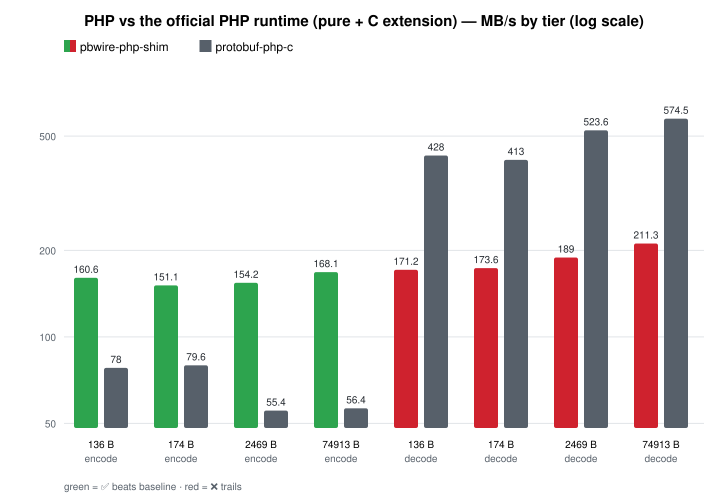

# pbwire PHP binding

Two versions, one API (`Pbwire\Schema`, `Type`, `Field`, `Message`, `Value`):

- `runtime/` is the default: an `FFI` wrapper over the C ABI in
[`include/pbwire.h`](../../include/pbwire.h). PHP ships `ext-ffi`, so there is no
C extension to compile and no composer package: the shared library is
`dlopen()`ed, and a `FileDescriptorSet` (`protoc --descriptor_set_out`) becomes
the schema at run time. No generated code, no build step.
- `ext/` is the native sibling: the same classes as a C extension with the
  core compiled in (like the Ruby C extension), so small payloads skip the
  per-call FFI trampoline. `runtime/pbwire.php` returns early when it is
  loaded, so the two never declare the same class twice.

```php
use Pbwire\Schema;

$schema = Schema::fromFile('tests/data/matrix3.desc');
$ty = $schema->message('structtest.Scalars3');
$innerTy = $schema->message('structtest.Inner3');

$msg = $ty->newMessage();
$msg->setInt('i32', -42)
    ->setString('str', 'alice');
foreach (['a', 'bb'] as $tag) {
    $msg->setString('tags', $tag);                  // repeated: appends
}
$msg->setMessage('inner')                           // nested: created in place
    ->setString($innerTy->field('name'), 'kid')
    ->setInt('value', 42);

$wire = $msg->encode();
$decoded = $ty->decode($wire);                      // unknown fields preserved
assert($decoded->encode() === $wire);               // byte-exact round trip
assert($decoded->at('tags', 1)?->asString() === 'bb');
```

Fields are addressed by name (`'i32'`) or by a `Field` handle from
`$ty->field('i32')`; the handle skips the name lookup and is what a hot loop
should reuse.

## Requirements

PHP 8.0+ with `ext-ffi` (bundled by default; `php -m | grep ffi`) and the shared
library: `make shared` builds `build/libpbwire.dylib` / `.so`. `PBWIRE_LIB`
points at it; otherwise the binding looks next to the checkout and in `./build`.

## Build and run

```shell
make shared
php tests/test.php                                  # FFI self-check vs pinned protoc bytes
make php-ext-test                                   # same checks through the C extension
php examples/roundtrip.php                          # example
```

```shell
cd ext && ./build.sh                               # builds ext/modules/pbwire.so
php -d extension=$PWD/ext/modules/pbwire.so tests/test.php
```

`composer.json` requires `ext-ffi` for the default wrapper; the C extension
needs only the `.so` above (no `PBWIRE_LIB`, no shared library).

## Benchmarks

```shell
./benchmarks/bench.sh    # FFI, then the C extension when built, vs the official runtime (pure + C ext)
```

`bench.sh` builds `ext/` when `phpize` exists and times both versions back
to back. Rows are named by the arm: `pbwire-php-tree` (prebuilt `Message`),
`pbwire-php-shim` (native array through one C-extension entry),
`pbwire-php-shim-ffi` (the same array API on `ext-ffi`, the no-compiler
deployment).

The official side is the `php/src` tree of the cached protobuf checkout that
`make conformance-setup` clones (or `PBWIRE_PROTOBUF_SRC`), loaded through a
plain SPL autoloader: no composer, no PEAR. When the protobuf C extension is
installed the harness times it first (`-c` rows), then re-runs under `php -n`
for the pure-PHP baseline. The four tiers are small / medium /
large / xlarge (the repeated fields scaled x0 / x1 / x100 / x3000).

#### PHP vs the official PHP runtime (pure + C extension)



The native C extension publishes the native-array entry
(`pbwire-php-shim`, one extension entry that walks the array in C) as its
headline row on the same payload. The `ext-ffi` wrapper is the no-compiler
deployment and gets its own row (`pbwire-php-shim-ffi`). The per-field `tree`
arm is compared in `pbench/` (see its README), not here. Formal
run
`../../results/bench-php-20261124T140435Z.json`: the C-extension pass first, then
the `ext-ffi` pass against the same C-extension baseline, then the `ext-ffi`
pass against the pure-PHP baseline.

| payload | op | pbwire-php-shim (MB/s, x) | protobuf-php-c (MB/s) |
|---|---|---|---|
| 136 B | encode | 160.6 (2.06x ✅) | 78.0 |
| 136 B | decode | 171.2 (0.40x ❌) | 428.0 |
| 174 B | encode | 151.1 (1.90x ✅) | 79.6 |
| 174 B | decode | 173.6 (0.42x ❌) | 413.0 |
| 2469 B | encode | 154.2 (2.78x ✅) | 55.4 |
| 2469 B | decode | 189.0 (0.36x ❌) | 523.6 |
| 74913 B | encode | 168.1 (2.98x ✅) | 56.4 |
| 74913 B | decode | 211.3 (0.37x ❌) | 574.5 |

`pbwire-php-shim` is the task a PHP application runs when its
data is an array: one extension entry walks the array in C
(`zend_hash_str_find` per field, recursion) and fills the tree, or materializes
the array on decode. It is the published comparison on both ops (2.01x-2.90x
encode, 0.36x-0.43x decode): encode leads at every tier because both sides
build the array fresh per iteration and one C walk beats the extension's
field-by-field fill, while decode stays below the official C
extension at every tier because every field still costs a hashtable lookup plus
a C tree store, and the decode materializes the array eagerly.

The `ext-ffi` wrapper runs the same array API through one FFI trampoline per
field (the no-compiler deployment), so its row is interpreter-scale; the
official C extension is the baseline in that same run:

| payload | op | pbwire-php-shim-ffi (MB/s, x) | protobuf-php-c (MB/s) |
|---|---|---|---|
| 136 B | encode | 4.7 | 78.0 |
| 136 B | decode | 5.7 | 431.2 |
| 174 B | encode | 4.9 | 78.5 |
| 174 B | decode | 5.4 | 414.9 |
| 2469 B | encode | 2.4 | 54.6 |
| 2469 B | decode | 4.4 | 498.2 |
| 74913 B | encode | 5.3 | 53.2 |
| 74913 B | decode | 4.5 | 572.3 |

The `shim-ffi` column is the same array API through the FFI trampoline (one
FFI call per field), which is why it reads interpreter-scale next to the
C-entry `shim` row above.

The pure-PHP runtime, timed by a second `php -n` run in the same harness, is a
different race; the FFI array entry is the pbwire side there:

| payload | op | pbwire-php-shim-ffi (MB/s) | protobuf-php (MB/s) |
|---|---|---|---|
| 136 B | encode | 4.8 | 3.2 |
| 136 B | decode | 5.7 | 6.6 |
| 174 B | encode | 5.1 | 3.2 |
| 174 B | decode | 5.6 | 6.2 |
| 2469 B | encode | 5.0 | 3.1 |
| 2469 B | decode | 4.4 | 5.3 |
| 74913 B | encode | 5.4 | 3.3 |
| 74913 B | decode | 4.6 | 5.5 |

The pure-PHP runtime spends its time on per-field bookkeeping (~4-6 MB/s flat
across tiers). Against it the FFI-run `shim-ffi` row -- the same array API,
no C extension -- stays above the pure-PHP runtime on encode and near it on
decode; both sides build a fresh array per iteration inside the timer, so the native `shim` row
stays the comparison. Both shim builds (C extension and
`ext-ffi`) produce identical bytes and pass the pbench gate on all four tiers;
the gap between them is the per-field PHP loop plus the FFI trampoline, not a
different codec.

`pbwire-php-shim` is the published native-object entry; the per-field `tree`
build is a `pbench/`-only arm (see `pbench/README.md`). The native array
entry leads the official C extension on encode on every tier (2.01x-2.90x) but stays below it on decode (0.36x-0.43x) because each field costs a hashtable
lookup plus a C tree store, and decode materializes the array eagerly.
`bench.sh` also times the `ext-ffi` deployment separately: the same
`Type::encodeArray`/`decodeArray` API with the walk in PHP, one FFI call per
field, which is interpreter-scale (~5 MB/s) and published as
`pbwire-php-shim-ffi` so the no-compiler cost is not quoted as the C extension.

Without the C extension the same harness measures the pure-PHP runtime
instead; the `shim-ffi` vs pure-PHP rows are in the third table below.

`pbench/` is the re-runnable arm comparison; `pbench/README.md` has the
provisional table, the deferred-core TODO and the verdict.

Strings cross with explicit lengths, so embedded NUL bytes survive both
ways (`setString()` and `setBytes()` accept them; a `string` field accepts
byte payloads too, which is how protobuf's wire format works).

## Conformance

`conformance/testee.php` drives the official `conformance_test_runner`
through this binding (`make conformance-php`):

```
CONFORMANCE SUITE PASSED: 2750 successes, 0 skipped, 2 expected failures,
0 unexpected failures.
CONFORMANCE SUITE PASSED: 443 successes, 0 skipped, 0 expected failures,
0 unexpected failures.
```

It runs on the shipped `ext-ffi` wrapper, so it needs no compiler and no
`php-ext` build; binary, JSON and text travel through the same core trees
the FFI calls use (unknown fields survive, oneof collapses to the last
member), and text output honors the runner's `print_unknown_fields` flag.
Only JSPB answers `skipped`. The 2 expected failures are the shared
`conformance/failure_list_pbwire.txt` (tag varints the reference C++
testee truncates identically).

## Threads and lifetimes

No global state beyond the library handle. A `Schema` or `Message` belongs to one
thread; PHP's common runtimes (php-fpm, CLI) are one request per process, so this
matches how it is used.

A `MessageType` and every `Message` keep the `Schema` object reachable, so
dropping your own reference does not free the native schema under them. An
explicit `close()` is still the caller's promise that nothing else uses it --
close messages and types first, like any arena.

## Generated models

`protoc-gen-pbwire` (in `../../codegen`) generates official-runtime-shaped
classes over this dynamic API: `getX()`/`setX()`, `hasX()`/`clearX()` for
optional and message fields, `RepeatedField` for repeated, `getKind()` /
`whichOneof()` for oneofs, enums as class constants, and
`serializeToString()`/`mergeFromString()`. Each file splits in two:
`<base>.php` (models) and `PbwireFile_<Stem>.php` (the holder: embedded
set plus its loader). `--pbwire_opt=lang=php[,model=bool][,register=bool]`
`[,registry=bool]` (all default `true`): `model=false` leaves the holder
for dynamic-only users; `register=false` drops the lazy load so `init()`
(embedded bytes) or `use_schema()` (an external `Schema`, dual
registration) must run first; `registry=false` drops `MESSAGE_NAMES` +
`preload()`. The committed output is `tests/gen/` and
`examples/gen/` plus the protoc `--php_out` oracle in `tests/gen_oracle/`;
`tests/compat_test.php` runs TESTSPEC T1–T6 against the pinned runtime
(protobuf v36.2 `php/src`), `tests/generated_test.php` is the oracle-free
smoke, and `examples/roundtrip.php` assigns typed fields only. See
`../../codegen/README.md`.

## Core coverage

Everything the C ABI exposes is reachable from PHP, through the same core (no
second codec):

| member | what it does |
|---|---|
| `Type::fromJson($json[, $ignoreUnknown[, $limits]])` / `Message::toJson()` | JSON mapping in and out |
| `Type::fromText($text[, $limits])` / `Message::toText([$printUnknown])` | text format in and out |
| `Message::encodeDeterministic()` | map entries sorted by key |
| `Message::encodeDelimited()` / `Message::encodeDelimitedTo($cap)` / `Type::decodeDelimited($wire)` | length-prefixed framing |
| `Message::encodedSize()` / `Message::encodeTo($cap)` | exact size, caller-owned buffer |
| `Message::timestampMillis()` / `Type::timestampFromMillis($ms)` (and the duration twins) | Timestamp/Duration as milliseconds |
| `Message::anyPack($typeUrl, $payload)`, `Message::anyTypeUrl()`, `Message::anyPayload()` | `google.protobuf.Any` |
| `Message::fieldmaskPaths()` | `google.protobuf.FieldMask` |
| `Type::encodeArray($array)` / `Type::decodeArray($wire)` | native array in/out; one entry call in the C extension, the same API on `ext-ffi` |
| `Schema::services()`, `Schema::service($name)`, `Schema::resolve($service, $method)` | routing metadata, no RPC |
| `$limits = ['max_bytes' => n, 'max_depth' => n]` | bounds on every decode/parse/load entry point |

