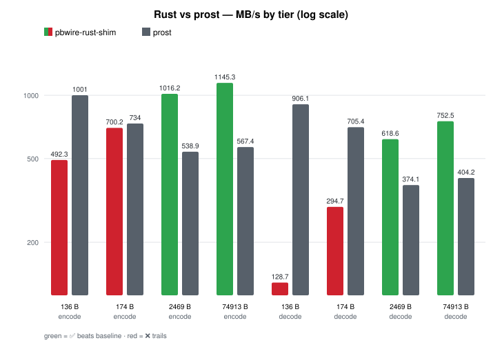

# pbwire Rust binding

`bindings/rust` is the Rust binding: a safe wrapper over the C ABI in
[`include/pbwire.h`](../../include/pbwire.h), linked as `libpbwire.a`. A
`FileDescriptorSet` (`protoc --descriptor_set_out`) becomes a schema at run
time; there is no generated code, no `build.rs` codegen and no bindgen step.
Wire bytes are the core's, so a Rust message and a C message are the same bytes
by construction.

```rust
use pbwire::Schema;

let schema = Schema::from_file("tests/data/matrix3.desc")?;
let ty = schema.message("structtest.Scalars3")?;
let inner_ty = schema.message("structtest.Inner3")?;

let mut msg = ty.new_message();
msg.set_i64(ty.field("i32")?, -42)
    .set_str(ty.field("str")?, "alice");
for tag in ["a", "bb"] {
    msg.set_str(ty.field("tags")?, tag);          // repeated: appends
}
msg.set_message(ty.field("inner")?)              // nested: created in place
    .set_str(inner_ty.field("name")?, "kid")
    .set_i64(inner_ty.field("value")?, 42);

let wire = msg.encode()?;
let decoded = ty.decode(&wire)?;                 // unknown fields preserved
assert_eq!(decoded.encode()?, wire);             // byte-exact round trip
# Ok::<(), pbwire::Error>(())
```

A `Field` is resolved once (`ty.field("i32")`) and reused, like the Java
binding's cached `FieldInfo`: a `set_*`/`get_*` call is one native call, not a
name lookup.

## Build and run

```shell
make -C ../..            # build/libpbwire.a, the archive the crate links
cargo test               # self-check against the pinned protoc bytes
cargo run --example roundtrip -- ../c/tests/data/matrix3.desc
```

`build.rs` copies `build/libpbwire.a` into `OUT_DIR` and links it statically, so
the resulting binary has no runtime dependency on the library. It also compiles
`bindings/c/runtime/pbw_struct.c` into a second archive (through `CC`/`AR`,
default `cc`/`ar`): that is the layout codec the in-place arm calls.
`PBWIRE_LIB_DIR` points at a different build directory. Everything is
`cdylib`-free on purpose: the FFI hosts (Java, Node, Objective-C, PHP, Dart, C#)
`dlopen` the shared library, while Rust compiles the archive in.

The `core` cargo feature adds a second, independent codec: the pure-Rust port of
the C core in `src/core/` (descriptor reader, value tree, encoder, decoder).
It is off by default -- the default build above is unchanged -- and it is the
only mode that needs no C toolchain, no `unsafe` and no generated code:

```shell
cargo test --no-default-features --features core   # descriptor + codec + wire tests
make -C ../.. conformance-rust                     # official binary suite (1412/2)
cargo run --no-default-features --features core --bin pbwire-conformance -- ../../build/conformance.desc
```

It is the pbench `core` arm, published as the no-native mode
(`pbench/README.md`); the published comparison is the `shim` row in
[BENCHMARKS.md](../../BENCHMARKS.md#rust-vs-prost).

## Benchmarks

```shell
./benchmarks/bench.sh    # vs prost generated code, four tiers
```

The prost baseline generates at build time
from crates.io. The four tiers are small / medium / large /
xlarge (the repeated fields scaled x0 / x1 / x100 / x3000).

#### Rust vs prost



| payload | op | pbwire-rust-shim (MB/s, x prost) | prost (MB/s) |
|---|---|---|---|---|
| 136 B | encode | 767.3 (0.80x ❌) | 964.8 |
| 136 B | decode | 237.2 (0.27x ❌) | 880.5 |
| 174 B | encode | 692.5 (0.95x ❌) | 730.6 |
| 174 B | decode | 204.3 (0.32x ❌) | 637.6 |
| 2469 B | encode | 976.0 (1.88x ✅) | 518.5 |
| 2469 B | decode | 568.0 (1.63x ✅) | 348.2 |
| 74913 B | encode | 1083.2 (2.06x ✅) | 525.0 |
| 74913 B | decode | 698.3 (1.86x ✅) | 374.6 |

The archive is linked in, so a call is a direct C call with no `dlopen` lookup.
The pbwire column is the native-in/native-out full task (formal run
`../../results/bench-rust-20261124T094448Z.json`).
`pbwire-rust-shim` is the published comparison: the
generated `#[repr(C)]` mirror read and written by the C struct codec in one
call per op, with a fresh image and decode arena built per iteration on both sides. prost, the
published baseline (generated at build time by build.rs, bytes
gated like the rest), is behind the `shim` rows on the two large tiers and
ahead of them on the two small tiers, where the per-iteration image build
dominates.

The pure-Rust core port is compared in `pbench/README.md`, not here.

The shim's decode leads prost on the two large tiers (1.63x at 2469 B, 1.86x
at 74 KB) and trails on the two small tiers (0.27x/0.32x), while its encode
trails at 136/174 B (0.80x/0.95x) and leads at 2469 B/74913 B
(1.88x/2.06x): under the fresh-build contract the per-iteration image build
dominates the small tiers, and on the large tiers the shared C struct encoder's
single pass (`make bench-c` measures the same codec at
1148.2 MB/s on 74913 B) beats prost's generated writer. `../../docs/perf-attempts.md` records the `-O3` A/B attempt on that
cell and why it was rejected (the sibling layout arms compile the same C file
at `-O2`).

`encode_to()` tries the caller's buffer first and only asks for the exact size
(a second tree walk) when the buffer does not fit, which is what keeps the
measured loop at one walk per call. Sizing on every call instead halves the
encode throughput (xlarge 624 MB/s, 0.52x prost): the number worth checking
first if this row ever regresses.

`set_str` rejects a string containing a NUL byte (it would truncate on the way
to C); use `set_bytes` for binary payloads, including on a `string` field.

### The native-object arm

`pbwire-rust-shim` is the published entry: it times the
generated `#[repr(C)]` mirror with one call per op (the per-field `tree` build
lives in `pbench/`, see [`pbench/README.md`](pbench/README.md)):

```rust
let mut plan = schema.in_place::<Scalars3Flat>()?;   // compiles the rows once
let mut buf = plan.encode_in_place(&image)?;         // bytes borrowed from the plan
let mut decoded = FlatImage::<Scalars3Flat>::new();  // mirror + reusable arena
plan.decode_in_place(&buf, &mut decoded)?;
```

The generated `<Message>Flat::FIELDS` rows carry the offsets and wire facts;
`build.rs` compiles the C codec they address. Decode allocates strings, bytes,
arrays and sub-messages from the image's arena, so the image must not outlive
it (decoding again into the same image invalidates the previous view). The arm,
its gate (`cargo test --test flat`) and the verdict live in
[`pbench/README.md`](pbench/README.md).

## Threads

A `Schema` is immutable once loaded, so `&Schema` can be shared. A `Message` is
not `Send`/`Sync` on purpose: like the C core, one tree belongs to one thread.

## Generated models

`protoc-gen-pbwire` (in `../../codegen`) generates prost-shaped structs:
the same field names, `Option` for optional/message/oneof fields, `i32` for
enums, nested modules, and `encode_to_vec` / `decode` over the embedded
schema — no schema argument at use sites. Each file splits in two:
`<mod>.rs` (models, including the sibling file as `pub mod meta`) and
`<mod>_meta.rs` (the embedded `DESC` plus the per-thread lazy `SCHEMA`).
`--pbwire_opt=lang=rust[,model=bool][,register=bool][,registry=bool]`
(all default `true`): `model=false` leaves the schema file for
dynamic-only users; `register=false` replaces the implicit schema with an
explicit per-thread `init()` (loud otherwise); `registry=false` drops
`MESSAGE_NAMES` + `preload()`. External descriptor sets keep working
through the raw runtime API (`Schema::from_file`); `Schema` stays
`!Sync` by design (one thread per schema, like the C core), so models
follow the embedded set. The committed output is
`tests/gen/` and `examples/gen/`; `examples/roundtrip.rs` assigns typed
fields only, and `tests/compat.rs` proves byte and field parity with the
pinned prost oracle (T1–T6). See `../../codegen/README.md`.

## Core coverage

The safe wrapper exposes the same surface as the C ABI, still over the statically
linked core:

| member | what it does |
|---|---|
| `Type::parse_json(text, ignore_unknown)` / `Message::to_json()` | JSON mapping |
| `Type::parse_text(text)` / `Message::to_text(print_unknown)` | text format |
| `Message::encode_deterministic()` | map entries sorted by key |
| `Message::encode_delimited()` / `Type::decode_delimited(wire)` | framing, returns `consumed` |
| `Message::encoded_size()` | exact size without writing |
| `Type::parse_json_limits(text, ignore_unknown, max_bytes, max_depth)`, `parse_text_limits(...)` | bounds on the JSON/text parsers |
| `Type::visit(wire, &mut cb)` | single-level scan; a panicking callback is caught, never unwinds into C |
| `Type::any_pack(url, payload)`, `Message::any_type_url()`/`any_payload()`, `Type::timestamp_from_millis(ms)`/`duration_from_millis(ms)`, `Message::timestamp_millis()`/`duration_millis()`, `Message::fieldmask_path_count()`/`fieldmask_path_at(i)` | WKT helpers |
| `Schema::service(..)`/`service_at`/`service_count`, `Schema::resolve_method(service, method)` | routing metadata |

