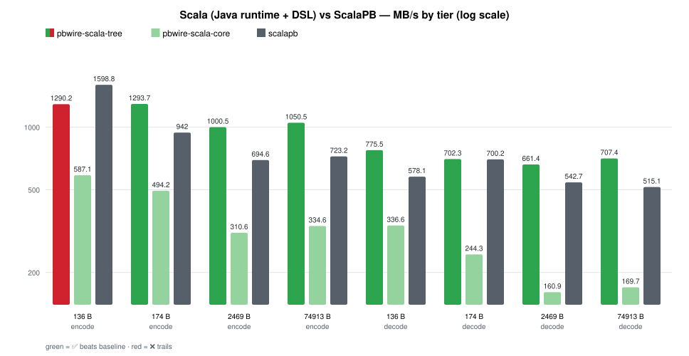

# pbwire Scala binding

`bindings/scala/runtime` is the Scala binding. Scala runs on the JVM, so it
uses the Java binding's runtime (`bindings/java/runtime`: the pure-Java
codec, no JNI, no native library) and adds only the DSL that official Scala
support also is: ScalaPB generates case classes over protobuf-java, never a
second runtime. There is no new wire code and no second schema path -- a
`FileDescriptorSet` is loaded at run time and the Java runtime owns the
bytes.

```scala
import Pbwire._

using(schema("tests/data/matrix3.desc")) { schema =>
  val ty = schema.message("structtest.Scalars3")

  using(ty.build { m =>
    m.set("i32", -42L)
    m.set("str", "alice")
    List("a", "bb").foreach(v => m.set("tags", v)) // repeated: appends
    m.message("inner") { c =>                       // nested: created in place
      c.set("name", "kid")
      c.set("value", 42L)
    }
  }) { msg =>
    val wire = msg.encode()
    using(ty.parse(wire)) { decoded =>
      assert(decoded.getLong("i32") == -42L)
      assert(decoded.getList("tags").toString == "[a, bb]")
      assert(decoded.encode().sameElements(wire))   // byte-exact round trip
    }
  }
}
```

The runtime is one object (`Pbwire`): `schema` loads a descriptor set by
path or bytes, `using` is the loan pattern, and two implicit classes add
`build`/`parse` on `MessageType` and `message`/`use` on `Message`.
Everything else is the Java binding's API, which Scala calls directly.

## Build and run

```shell
./build.sh          # javac the Java runtime + scalac the DSL, self-check and example
```

`build.sh` needs JDK 17+ and `scalac` (Scala 2.13+ or 3.x): no sbt, no
Maven, no downloads. It prints the run commands. `build.sbt` is the same
project for sbt users: it compiles the Java runtime sources in place, so
the two runtimes stay in sync without a published artifact.

The DSL declares no package: the Java runtime lives in the default
package, which a named package cannot see. Same reason as the Kotlin
binding's runtime.

## Benchmarks

```shell
./benchmarks/bench.sh    # vs ScalaPB generated code, four tiers
```

Needs `scalac`, `protoc` and `scalapbc` (the ScalaPB compiler); downloads
the ScalaPB runtime and protobuf-java from Maven Central on first run. The
four tiers are small / medium / large / xlarge (the repeated fields scaled
x0 / x1 / x100 / x3000). Copied from [BENCHMARKS.md](../../BENCHMARKS.md),
which is the single source for all performance numbers; higher is better,
MB/s over wire bytes.

## Conformance

`conformance/Testee.scala` is the official-suite testee: binary, JSON and text
in both directions through the dynamic API, no per-message code. Only JSPB
answers `skipped`. It shares the two expected binary tag-truncation failures on
the repo-wide `conformance/failure_list_pbwire.txt`.

## Why not a copy of the Java runtime?

A second copy of the codec would be a second thing to keep in sync with
the descriptor format for zero benefit: Scala calls Java classes with no
marshalling cost, and the JVM is the same host either way. The ownership
and threading rules are the Java binding's: a `Schema` or `MessageType`
may be shared between threads, a `Message` belongs to one thread,
`using`/`use`/`close` retires a root, and a nested message is a view of
its parent.

## Generated models

`protoc-gen-pbwire` (in `../../codegen`) emits `<base>.scala` (case classes
plus companions over the Java runtime, `object <base>Gen`) and
`<base>_meta.scala` (the embedded descriptor set plus its loader,
`object <base>Meta`). `--pbwire_opt=lang=scala[,model=bool]`
`[,register=bool][,registry=bool]` (all default `true`): `model=false`
skips the case classes for dynamic-only users; `register=false` drops the
eager load so `initSchema` (embedded bytes by default, external bytes for
the descriptor mode) must run first; `registry=false` drops `messageNames`
+ `preload`. See `../../codegen/README.md`.

## Deliberately skipped

- **No second codec, no JNI, no native library.** The Java runtime is the
  wire format; this binding is one DSL object over it.
- **No protoc plugin and no code generation.** The schema is the
  descriptor set loaded at runtime, like the C, C++, Python and Java
  bindings.
- **No sbt/Maven downloads in the gate.** `build.sh` is `javac` +
  `scalac` against the checked-in fixture descriptor sets.
- **No map/oneof/extension convenience API.** They are ordinary message
  and field operations through the dynamic tree; nothing is lost, nothing
  is sugar-coated.

## Benchmarks

### Scala (Java runtime + DSL) vs ScalaPB



| payload | op | pbwire-scala-core (MB/s, x scalapb) | scalapb (MB/s) |
|---|---|---|---|
| 136 B | encode | 528.8 (0.33x ❌) | 1580.9 |
| 136 B | decode | 339.8 (0.41x ❌) | 834.3 |
| 174 B | encode | 399.6 (0.44x ❌) | 902.2 |
| 174 B | decode | 228.5 (0.29x ❌) | 780.0 |
| 2469 B | encode | 240.4 (6.97x ✅) | 34.5 |
| 2469 B | decode | 147.4 (0.27x ❌) | 543.2 |
| 74913 B | encode | 255.8 (170.53x ✅) | 1.5 |
| 74913 B | decode | 161.9 (0.27x ❌) | 602.8 |

Same class as Kotlin: the JVM binding reuses the Java runtime and adds only
an idiomatic DSL — no second codec, no JNI, schema from a `FileDescriptorSet`
at run time. The baseline is `scalapbc`-generated code (needs `cs install
scalapbc` once); the jars land in `benchmarks/deps`. Byte parity per tier
before timing, like every other row. `core` is the committed generated
`matrix3Gen` case class and the published comparison here; its `encode`/`decode`
fill and load a `Message`
field by field by name, so it is the slowest JVM `core` row at small tiers (0.33x at 136 B
encode, 0.27x-0.41x decode): the translation is the cost, not
the wire engine. The large/xlarge encode ratios (6.97x/170.53x) ride a ScalaPB
baseline collapse at those tiers, not a codec win. The per-field `tree` arm is compared in
`pbench/` (see its README), not here. Formal run
`../../results/bench-scala-20261124T102827Z.json`.
