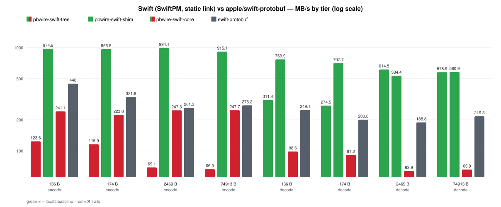

# pbwire Swift binding

A SwiftPM package over the C ABI: a `FileDescriptorSet`
(`protoc --descriptor_set_out`) becomes a schema at runtime, and messages are
`Message` objects with field access by name. No code generation, no protoc
plugin, no wire code — the format stays in the C core, like the Objective-C
and Dart bindings.

The package also ships **`PbwireCore`**, a pure-Swift wire implementation (see
[The pure-Swift core](#the-pure-swift-core)): no C module, no `libpbwire.a`, no
`unsafeFlags`, so it can be a normal SwiftPM dependency. `Pbwire` stays the
default and the fast path.

```swift
import Pbwire

let schema = try Schema(contentsOfFile: "tests/data/probe.desc")
let message = schema.message("pbwswift.Probe")!

try message.set(.int(1234), "i32")
try message.set(.string("alice"), "text")
try message.makeNested("inner").set(.string("child"), "label")

let wire = try message.encode() // proto3 bytes
let decoded = try message.decode(wire)

assert(decoded.get("text") == .string("alice"))
assert(decoded.nested("inner")?.get("label") == .string("child"))
assert(try decoded.encode() == wire) // byte-exact re-encode
```

## Build and run

From `bindings/swift` (macOS, Swift 6.x; `build/libpbwire.a` comes from
`make` at the repo root, which `build.sh` runs itself when it is missing):

```sh
./build.sh          # self-check + example
./build.sh test     # self-check only
./build.sh example  # example only
```

or plain SwiftPM (no dependencies to fetch, works offline):

```sh
swift test            # self-check, 25 tests
swift run Roundtrip   # example
swift run -c release Bench   # the four standard tiers, pbwire-swift only
```

`Package.swift` links `../../build/libpbwire.a` with a relative path, so the
default commands work with no environment setup. A package with unsafe linker
flags cannot itself be a dependency; that is fine, this binding is an
end-user FFI host. The `ld` warning that the archive "was built for newer
'macOS' version" is benign (static link, no runtime dependency).

## API

### `Schema`

| member | meaning |
|---|---|
| `init(contentsOfFile:)` | load a serialized `FileDescriptorSet`; throws `PbwireError(-1)` when the file cannot be read, a `pbw_status` error (with the `pbw_schema_error()` reason) for a bad set |
| `init(bytes:)` | same from bytes, e.g. embedded in the app bundle |
| `message(_:)` | an empty `Message` of that fully qualified type (`"pkg.Outer.Inner"`), or `nil` for an unknown name or an enum |

Use `protoc --include_imports` so every referenced type is in the set. A
message retains its schema, so keeping a message alive keeps the descriptors
valid.

### `Message`

| member | meaning |
|---|---|
| `typeName` | the message's full type name |
| `has(_:)` | true when the field has a value (set here or on the wire) |
| `get(_:)` | present value of a singular field, or nil when absent, unknown or repeated |
| `set(_:_:)` | store a singular field, replacing the previous one; nil clears it |
| `add(_:_:)` | append one item to a repeated field (or set a singular one) |
| `count(_:)` / `at(_:_:)` | items in a repeated field / one item by index |
| `nested(_:)` | the nested message of a singular message field, or nil |
| `makeNested(_:)` | get-or-create the nested message, filling it in place |
| `encode()` | wire bytes |
| `encodeDeterministic()` | wire bytes with map entries sorted by key |
| `encodeDelimited()` | one length-delimited frame (varint length + message) |
| `decode(_:maxBytes:maxDepth:)` | decode bytes as a message of the same type; zeros mean the defaults (no byte cap, `PBW_MAX_DEPTH` nesting) |
| `decodeDelimited(_:maxBytes:maxDepth:)` | decode one frame, returning `(message, consumed)` so concatenated frames decode in a loop |
| `toJSON()` / `fromJSON(_:ignoreUnknown:maxBytes:maxDepth:)` | JSON mapping round trip; unknown fields throw unless ignored |
| `toText(printUnknown:)` / `fromText(_:maxBytes:maxDepth:)` | text format round trip; unknown fields print numerically unless disabled |

Value mapping (the field's schema type decides the wire type):

| protobuf | Swift |
|---|---|
| int32/int64/sint\*/sfixed\*/enum | `.int(Int64)` |
| uint\*/fixed\* | `.uint(UInt64)` |
| bool | `.bool(Bool)` |
| float/double | `.float(Float)` / `.double(Double)` |
| string | `.string(String)`, written as UTF-8 |
| bytes | `.bytes(Data)` |
| message/group | `.message(Message)` |

Errors never cross the C boundary as anything but values: every failure
throws `PbwireError` whose `status` is the `pbw_status` of the failing call
(`3` not-found, `4` type mismatch, ...) and whose `message` is
`pbw_strerror()` plus the field name.

### Ownership

A message from `message(_:)` or `decode(_:)` owns its C tree and frees it on
release (`pbw_message_free`, which releases the whole decoded tree, so a
double release cannot happen: a nested message is a view that frees nothing).
A nested message view retains its parent, so it cannot outlive the storage it
points into, and editing a view edits the parent's tree. One tree belongs to
one thread, like the C core.

## Files

| Piece | Path | Role |
|---|---|---|
| runtime | `Sources/CPbwire/` (C header re-export + the layout reader + `bindings/c/runtime/pbw_struct.c`), `Sources/Pbwire/Pbwire.swift` | the `CPbwire` module shim, the `Schema`/`Message` wrapper and the flat-mirror API (`ReprMessage`, `FieldPlan`, `InPlace`, `ReprStorage`) |
| example | `Sources/Roundtrip/main.swift` | build, encode, decode, assert, print |
| tests | `Tests/PbwireTests/PbwireTests.swift`, `GeneratedTest.swift`, `InPlaceTest.swift` | XCTest self-check: descriptor load, full round trip, pinned bytes, presence, repeated fields, errors, lifetime loop, JSON/text, deterministic encoding, delimited framing, explicit limits; the generated models; and the mirror gate (bytes, fields, re-encode, layout rows) |
| benchmark | `Sources/Bench/main.swift`, `Sources/Pbench/` (arms, payload, provisional compare), `benchmarks/baseline/` | the four standard tiers with both rows (`pbwire-swift-tree`, `pbwire-swift-shim`) vs apple/swift-protobuf (`benchmarks/bench.sh`) |
| fixture | `tests/data/probe.proto` + committed `probe.desc`, `tests/data/matrix3.desc`, `tests/data/maptest.desc` (maps for the deterministic row) | regenerate with `protoc -Itests/data --descriptor_set_out=tests/data/probe.desc tests/data/probe.proto` (`build.sh` also regenerates `matrix3.desc`/`maptest.desc` from `bindings/c/tests/data` when protoc exists) |
| conformance | `conformance/README.md` | how the official suite covers this binding (via the C testee) |

## Benchmarks

`benchmarks/bench.sh` runs the four standard tiers from
[`BENCHMARKS.md`](../../BENCHMARKS.md), then the side-by-side comparison in
`benchmarks/baseline/` (a second package: this binding by path plus
apple/swift-protobuf with the matrix3 model from its own build plugin, so no
generated code is checked in and no protoc plugin is installed — needs
network once and `PROTOC_PATH`, which `bench.sh` exports):

```sh
./benchmarks/bench.sh          # tiers + baseline
./benchmarks/bench.sh tiers    # tiers only, no network
```

Both sides must produce identical bytes before anything is timed, and both
allocate per call.

`pbwire-swift-shim` is the published entry: it times the generated
`@frozen` `<Message>Repr` mirror with one call per op into the C layout codec (the per-field `tree` build is a `pbench/`-only arm). The wrapper adds one
Swift object per call and no copy (`encode` hands the malloc'd buffer the C
encoder already filled to `Data` with a free deallocator, `decode` wraps the
decoder's arena in one `Message`) —
see [`pbench/README.md`](pbench/README.md) for the mechanism and the gate.

### Swift (SwiftPM, static link) vs `apple/swift-protobuf`



| payload | op | pbwire-swift-shim (MB/s, x swift-protobuf) | swift-protobuf (MB/s) |
|---|---|---|---|
| 136 B | encode | 965.6 (2.12x ✅) | 454.6 |
| 136 B | decode | 753.1 (2.98x ✅) | 252.5 |
| 174 B | encode | 988.8 (2.91x ✅) | 340.1 |
| 174 B | decode | 706.1 (3.45x ✅) | 204.9 |
| 2469 B | encode | 1006.9 (3.71x ✅) | 271.6 |
| 2469 B | decode | 532.2 (2.65x ✅) | 200.5 |
| 74913 B | encode | 912.6 (3.20x ✅) | 285.5 |
| 74913 B | decode | 570.9 (2.47x ✅) | 231.2 |

The pbwire column is the native-in/native-out full task (formal run
`../../results/bench-swift-20261124T102332Z.json`): `shim` runs it in one
`encodeInPlace`/`decodeInPlace` call. The per-field `tree` arm is compared in
`pbench/README.md`, not here. Pairing note: the formal run prints the four native
rows without the baseline in its first case set and the native row against
`swift-protobuf` in its second; the ratios above pair each MB/s with
the same run's own baseline MB/s (e.g. xlarge shim 912.6 vs 285.5 = 3.20x).

FFI host like Objective-C/Dart: `FileDescriptorSet` at run time, C ABI calls
only, no wire code, no plugin. SwiftPM links `build/libpbwire.a` via
`unsafeFlags` (so plain `swift test` works offline); the baseline is a
separate package using swift-protobuf's own build plugin, so no generated
code is checked in. The gate is byte parity per tier plus the pinned
`matrix3.bin` oracle.

`pbwire-swift-shim` is the published comparison: it times the generated `@frozen <Message>Repr` mirror with one
`encodeInPlace`/`decodeInPlace` call into `../c/runtime/pbw_struct.c`
(compiled into the package's `CPbwire` target), so no field and no ARC crosses
per field. The shim answers
the native-object question at 2.1-3.7x encode and 2.5-3.5x decode.

The pure-Swift core port is compared in `pbench/README.md`, not here.

## The pure-Swift core

`Sources/PbwireCore/` is a second, independent implementation of the binary
format: descriptor reader, value tree, wire primitives, encoder and decoder.
It exists because the products above link `build/libpbwire.a` through
`LinkerSetting.unsafeFlags`, which SwiftPM rejects in a non-root package — a
consumer who adds `pbwire` as a dependency, or a machine with no C toolchain,
needs a product with no native code at all.

```swift
import PbwireCore

let schema = try Schema(contentsOfFile: "tests/data/matrix3.desc")
let ty = try schema.message("structtest.Scalars3")
let message = ty.newMessage()
try message.setStr("str", "hello")
let wire = try ty.encode(message)
let back = try ty.decode(wire)
```

It decodes unknown fields (retained verbatim, re-encoded last in input order),
groups, packed runs, oneofs, the four presence kinds and proto2 requiredness,
and it enforces the same nesting/byte limits. `make swift-test` runs its own
gate (`Tests/PbwireCoreTests`: descriptor, codec, wire), and `make
conformance-swift` drives the **official binary suite** through it via
`conformance/main.swift` (1412 successes, 1403 skipped, 2 expected, 0
unexpected). It is slower than the FFI path (0.54-0.90x encode, 0.28-0.43x
decode of swift-protobuf — the value tree's ARC), and is published as the
no-native mode, not as the fast path; see `pbench/README.md#verdict-the-pure-core-stage-4`.

## Deliberately skipped

- **No generated code on the shipped path.** Swift is a compiled language, but
  this binding follows the dynamic path the C ABI and the Objective-C binding
  already take: a `FileDescriptorSet` is the runtime schema, so there is no
  second schema source to keep in sync and no build step to run. The emitter's
  `@frozen` mirrors are the pbench `shim` arm (and the tests' models); the
  quick start above never needs them.
- **No conformance testee.** The official suite drives the C core through
  `conformance/testee.c`; a Swift testee would test the same core code, and
  the wrapper adds no wire behavior of its own. See `conformance/README.md`.
- **No WKT/service helpers.** The C ABI's `pbw_any_*` /
  `pbw_timestamp_*` / `pbw_service_*` entry points are one import away
  (`import CPbwire`); the Objective-C binding already covers them, and no
  caller here asked for them yet.

## In-place mirrors (the pbench `shim` arm)

Beside each message the emitter also writes a `@frozen public struct
<Message>Repr: Pbwire.ReprMessage`: fixed-width slots in a known order, no
references, and a `fields: [Pbwire.FieldPlan]` table whose offsets come from
`MemoryLayout<Repr>.offset(of:)`. One C call per op encodes or decodes it:

```swift
let inPlace = try schema.inPlace(Structtest_Scalars3Repr.self)  // once
var image = Structtest_Scalars3Repr()
fill(&image)                                     // pointers borrow your storage
let wire = try inPlace.encodeInPlace(image)      // one downcall
var back = Structtest_Scalars3Repr()
try inPlace.decodeInPlace(wire, into: &back)     // one downcall, arena-backed
```

A decoded mirror borrows the type's arena, so it stays readable until that
type's next decode; `Pbwire.ReprStorage` owns the buffers a hand-built mirror
points at. A `string` slot is NUL-terminated UTF-8 (use `bytes` for arbitrary
bytes), `bytes` is the core's inline `pbw_bytes_t`. Encoder and decoder both
live in C (`Sources/CPbwire/shim.c` + `bindings/c/runtime/pbw_struct.c`,
compiled into the package), so nothing walks fields across the boundary.

## Generated models

`protoc-gen-pbwire` (in `../../codegen`) emits `<base>.swift` (structs)
and `<base>_meta.swift` (the embedded descriptor set plus its loader).
`--pbwire_opt=lang=swift[,model=bool][,register=bool][,registry=bool]`
(all default `true`): `model=false` leaves the meta file for dynamic-only
users; `register=false` drops the lazy load so `initSchema()` (embedded)
or `useSchema()` (an external `Schema`, dual registration) must run first;
`registry=false` drops `messageNames` + `preload()`.

Known limits (same as the Objective-C wrapper):

- A string field whose bytes are not valid UTF-8 reads as nil (the C payload
  is kept, so re-encoding is still byte-exact).
- A 32-bit numeric field set out of range fails with a type error instead of
  being truncated.
- `float` values are stored as 32-bit floats, `double` as 64-bit; assigning a
  `.double` to a `float` field (or `.int`/`.uint` to either) converts the way
  a narrowing Swift initializer does.

