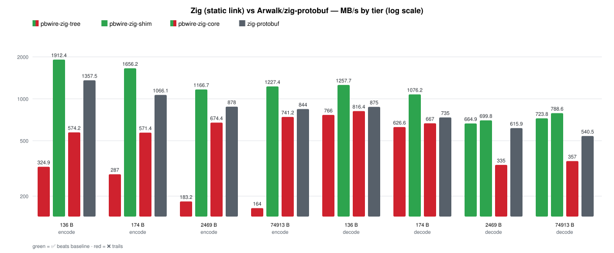

# pbwire Zig binding

Zig binding: a safe wrapper over the C ABI in
[`include/pbwire.h`](../../include/pbwire.h), linked as a static library. A
`FileDescriptorSet` (`protoc --descriptor_set_out`) becomes a schema at run
time; there is no generated code, no build-time codegen and no bindgen step.
Wire bytes are the core's, so a Zig message and a C message are the same bytes
by construction.

```zig
const pbwire = @import("pbwire");

var schema = try pbwire.Schema.fromFile(allocator, "matrix3.desc");
defer schema.deinit();
const ty = try schema.messageType("structtest.Scalars3");
const inner_ty = try schema.messageType("structtest.Inner3");

var msg = try ty.newMessage();
defer msg.deinit();
try msg.setI64(try ty.field("i32"), -42);
try msg.setStr(try ty.field("str"), "alice");
for ([_][]const u8{ "a", "bb" }) |tag| try msg.setStr(try ty.field("tags"), tag);
var inner = try msg.setMessage(try ty.field("inner")); // nested: created in place
try inner.setStr(try inner_ty.field("name"), "kid");
try inner.setI64(try inner_ty.field("value"), 42);

const wire = try msg.encode(allocator);
defer allocator.free(wire);
var decoded = try ty.decode(wire); // unknown fields preserved
defer decoded.deinit();
const back = try decoded.encode(allocator); // byte-exact round trip
defer allocator.free(back);
```

A `Field` is resolved once (`ty.field("i32")`) and reused: a `set*`/`get*`
call is one native call, not a name lookup.

## Build and run

```shell
zig build test     # self-check against the pinned protoc bytes
zig build example  # runnable round trip (takes an optional <matrix3.desc>)
zig build bench -- matrix3.desc   # the four standard tiers
zig build testee   # conformance testee -> zig-out/bin/testee-zig
zig build -Dcore=true testee          # the same suite through the pure-Zig core
zig build test                        # self-check + pure-core descriptor/codec tests
```

`build.zig` compiles the core sources (`../../src/*.c`) into a static library
and links it into every artifact, so the result has no runtime dependency on
the library. There is no `dlopen`, no `bindgen`, and no second wire
implementation. `setStr` rejects a string containing a NUL byte (it would
truncate on the way to C); use `setBytes` for binary payloads, including on a
`string` field.

## Pure-Zig core (`-Dcore=true`)

`core/` is a pure-Zig port of the wire core: a `FileDescriptorSet` reader, a
value tree, wire primitives and a binary encoder/decoder, with no `@cImport`,
no translate-c and no C source. It is selected for an artifact with
`zig build -Dcore=true testee` (and its own tests run in `zig build test`); the
default build still compiles and links the C core, which stays the fast path.

The option exists for a build that cannot compile `src/*.c`. It is gated by
`make conformance-zig-core` on the official binary suite (same failure set as
the C core: 1412 successes, 1403 skipped, 2 expected, 0 unexpected) and its
`pbwire-zig-core` pbench row is the no-C-source comparison. Unknown fields are
retained in input order, groups validate to their matching end tag, packed runs
and unpacked element forms are both accepted, oneofs collapse to the last
member, presence follows each field's rule, and a root message owns one arena
(freed on every error path and by `deinit`).

## Benchmarks

```shell
./benchmarks/bench.sh [matrix3.desc]             # pbwire column only, offline-safe
./benchmarks/bench.sh --baseline [matrix3.desc]  # vs Arwalk/zig-protobuf (network once)
```

The four tiers are small / medium / large / xlarge (the repeated fields scaled
x0 / x1 / x100 / x3000, landing on 136 / 174 / 2469 / 74913 bytes), the same
payload as every other binding (see `BENCHMARKS.md`). The baseline is
Arwalk/zig-protobuf generated code from the same `matrix3.proto`: the tarball
is pinned in `build.zig.zon` and fetched on first run (then cached), the
generator runs under the system `protoc`, and `zig build test` plus the plain
`bench` step never resolve the dependency, so they stay offline-safe. The
comparison harness (`benchmarks/bench_vs_baseline.zig`, `zig build
-Dbaseline=true bench-baseline`) times both sides with shared iteration
counts and gates every tier on byte-identical output before timing.

## Threads

A `Schema` is immutable once loaded, so it can be shared between threads. A
`Message` is not thread safe on purpose: like the C core, one tree belongs to
one thread.

## Conformance

`conformance/testee.zig` speaks the runner's wire protocol and covers binary,
JSON and text (JSPB answers `skipped`); see `conformance/README.md`.
Error-result strings carry the Zig error name rather than the core's
`strerror` text — the runner only checks which result field is set, not the
message. The two binary tag-truncation cases the reference C++ testee fails
identically apply here too (same core decoder), so the shared
`failure_list_pbwire.txt` covers this testee as well.

## Layout

| path | contents |
|------|----------|
| `runtime/pbwire.zig` | the binding: `Schema`, `MessageType`, `Field`, `Message`, `Value` over `@cImport` |
| `core/` | pure-Zig descriptor reader, tree, wire engine, encode/decode (`-Dcore=true`) |
| `build.zig` / `build.zig.zon` | static-libpbwire step plus `test` / `example` / `bench` / `testee` steps and the `core` option |
| `examples/roundtrip.zig` | runnable round trip |
| `tests/selftest.zig` | self-check (`zig build test`): oracle bytes, round trip, rejects, text/JSON |
| `benchmarks/bench.zig` + `bench.sh` | the four standard tiers |
| `conformance/testee.zig` | official-suite testee (binary + JSON + text, JSPB skipped); `make conformance-zig` |
| `conformance/testee_core.zig` | binary pure-core testee (`-Dcore=true`); `make conformance-zig-core` |
| `pbench/core_arm.zig` | the `core` pbench arm, imported by both bench harnesses |

## Generated models

`protoc-gen-pbwire` (in `../../codegen`) emits `<base>.zig` (structs whose
`encode`/`decode` take an explicit `schema`) and `<base>_meta.zig` (the
embedded descriptor set, `loadSchema`, `MESSAGE_NAMES` + `preload`).
`--pbwire_opt=lang=zig[,model=bool][,registry=bool]` (both default `true`):
`model=false` leaves the schema file for dynamic-only users;
`registry=false` drops the name list and preload. Loading stays explicit
(the caller passes the schema), so there is no implicit registry for
`register` to gate.

## Benchmarks

### Zig (static link) vs Arwalk/zig-protobuf



| payload | op | pbwire-zig-shim (MB/s, x zig-protobuf) | zig-protobuf (MB/s) |
|---|---|---|---|
| 136 B | encode | 1719.1 (1.37x ✅) | 1257.8 |
| 136 B | decode | 1271.7 (1.46x ✅) | 868.6 |
| 174 B | encode | 1355.5 (1.61x ✅) | 842.6 |
| 174 B | decode | 1095.9 (1.44x ✅) | 759.4 |
| 2469 B | encode | 1120.5 (1.42x ✅) | 788.7 |
| 2469 B | decode | 708.9 (1.16x ✅) | 611.1 |
| 74913 B | encode | 1129.9 (1.83x ✅) | 616.7 |
| 74913 B | decode | 785.9 (1.40x ✅) | 559.8 |

The pbwire column is the native-in/native-out full task (formal run
`../../results/bench-zig-20261124T110757Z.json`): `shim` runs it in one
`encodeInPlace`/`decodeInPlace` call. The per-field `tree` arm is compared in
`pbench/README.md`, not here.

Same class as Rust: the core sources compile into a static archive that links
into one self-contained binary, schema from a `FileDescriptorSet` at run
time. The baseline is Arwalk/zig-protobuf 7.0.0 generated code from the same
`matrix3.proto` (tarball pinned in `build.zig.zon`, fetched on first run and
cached; generation runs the system `protoc` against their plugin, and the
`test` / plain `bench` steps never resolve the dependency, so they stay
offline-safe — `bench.sh` runs pbwire-only by default, `--baseline` (what
`make zig-bench` passes) runs the comparison). Bytes are gated equal on all
four tiers before timing. `pbwire-zig-shim` is the published comparison: it
times the generated
`extern struct <Message>Mirror` with one `encodeInPlace`/`decodeInPlace` call
into `../c/runtime/pbw_struct.c` (compiled into the same archive), so no
field crosses per field. The shim is above the baseline on every cell.

The pure-Zig core port is compared in `pbench/README.md`, not here.

The baseline's decode is structural:
it materializes every field with its own allocation (which is also what the
small tiers time most of), while the binding decodes into one arena; the lead
shrinks as the payload grows and per-byte work takes over. At
`-Doptimize=ReleaseFast` (what `bench.sh` runs) both sides sit near the core's
pace; the default debug build is ~20x slower and is not timed.
